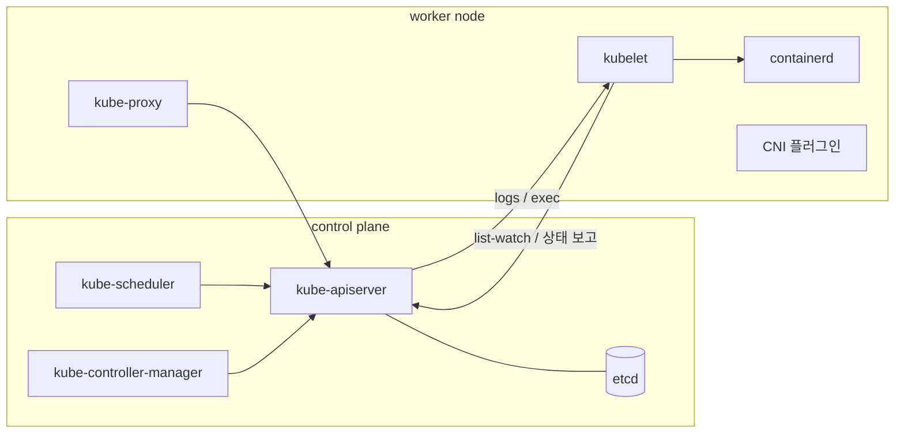
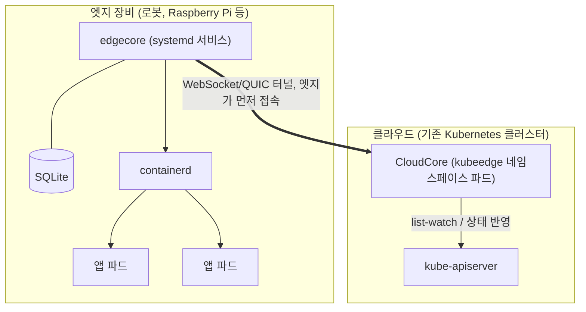
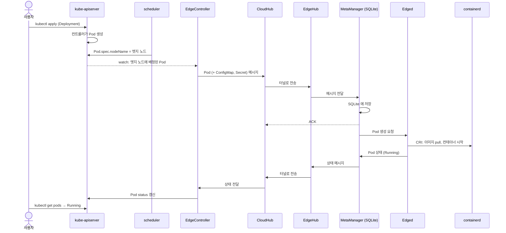
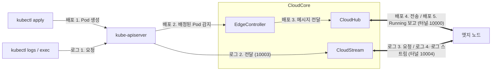
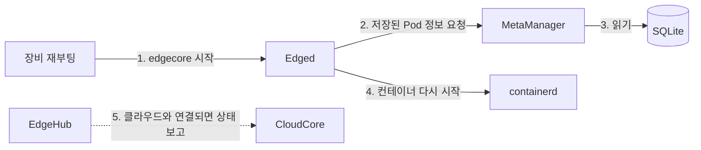
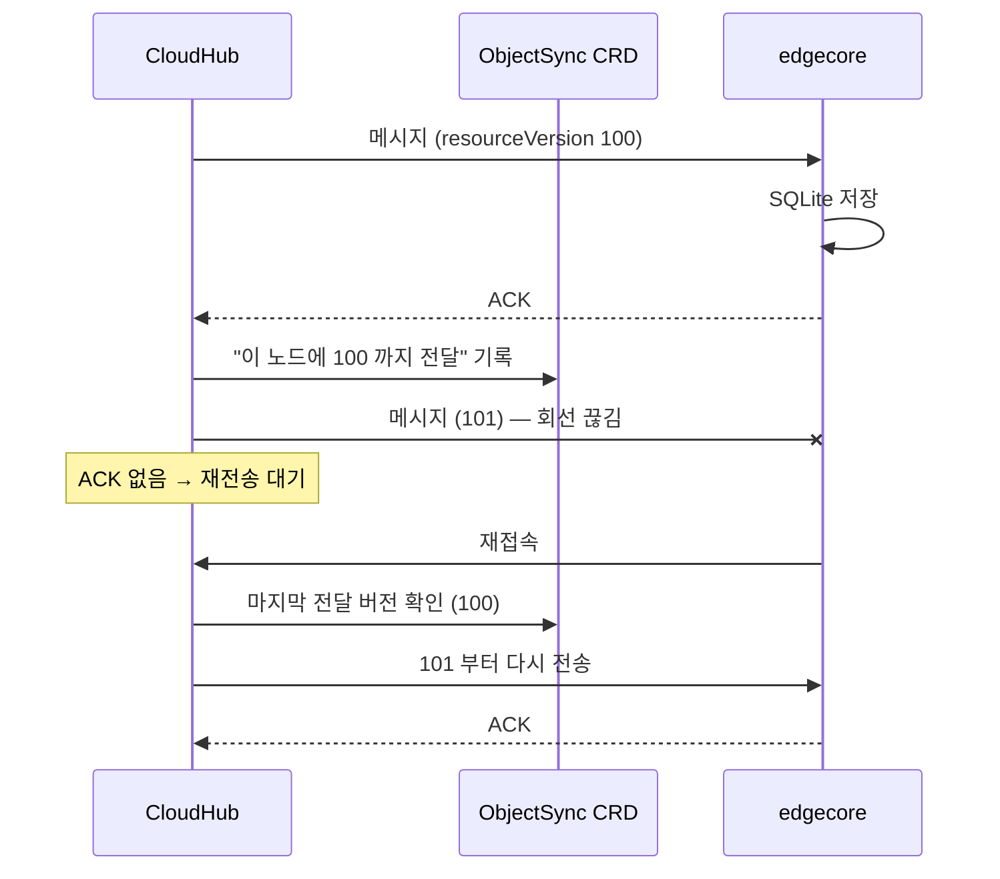
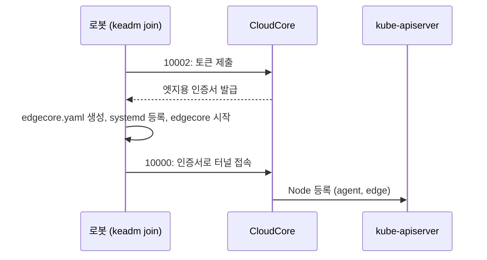
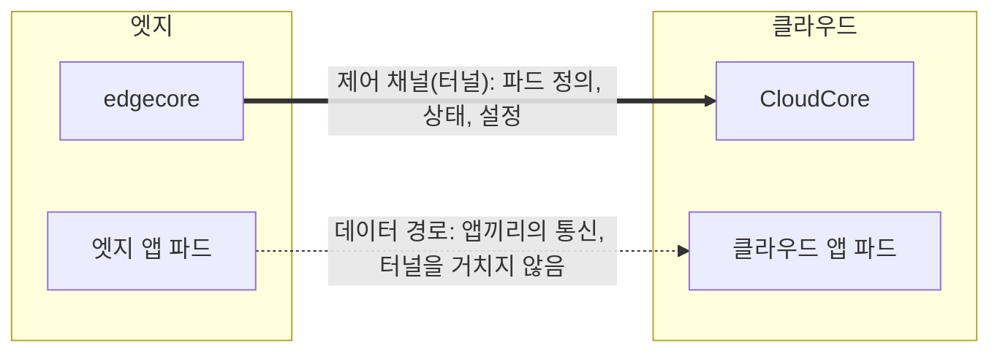

# 1. 들어가며

2026년 9월 22일부터 24일까지 캐나다 토론토에서 열린 ROSCon Global 2026에 다녀왔다. 행사 앱(Whova)으로 열린 작은 모임 중에 Kubernetes와 KubeEdge로 ROS를 운영하는 이야기를 나누는 자리가 있어서 참석했다. 15분 정도 서서 궁금한 것을 묻고 답을 듣는 형식이었다.

모임을 연 사람은 Tomoya Fujita였다. KubeEdge SIG Robotics의 chair 중 한 명이고 ROS PMC(Project Management Committee) 위원이다. ROSCon 2023에서 [ROS with Kubernetes/KubeEdge](https://roscon.ros.org/2023/talks/ROS_with_KubernetesKubeEdge.pdf)를 발표했고, 이 글에서 계속 참고할 [ros_k8s](https://github.com/fujitatomoya/ros_k8s) 저장소를 만들었다.

ros_k8s는 ROS와 ROS 2를 Kubernetes·KubeEdge 클러스터에서 돌려 보는 튜토리얼 저장소다. 실물 장비(Ubuntu PC, Raspberry Pi)나 kind 같은 가상 환경에 클러스터를 꾸리고 ROS 2 앱을 배포하는 절차가 문서로 정리되어 있다. 다만 KubeEdge 설치 문서는 명령을 따라가는 데 집중되어 있어서, KubeEdge가 무엇이고 왜 그렇게 구성하는지는 따로 공부해야 했다. 모임에서 나눈 이야기를 계기로 그 빈 곳을 채우며 정리한 것이 이 글이다.

**이 글에서 다루는 것**

- 로봇을 그냥 Kubernetes 노드로 붙이면 생기는 문제
- KubeEdge의 구조와, `kubectl apply` 한 번으로 로봇에 파드가 뜨기까지의 흐름
- 클라우드와 연결이 끊기거나 로봇이 재부팅될 때 일어나는 일
- keadm으로 로봇 한 대를 엣지 노드로 붙이는 4단계 설치
- 로봇에 적용할 때 잘 맞는 점과 주의할 점

# 2. 왜 로봇에 Kubernetes인가

Tomoya Fujita가 ROS TSC에서 발표한 [ROS with Kubernetes](https://www.slideshare.net/slideshow/rostscrosk8s20230309pdf/256331489)는 이 질문에서 출발한다. 지금은 환경마다 앱을 배포하는 방식이 따로다.

| 환경 | 지금 배포하는 방식 |
|---|---|
| 클라우드 | 컨테이너와 Kubernetes. 개발자는 kubectl·Helm·GitOps로 배포한다 |
| IoT 장치 | 장치별로 정적으로 구현되어 있어 바꾸기 어렵다 |
| 로봇 | 로봇마다 환경을 구성하고 설치한다 |

클라우드와 엣지 장치는 아키텍처부터 다르다. 그래서 같은 앱이라도 환경마다 구성하고 실행하는 데 시간과 노력이 따로 든다.

로봇과 IoT 장치도 Kubernetes 노드로 만들면 이야기가 달라진다. 클라우드 앱을 배포하던 방식 그대로 어디에든 배포할 수 있고, Kubernetes가 원래 갖고 있는 기능을 로봇에서도 쓸 수 있다.

- 라벨로 배포 대상을 고른다 (예: 배달 로봇만, 특정 현장의 로봇만)
- Rolling·Canary 방식으로 업데이트한다
- 앱이 죽으면 자동으로 복구한다
- 하드웨어를 추상화한다
- 관측하고 확장한다

로봇은 여러 대가 협업하고, 센싱 결과에 따라 앱을 올리고 내리며, 문제가 생기면 스스로 복구되어야 한다. 클라우드에서 쓰던 배포·운영 방식을 엣지까지 가져오려는 것이 로봇에 Kubernetes를 쓰려는 동기다.

그런데 로봇을 그냥 Kubernetes 노드로 붙이면 몇 가지 문제가 생긴다. 그 전에 Kubernetes가 노드를 어떻게 다루는지부터 짚는다.

# 3. Kubernetes 기본

KubeEdge를 이해할 때 핵심은 Kubernetes의 **어느 부분을 바꾸는지**다. 그래서 Kubernetes 전체가 아니라 바뀌는 부분 위주로 짧게 짚는다.

## 3.1 control plane과 node



control plane은 "무엇을 어디에 띄울지" 결정해서 기록하고, 각 노드가 그 결정을 실행한다. 컴포넌트끼리는 서로 직접 말하지 않고 모두 API 서버를 거친다. 스케줄러가 kubelet에게 "이거 띄워"라고 말하는 대신 API 서버에 기록하고, kubelet이 그 기록을 보고 움직이는 식이다.

| 구분 | 컴포넌트 | 하는 일 |
|---|---|---|
| control plane | kube-apiserver | 클러스터의 모든 읽기·쓰기를 받는 REST API 서버. 다른 컴포넌트는 모두 여기를 거친다 |
| control plane | etcd | 모든 리소스(Deployment, Pod, Service, Node 등)를 저장하는 key-value DB. API 서버만 접근한다 |
| control plane | kube-scheduler | 노드가 정해지지 않은 파드를 찾아 어느 노드에 둘지 정한다. 실행은 하지 않는다 |
| control plane | kube-controller-manager | 원하는 상태와 실제 상태를 비교해 맞추는 컨트롤러(Deployment, ReplicaSet, Node 등) 묶음 |
| node | kubelet | 노드마다 systemd 서비스로 도는 에이전트. 배정된 파드를 watch해 containerd로 띄우고, 상태와 하트비트를 보고한다 |
| node | containerd | 컨테이너를 실제로 만드는 런타임. kubelet과는 CRI(Container Runtime Interface)로 이야기한다 |
| node | kube-proxy | Service의 ClusterIP로 들어온 요청을 실제 파드 IP로 보내는 iptables/IPVS 규칙을 노드마다 설치한다 |
| node | CNI 플러그인 | 파드에 IP를 주고 노드 간 파드 통신 경로를 만든다. 없으면 노드가 `NotReady`로 남는다 |

## 3.2 "원하는 상태"와 list-watch

Kubernetes는 "명령"이 아니라 **"원하는 상태"를 저장**하는 방식으로 동작한다.

1. 사용자가 "nginx 파드 3개가 떠 있어야 한다"(Deployment `replicas: 3`)를 API 서버에 저장한다
2. 컨트롤러가 이 변화를 watch하다가 파드 객체 3개를 만든다
3. 스케줄러가 노드가 비어 있는 파드를 발견하고 `spec.nodeName`을 채운다
4. 각 노드의 kubelet이 "`nodeName`이 나인 파드"를 watch하다가 containerd로 컨테이너를 띄운다
5. kubelet이 파드 상태(`Running` 등)를 API 서버에 보고한다

여기서 **list-watch**는 처음에 목록을 한 번 받고(list), 이후에는 바뀐 것만 계속 받는(watch) 방식이다. 모든 컴포넌트가 이 방식으로 API 서버를 지켜본다.

**KubeEdge가 끼어드는 지점은 4·5번, kubelet ↔ API 서버 구간이다.** 나머지는 그대로 두고 이 구간만 바꾼다는 점을 기억해 두면 뒤의 구조가 쉽게 읽힌다.

## 3.3 노드와 연락이 끊기면

1. 노드의 하트비트가 끊기면 노드 상태가 `Unknown`(화면에는 `NotReady`)으로 바뀌고, 노드에 `node.kubernetes.io/unreachable:NoExecute` taint가 붙는다
2. Kubernetes는 일반 파드에 이 taint를 **300초** 동안만 견디는 toleration을 자동으로 넣는다. 그래서 5분이 지나면 그 노드의 파드가 축출(eviction) 대상이 된다
3. DaemonSet 파드는 이 taint를 기한 없이 견디는 toleration을 받으므로 축출되지 않는다

여기에 하나가 더 있다. 노드와 통신이 끊긴 동안에는 API 서버가 내린 파드 삭제 결정이 그 노드의 kubelet에 전달되지 않는다. 그래서 삭제 대상이 된 파드가 끊긴 노드에서는 계속 돌 수 있다([Kubernetes 문서](https://kubernetes.io/docs/concepts/scheduling-eviction/taint-and-toleration/#taint-based-evictions)). 이 어긋남은 5.4절과 7.2절에서 다시 나온다.

## 3.4 taint와 toleration

taint는 노드에 붙이는 **"이 노드는 피하라"는 표시**다. 파드가 "나는 이 표시를 견딘다"고 선언하면 피하지 않는데, 이 선언이 toleration이다. taint는 `key=value:effect` 모양이고, effect가 무엇을 막을지 정한다.

| effect | 동작 |
|---|---|
| `NoSchedule` | 견디지 못하는 새 파드를 배치하지 않는다. 이미 떠 있는 파드는 그대로 둔다 |
| `PreferNoSchedule` | 되도록 피하지만 보장하지는 않는다 |
| `NoExecute` | 새 파드를 배치하지 않고, 이미 떠 있는 파드 중 견디지 못하는 것은 쫓아낸다(축출) |

taint는 파드를 밀어내기만 하고 끌어당기지 않는다. toleration은 "가도 된다"는 허가일 뿐이라, 특정 노드에 파드를 고정하려면 `nodeSelector`나 node affinity를 함께 쓴다.

## 3.5 정리

이 글에서 계속 쓰일 세 가지다.

1. 모든 것은 API 서버를 거친다
2. 노드 쪽 대리인은 kubelet이다
3. 연결이 끊기면 클라우드는 노드를 의심한다

# 4. KubeEdge가 필요한 이유

클라우드에 Kubernetes 클러스터가 있고, 공장·매장·건물 곳곳에 로봇이 수십 대 있다고 해 보자. 이 로봇들에 컨테이너 앱을 배포하고 버전을 관리하고 싶다. 가장 단순한 방법은 로봇을 **일반 worker 노드로 `kubeadm join`**하는 것이다. 그렇게 하면 다음 문제가 생긴다.

## 4.1 노드와 API 서버가 서로 닿아야 한다

일반 Kubernetes 노드는 **양방향 연결**을 전제한다.

- kubelet → API 서버(6443): 내게 배정된 파드 목록을 받고 상태를 보고한다
- API 서버 → kubelet(10250): `kubectl logs`, `kubectl exec`, `port-forward`를 할 때 API 서버가 kubelet에 **직접 접속**한다
- CNI 오버레이(VXLAN 등)도 노드끼리 직접 통신할 수 있다고 가정한다

로봇은 LTE 라우터나 공유기 뒤, 즉 **NAT 뒤**에 있는 경우가 많다. 로봇에서 클라우드로 나가는 연결은 되지만 클라우드에서 로봇으로 들어오는 연결은 막힌다. 노드 IP도 사설 IP라 클라우드에서 보이지 않는다. 그래서 그냥 join하면 클라우드 → 로봇 방향이 필요한 `logs`·`exec`부터 동작하지 않는다.

## 4.2 회선이 끊기면 클라우드가 노드를 의심한다

3.3절에서 본 대로 하트비트가 끊기면 노드는 `NotReady`가 되고, 5분 뒤 그 노드의 파드가 축출 대상이 된다. 클라우드는 "노드가 죽었다"와 "회선만 끊겼다"를 구분하지 못한다. 로봇은 멀쩡히 일하고 있는데, 클라우드는 그 파드를 지우고 다른 곳에 띄우려는 어긋남이 생긴다.

## 4.3 끊긴 상태에서 재부팅하면 파드를 못 살린다

kubelet은 실행할 파드 목록을 API 서버에서 받아온다(static pod는 예외). 클라우드와 끊긴 상태에서 로봇이 재부팅되면 API 서버에서 목록을 받아올 수 없으니, 무엇을 띄워야 할지 모르는 상태가 된다.

## 4.4 장비가 작고 회선이 느리다

Raspberry Pi나 산업용 게이트웨이 같은 장비는 자원이 넉넉하지 않다. kubelet, kube-proxy, CNI 에이전트, 로그 수집기를 모두 올리면 부담이 된다. LTE처럼 느리고 비싼 회선에서 클러스터 정보를 계속 주고받는 것도 낭비다.

## 4.5 컨테이너가 아닌 장치를 다룰 방법이 없다

Kubernetes는 컨테이너를 관리한다. Modbus 센서, 블루투스 장치, PLC처럼 "컨테이너가 아닌 장치"를 표현할 기본 리소스가 없다.

## 4.6 KubeEdge의 답

| 문제 | KubeEdge의 답 | 자세히 |
|---|---|---|
| NAT 뒤 장비, 양방향 연결 필요 | 엣지가 클라우드로 **먼저 접속**한 터널 하나로 모든 제어를 처리 | 5절 |
| 끊기면 클라우드가 노드를 의심 | 엣지는 클라우드 판단과 상관없이 계속 동작하고, 다시 연결되면 동기화 | 5.4절 |
| 재부팅하면 파드를 못 살림 | 받은 정보를 엣지의 **SQLite에 저장**해 두고 그것으로 다시 띄움 | 5.3절, 5.4절 |
| 장비가 작고 회선이 느림 | kubelet을 줄인 **edgecore** 하나만 설치하고, 그 노드에 필요한 정보만 받음 | 5.1절, 5.3절 |
| 장치를 다룰 방법이 없음 | 장치를 CRD(`Device`, `DeviceModel`)로 표현 | 7.2절 |

한 줄로 정리하면 다음과 같다.

> **KubeEdge는 Kubernetes 클러스터는 클라우드에 그대로 두고, 엣지 장비에는 kubelet 대신 edgecore라는 가벼운 에이전트를 두어, 엣지가 먼저 연결한 터널 하나로 관리하는 프레임워크다.**

KubeEdge는 2018년 11월 Huawei Cloud가 오픈소스로 공개했다. 2019년 CNCF Sandbox에 들어갔고 2020년 9월 Incubating을 거쳐 2024년 10월 CNCF 졸업(Graduated) 프로젝트가 되었다([CNCF 발표](https://www.cncf.io/announcements/2024/10/15/cloud-native-computing-foundation-announces-kubeedge-graduation/)).

# 5. KubeEdge 구조



- **클라우드**: 기존 Kubernetes를 그대로 쓰고 **CloudCore**가 하나 추가된다. `keadm init`이 Helm chart로 `kubeedge` 네임스페이스에 배포한다
- **엣지**: kubelet 대신 **edgecore**가 systemd 서비스로 돈다. 바이너리 하나이고, 컨테이너 런타임(containerd)은 따로 필요하다
- **연결**: 엣지 → 클라우드 방향으로 **장기 연결 하나**를 맺는다. 클라우드에서 엣지로 새 연결을 열 일이 없으므로 엣지가 NAT 뒤에 있어도 된다. 필요한 것은 클라우드 쪽 포트 개방뿐이다
- **클라우드에서 보이는 모습**: 엣지 장비도 `kubectl get nodes`에 일반 노드처럼 나타난다. ROLES가 `agent,edge`로 표시되고(6.4절), 배포는 평소처럼 `kubectl`이나 Helm으로 한다

역할을 대리인 관계로 보면 이해가 쉽다.

| | 상대방이 보기에 |
|---|---|
| **CloudCore** | 엣지 입장에서 "API 서버의 대리인" |
| **edgecore** | 클라우드 입장에서 "kubelet의 대리인" |

본사(클라우드)와 지점(엣지)에 비유할 수 있다. 지점이 본사에 전화를 걸어 회선을 열어 두고 지시를 받는다. 받은 지시서는 지점 캐비닛(SQLite)에 보관한다. 전화가 끊겨도 지점은 캐비닛을 보고 하던 일을 계속하고, 다시 연결되면 그동안의 일을 보고한다.

## 5.1 `kubectl apply`부터 로봇에 파드가 뜨기까지

1. `kubectl apply`로 Deployment를 저장하면 스케줄러가 엣지 노드를 지정한다
2. CloudCore가 엣지 노드에 배정된 파드를 watch한다
3. 엣지가 먼저 열어 둔 터널로 파드 정보를 엣지에 밀어 준다(push)
4. edgecore가 받은 정보를 SQLite에 먼저 저장하고 ACK를 보낸다
5. containerd로 이미지를 받고 컨테이너를 실행한다
6. 상태(`Running`)를 터널로 보고하고, CloudCore가 API 서버에 반영한다

모듈 단위로 펼치면 다음과 같다. 각 모듈은 5.2절과 5.3절에서 설명한다.



일반 노드와 다른 점은 세 가지다.

- 일반 노드는 **kubelet이 API 서버를 직접 watch**한다. KubeEdge는 **CloudCore가 대신 watch하다가 엣지로 밀어 준다**
- 엣지는 받은 정보를 먼저 **SQLite에 저장**하고 ACK를 보낸 다음 실행한다. 그래서 이후 재부팅해도 같은 정보로 다시 띄울 수 있다
- 엣지는 **자기 노드에 배정된 것만** 받는다. 클러스터 전체 정보를 받지 않으므로 회선 부담이 작다

스케줄러는 엣지 노드를 일반 노드와 똑같이 취급한다. 그래서 의도한 로봇에 파드를 보내려면 라벨로 지정해야 한다.

```yaml
# 엣지 노드 중 하나에
nodeSelector:
  node-role.kubernetes.io/edge: ""

# 특정 로봇 한 대에
nodeSelector:
  kubernetes.io/hostname: robot-01
```

## 5.2 CloudCore 모듈

CloudCore와 edgecore는 각각 여러 모듈의 묶음이다. 모듈마다 기능이 하나씩 있고, 모듈끼리는 Beehive라는 프로세스 내부 메시지 프레임워크로 메시지를 주고받는다.

| 모듈 | 하는 일 |
|---|---|
| **CloudHub** | edgecore가 접속하는 WebSocket/QUIC 서버. 엣지 노드별 메시지 큐를 두고 ACK를 받으며 순서대로 보낸다. 엣지 인증서 발급(10002)도 맡는다 |
| **EdgeController** | 엣지 노드에 배정된 Pod와 그 파드가 쓰는 ConfigMap·Secret 등을 API 서버에서 watch해 해당 엣지로 보낸다. 엣지에서 올라온 노드·파드 상태를 API 서버에 반영한다 |
| **DeviceController** | 장치 CRD(`Device`, `DeviceModel`)를 엣지의 DeviceTwin과 동기화한다 |
| **SyncController** | 어느 엣지에 어떤 리소스가 어느 버전까지 전달됐는지 `ObjectSync` CRD로 기록하고, 빠진 메시지를 보충한다 |
| **CloudStream** | `kubectl logs`/`exec` 요청을 엣지로 전달한다. 엣지의 EdgeStream과 짝을 이룬다 |

이 밖에 선택 기능으로 클라우드와 엣지 사이 사용자 정의 메시지를 라우팅하는 Router, 엣지 앱의 list-watch를 지원하는 DynamicController가 있다.

정리하면 **CloudHub가 통신**을 맡고, **EdgeController·DeviceController가 "무엇을 보낼지"** 정하고, **SyncController가 "제대로 갔는지"** 확인하는 구조다.

엣지로 가는 길은 둘이다.



- **배포 경로**: EdgeController가 kubelet 대신 API 서버를 지켜보다가, 엣지로 보낼 Pod를 CloudHub에 넘긴다. 엣지가 보고한 상태는 같은 길을 거꾸로 올라가 API 서버의 Pod status에 반영된다
- **로그 경로**: 일반 노드라면 API 서버가 kubelet(10250)에 직접 접속하지만, 엣지 노드에는 직접 닿을 수 없다. 그래서 CloudStream이 대신 받아 별도의 스트림 터널로 넘긴다. 켜는 방법은 6.5절에 있다

Kubernetes 리소스와 상태는 CloudHub 터널로, `kubectl logs`/`exec` 같은 실시간 스트림은 CloudStream 터널로 간다.

## 5.3 edgecore 모듈

| 모듈 | 하는 일 |
|---|---|
| **EdgeHub** | CloudHub에 접속하는 클라이언트. 하트비트를 보내고, 끊기면 다시 접속한다. 받은 메시지를 내부 모듈로 나눠 준다 |
| **MetaManager** | EdgeHub와 Edged 사이의 메시지 처리기. 받은 Pod·ConfigMap·Secret 등을 **SQLite에 저장**한 뒤 Edged에 넘긴다 |
| **Edged** | **경량 kubelet**. kubelet을 최적화해 edgecore에 통합한 것으로, v1.11에서 Beta, v1.12에서 GA가 되었다. CRI로 containerd를 호출해 파드를 띄우고 probe·볼륨·상태 보고를 처리한다. API 서버 대신 MetaManager를 통해 정보를 주고받는다 |
| **MetaServer** | 엣지 안의 작은 API 서버(기본 주소 `127.0.0.1:10550`). 엣지 파드가 Kubernetes API를 list-watch하면 클라우드 대신 SQLite의 데이터로 응답한다. 기본으로 꺼져 있다 |
| **EventBus** | MQTT 클라이언트. 엣지의 MQTT 브로커(mosquitto)를 통해 장치·앱과 메시지를 주고받는다 |
| **DeviceTwin** | 장치 상태를 SQLite에 저장하고 클라우드와 동기화한다 |
| **ServiceBus** | 클라우드에서 엣지의 HTTP 서버를 호출할 때 쓰는 HTTP 클라이언트 |
| **EdgeStream** | CloudStream과 짝. `kubectl logs`/`exec`를 엣지 파드로 연결한다 |

**받은 Pod를 SQLite에 먼저 저장한 다음 Edged에 넘기는 것이 일반 kubelet과 다른 점이다.** 이 저장 덕분에 5.4절의 재부팅 복구가 가능하다.

설정 파일은 `/etc/kubeedge/config/edgecore.yaml`에 있고, 모듈별로 `enable`을 켜고 끌 수 있다. 고친 뒤에는 `systemctl restart edgecore`로 반영한다.

```yaml
# /etc/kubeedge/config/edgecore.yaml 일부 (구조만 보기 위한 발췌, 값은 환경마다 다름)
database:
  dataSource: /var/lib/kubeedge/edgecore.db
modules:
  edgeHub:
    heartbeat: 15
    websocket:
      enable: true
      server: <클라우드 IP>:10000
  edged:
    tailoredKubeletConfig:
      cgroupDriver: systemd
  metaManager:
    metaServer:
      enable: true        # 필요할 때 켬 (기본값 false)
  edgeStream:
    enable: true          # kubectl logs/exec 를 쓰려면 켬 (기본값 false)
    server: <클라우드 IP>:10004
```

## 5.4 끊겼을 때와 재부팅했을 때

클라우드와 끊기거나 엣지가 재시작돼도 엣지의 앱이 정상 동작하도록 하는 것을 KubeEdge는 **엣지 자율성(Edge Autonomy)**이라고 부른다. KubeEdge의 가장 중요한 특징이다. 끊겼을 때 양쪽에서 각각 무슨 일이 일어나는지 나눠서 본다.

### 5.4.1 끊겼을 때 엣지에서

- 실행 중인 파드는 그대로 돈다
- probe와 재시작 정책(`restartPolicy`)도 엣지에서 계속 동작한다. 컨테이너가 죽으면 엣지가 알아서 다시 띄운다
- **edgecore가 재시작되거나 장비가 재부팅돼도 SQLite에 저장된 파드 정보로 다시 띄운다.** 일반 kubelet과 가장 크게 다른 점이다(4.3절)
- MetaServer를 켜 두었다면 엣지 앱의 Kubernetes API 조회에도 로컬 데이터로 계속 응답한다

재부팅 후 복구 흐름은 다음과 같다.



1~4번은 클라우드와 연결되지 않아도 엣지 혼자 진행된다.

### 5.4.2 끊겼을 때 클라우드에서

- 하트비트가 끊기므로 노드가 `NotReady`로 바뀐다
- 일반 파드는 3.3절에서 본 규칙대로 기본 5분 뒤 **축출 대상**이 된다. 클라우드에서는 파드가 `Terminating`으로 보이지만, 그 결정이 엣지에 전달되지 못하므로 엣지에서는 계속 돈다
- 끊긴 동안 클라우드에서 바뀐 것은 다시 연결된 뒤에 엣지로 내려간다. KubeEdge 설계 문서([reliable message delivery](https://github.com/kubeedge/kubeedge/blob/master/docs/proposals/sig-node/reliable-message-delivery.md))에 따르면, 엣지가 오프라인인 동안 CloudHub의 노드별 큐가 메시지를 쌓아 두었다가 다시 연결되면 보낸다. 삭제 이벤트를 놓친 경우에도 SyncController가 `ObjectSync` 기록과 실제 객체를 비교해 삭제 이벤트를 다시 만들어 보낸다. 설계대로라면 앞의 `Terminating` 파드도 다시 연결된 뒤 이 경로로 엣지에서 정리된다

로봇처럼 파드가 그 장비에 묶여 있어야 하는 경우에는 이 축출이 오히려 문제를 만든다. 무슨 일이 생기고 어떻게 피하는지는 7.2절에서 다룬다.

### 5.4.3 메시지 전달 보장

불안정한 회선에서 메시지가 빠지지 않도록 다음 장치를 둔다.



- CloudHub는 엣지 노드마다 메시지 큐를 두고, 엣지가 **로컬에 저장한 뒤 보내는 ACK**를 받아야 다음 메시지를 보낸다
- ACK가 오지 않으면 재전송한다. ACK만 유실돼 같은 메시지가 두 번 가도 엣지가 중복을 처리한다
- 전달된 리소스 버전은 `ObjectSync` CRD(클러스터 범위 리소스는 `ClusterObjectSync`)에 기록되므로, CloudCore가 재시작해도 이미 보낸 것을 다시 보내지 않고 이어서 보낼 수 있다
- 결과적으로 **최소 한 번(at-least-once)** 전달을 보장한다. 설계 문서는 정확히 한 번(exactly-once)이 비용이 커서 at-least-once를 택했다고 밝힌다

# 6. KubeEdge 설치

설치 절차는 ros_k8s 문서와 KubeEdge 공식 문서([Installing KubeEdge with Keadm](https://kubeedge.io/docs/setup/install-with-keadm/))를 기준으로 정리했다. 각 단계의 **확인** 블록은 직접 실행한 결과가 아니라 ros_k8s 문서에서 발췌한 출력이다. 원문의 노드 이름 `tomoyafujita`(클라우드)와 `ubuntu`(Raspberry Pi)는 읽기 쉽게 `cloud`와 `robot-01`로 바꿨다.

설치는 KubeEdge 설치·관리 CLI인 keadm으로 한다. CloudCore는 클라우드에, edgecore는 로봇에 설치하고, keadm은 양쪽 모두에 필요하다. 로봇 한 대가 엣지 노드 하나가 된다.

| 단계 | 실행 위치 | 하는 일 | 확인 |
|---|---|---|---|
| 1. 클러스터 준비 | 클라우드·로봇 | 패키지 설치, `kubeadm init` + CNI, control-plane taint 제거 | `kubectl get nodes` → Ready |
| 2. CloudCore 설치 | 클라우드 | `keadm init`(Helm으로 CloudCore 배포), `keadm gettoken` | `kubectl get all -n kubeedge` |
| 3. 로봇 참여 | 로봇 | `keadm join` → edgecore 설치, 인증서 발급(10002), 터널 연결(10000) | `kubectl get nodes` → `agent,edge` |
| 4. ROS 2 파드 배포 | 클라우드 → 로봇 | `kubectl apply`, CloudCore가 터널로 전달 | `kubectl get pods` → Running |

설치 전에 확인할 것은 다음과 같다.

| 항목 | 이유 |
|---|---|
| 클라우드 클러스터에 CNI가 깔려 노드가 `Ready` | `NotReady`면 CloudCore 파드가 뜨지 않는다 |
| `--advertise-address`가 로봇에서 실제로 닿는 IP | CloudCore 인증서(SAN)에 들어가는 주소라 로봇이 접속하는 주소와 같아야 한다 |
| 로봇 → 클라우드 10000, 10002 포트 개방 | 터널과 인증서 발급에 필요하다 |
| 로봇에서 **kubelet이 꺼져 있음** | edgecore가 kubelet을 대체하므로 둘이 같이 돌면 안 된다 |
| 로봇에 containerd 동작, cgroup driver 일치 | Edged가 CRI로 containerd를 호출한다. `--cgroupdriver`와 containerd의 `SystemdCgroup` 설정이 맞아야 한다 |
| 클라우드와 로봇의 KubeEdge 버전 일치 | `--kubeedge-version`을 양쪽에서 같게 준다 |

KubeEdge는 내부에 특정 버전의 Kubernetes 라이브러리를 쓰기 때문에 **클러스터의 Kubernetes 버전을 KubeEdge에 맞춰야** 한다. 공식 저장소의 [호환표](https://github.com/kubeedge/kubeedge#kubernetes-compatibility)는 다음과 같다(✓ 정확히 호환, + KubeEdge의 기능이나 API가 해당 Kubernetes에 없을 수 있음, - 해당 Kubernetes의 기능을 KubeEdge가 쓰지 못함).

| KubeEdge | K8s 1.27 | 1.28 | 1.29 | 1.30 | 1.31 | 1.32 |
|---|---|---|---|---|---|---|
| 1.19 | ✓ | ✓ | ✓ | - | - | - |
| 1.20 | + | ✓ | ✓ | ✓ | - | - |
| 1.21 | + | ✓ | ✓ | ✓ | - | - |
| 1.22 | + | + | ✓ | ✓ | ✓ | - |
| **1.23** | + | + | + | **✓** | **✓** | **✓** |

이 글은 ros_k8s를 따라 KubeEdge v1.23.1과 Kubernetes v1.32를 쓴다. ros_k8s의 설치 스크립트는 기본으로 Kubernetes v1.37을 설치하므로, KubeEdge를 쓸 때는 `KUBERNETES_VERSION=v1.32`를 지정하라고 안내한다. 표에 없는 최신 Kubernetes는 비호환으로 확인된 것이 아니라 **검증되지 않은** 것이다.

## 6.1 1단계: 패키지 설치

클라우드 노드와 로봇 모두 같은 준비를 한다.

```bash
# 1) swap 끄기 (재부팅 후에도 꺼지게 fstab 도 수정), IPv4 forwarding 켜기
swapoff -a
sed -i '/\sswap\s/s/^\(.*\)$/#\1/g' /etc/fstab
echo 'net.ipv4.ip_forward = 1' > /etc/sysctl.d/k8s.conf && sysctl --system

# 2) containerd 설치 후 CRI 켜기 + systemd cgroup
apt install -y containerd.io  # Docker apt 저장소에서
mkdir -p /etc/containerd
containerd config default > /etc/containerd/config.toml
sed -i 's/SystemdCgroup = false/SystemdCgroup = true/' /etc/containerd/config.toml
systemctl restart containerd

# 3) Kubernetes v1.32 패키지
K8S=https://pkgs.k8s.io/core:/stable:/v1.32/deb
KEY=/etc/apt/keyrings/kubernetes-apt-keyring.gpg
curl -fsSL $K8S/Release.key | gpg --dearmor -o $KEY
echo "deb [signed-by=$KEY] $K8S/ /" > /etc/apt/sources.list.d/kubernetes.list
apt update && apt install -y kubelet kubeadm kubectl
apt-mark hold kubelet kubeadm kubectl

# 4) keadm v1.23.1
KE=keadm-v1.23.1-linux-$(dpkg --print-architecture)
wget https://github.com/kubeedge/kubeedge/releases/download/v1.23.1/$KE.tar.gz
tar -zxvf $KE.tar.gz && cp $KE/keadm/keadm /usr/local/bin/
```

- kubelet은 swap이 켜져 있으면 시작하지 않는다
- `containerd.io`는 Docker apt 저장소의 패키지다(저장소 추가 방법은 ros_k8s의 [Install_Kubernetes_Packages.md](https://github.com/fujitatomoya/ros_k8s/blob/main/docs/Install_Kubernetes_Packages.md)). 이 패키지는 CRI 플러그인이 꺼진 채 설치되므로 기본 설정을 새로 만들어 CRI를 켠다
- cgroup 드라이버를 kubelet과 같은 systemd로 맞춘다
- Kubernetes apt 저장소는 마이너 버전별로 나뉘어 있어서 URL의 `v1.32`가 설치 버전을 정한다. `apt-mark hold`로 apt upgrade 때 세 패키지가 따로 올라가는 것을 막는다
- keadm은 클라우드와 로봇 모두 필요하다. 로봇의 kubelet은 3단계에서 끈다

**확인 (ros_k8s 문서 발췌)**

```bash
> sysctl net.ipv4.ip_forward
net.ipv4.ip_forward = 1

> grep SystemdCgroup /etc/containerd/config.toml
      SystemdCgroup = true

> keadm version
version: version.Info{Major:"1", Minor:"23", GitVersion:"v1.23.1", GitCommit:"...", GitTreeState:"clean", BuildDate:"2026-07-15T...", GoVersion:"go1.2x.x", Compiler:"gc", Platform:"linux/amd64"}
```

Kubernetes 패키지는 `kubeadm version`으로 v1.32인지 확인한다.

## 6.2 1단계: control-plane 생성

클라우드 노드에서 클러스터를 만든다.

```bash
# 1) control-plane 만들기
kubeadm init --pod-network-cidr=10.244.0.0/16 \
  --cri-socket unix:///run/containerd/containerd.sock
mkdir -p $HOME/.kube
cp -i /etc/kubernetes/admin.conf $HOME/.kube/config

# 2) cilium CLI 설치 후 CNI 배포 → 노드가 Ready 로 바뀜
CLI=https://github.com/cilium/cilium-cli/releases/latest/download
curl -fL $CLI/cilium-linux-$(dpkg --print-architecture).tar.gz \
  | tar xz -C /usr/local/bin
cilium install --version 1.20.2
kubectl get nodes

# 3) control-plane taint 제거
kubectl taint nodes --all node-role.kubernetes.io/control-plane-
```

**확인 (ros_k8s 문서 발췌, CNI 배포 전)**

원문 출력은 Kubernetes v1.37 기준이라 버전이 찍힌 열은 뺐다.

```bash
> kubectl get nodes
NAME    STATUS     ROLES           AGE
cloud   NotReady   control-plane   1m

> kubectl get pods -A
NAMESPACE     NAME                                   READY   STATUS    RESTARTS   AGE
kube-system   coredns-xxxxxxxxxx-xxxxx               0/1     Pending   0          4m3s
kube-system   coredns-xxxxxxxxxx-xxxxx               0/1     Pending   0          4m3s
kube-system   etcd-cloud                             1/1     Running   0          4m16s
kube-system   kube-apiserver-cloud                   1/1     Running   0          4m16s
kube-system   kube-controller-manager-cloud          1/1     Running   0          4m17s
kube-system   kube-proxy-xxxxx                       1/1     Running   0          4m3s
kube-system   kube-scheduler-cloud                   1/1     Running   0          4m16s
```

CNI가 없어서 노드는 `NotReady`, coredns는 `Pending`이다. 이 상태에서는 CloudCore 파드도 뜰 수 없으므로 Cilium부터 배포한다.

**확인 (ros_k8s 문서 발췌, Cilium 배포)**

```bash
> cilium install --version 1.20.2
🔮 Auto-detected Kubernetes kind: kubernetes
ℹ️  Using Cilium version 1.20.2
🔮 Auto-detected cluster name: kubernetes
🔮 Auto-detected kube-proxy has been installed

> cilium status --wait
    /¯¯\
 /¯¯\__/¯¯\    Cilium:             OK
 \__/¯¯\__/    Operator:           OK
 /¯¯\__/¯¯\    Envoy DaemonSet:    OK
 \__/¯¯\__/    Hubble Relay:       disabled
    \__/       ClusterMesh:        disabled
...<snip>
```

Cilium이 준비되면 노드가 `Ready`로 바뀐다. 마지막으로 control-plane taint를 지운다.

**확인 (ros_k8s 문서 발췌, taint 제거)**

```bash
> kubectl get nodes -o json | jq '.items[].spec.taints'
[
  {
    "effect": "NoSchedule",
    "key": "node-role.kubernetes.io/control-plane"
  }
]

> kubectl taint nodes --all node-role.kubernetes.io/control-plane-
node/cloud untainted

> kubectl get nodes -o json | jq '.items[].spec.taints'
null
```

### 6.2.1 taint를 지우는 이유

- kubeadm으로 만든 클러스터는 control-plane 노드에 `node-role.kubernetes.io/control-plane:NoSchedule`이 자동으로 붙는다. kube-apiserver·etcd 같은 클러스터 핵심을 일반 앱으로부터 보호하려는 장치다
- ros_k8s 튜토리얼은 클라우드 쪽이 control-plane 노드 한 대뿐이다. taint를 그대로 두면 `keadm init`이 만든 CloudCore 파드가 올라갈 노드가 없어 `Pending`에 멈추고, `keadm init`이 `Error: timed out waiting for the condition`으로 실패한다. 그래서 `keadm init` 전에 taint를 지운다. 명령 끝의 `-`가 제거라는 뜻이다
- 프로덕션에서는 taint를 유지하는 것이 원칙이다. CloudCore를 worker 노드에 두거나, control-plane에 꼭 둬야 하면 CloudCore에만 toleration을 준다
- 나중에 taint를 다시 붙여도(`NoSchedule`) 이미 떠 있는 CloudCore는 그대로 돈다. 하지만 재시작되면 `Pending`에 걸리므로, 다시 붙일 계획이면 toleration 추가나 worker 이동을 같이 해야 한다

taint 제거는 문을 여는 것이고, toleration은 그 파드에만 통과증을 주는 것이라고 기억하면 된다.

### 6.2.2 엣지 노드에 DaemonSet이 뜨지 않게 하기

DaemonSet은 기본으로 모든 노드에 파드를 띄우려 한다. 3단계에서 로봇이 엣지 노드로 참여하면 kube-proxy와 Cilium DaemonSet도 로봇에 파드를 띄우려 한다. 엣지 노드에서는 이들이 전제하는 환경(노드 간 직접 통신, API 서버 직접 접속)이 없다.

KubeEdge 공식 문서([Enable Kubectl logs/exec](https://kubeedge.io/docs/advanced/debug/))도 kube-proxy가 엣지 노드에 배포되지 않게 하라고 안내하고, 다음 patch를 제시한다.

```bash
kubectl patch daemonset kube-proxy -n kube-system -p '{"spec": {"template": {"spec": {"affinity": {"nodeAffinity": {"requiredDuringSchedulingIgnoredDuringExecution": {"nodeSelectorTerms": [{"matchExpressions": [{"key": "node-role.kubernetes.io/edge", "operator": "DoesNotExist"}]}]}}}}}}}'
```

엣지 노드에는 `node-role.kubernetes.io/edge` 라벨이 붙으므로, 이 라벨이 없는 노드에만 뜨게 하는 것이다. Cilium 같은 CNI DaemonSet도 같은 nodeAffinity로 제외한다. Helm으로 설치했다면 patch 대신 values의 affinity 설정으로 넣어야 업그레이드 때 덮어써지지 않는다.

## 6.3 2단계: CloudCore 설치

클라우드 노드에서 CloudCore를 설치하고, 로봇이 참여할 때 쓸 토큰을 받는다.

```bash
# CloudCore 배포 (Helm chart → kubeedge 네임스페이스)
keadm init --advertise-address=<클라우드 노드 IP> \
  --kube-config=/root/.kube/config \
  --kubeedge-version=v1.23.1

# 배포 확인
kubectl get all -n kubeedge

# 로봇이 참여할 때 쓸 토큰 출력
keadm gettoken
```

`keadm init`은 Helm chart로 `kubeedge` 네임스페이스에 CloudCore를 배포한다. `--advertise-address`는 로봇이 실제로 접속할 수 있는 클라우드 IP여야 한다. 이 주소가 CloudCore 인증서에 들어가기 때문이다.

**확인 (ros_k8s 문서 발췌)**

```bash
> keadm init --advertise-address=<YOUR_IP_ADDRESS> --kube-config=/root/.kube/config --kubeedge-version=v1.23.1
Kubernetes version verification passed, KubeEdge v1.23.1 installation will start...
CLOUDCORE started
=========CHART DETAILS=======
Name: cloudcore
LAST DEPLOYED: Wed Oct 14 15:36:04 2026
NAMESPACE: kubeedge
STATUS: deployed
REVISION: 1

> kubectl get all -n kubeedge
NAME                             READY   STATUS    RESTARTS   AGE
pod/cloudcore-xxxxxxxxxx-xxxxx   1/1     Running   0          42s

NAME                TYPE        CLUSTER-IP      EXTERNAL-IP   PORT(S)                                             AGE
service/cloudcore   ClusterIP   10.111.74.141   <none>        10000/TCP,10001/UDP,10002/TCP,10003/TCP,10004/TCP   42s

NAME                                    DESIRED   CURRENT   READY   UP-TO-DATE   AVAILABLE   NODE SELECTOR   AGE
daemonset.apps/edge-eclipse-mosquitto   0         0         0       0            0           <none>          42s

NAME                        READY   UP-TO-DATE   AVAILABLE   AGE
deployment.apps/cloudcore   1/1     1            1           42s

NAME                                   DESIRED   CURRENT   READY   AGE
replicaset.apps/cloudcore-xxxxxxxxxx   1         1         1       42s

> keadm gettoken
<토큰>
```

`cloudcore` Service가 여는 포트는 cloudcore Helm chart에 다음과 같이 정의되어 있다.

| 포트 | 이름 | 용도 |
|---|---|---|
| 10000/TCP | cloudhub | 터널(WebSocket). edgecore가 접속하는 기본 포트 |
| 10001/UDP | cloudhub-quic | 터널(QUIC). WebSocket 대신 쓸 수 있고 기본은 꺼져 있다 |
| 10002/TCP | cloudhub-https | 엣지가 처음 참여할 때 토큰을 내고 인증서를 발급받는 곳 |
| 10003/TCP | cloudstream | `kubectl logs`/`exec` 요청을 API 서버에서 받는 곳 |
| 10004/TCP | tunnelport | `kubectl logs`/`exec`용 스트림 터널. edgecore의 EdgeStream이 접속한다 |

공식 문서 기준으로 로봇에서 접근할 수 있어야 하는 포트는 기본으로 10000과 10002다. `edge-eclipse-mosquitto` DaemonSet은 엣지에서 쓰는 MQTT 브로커다.

## 6.4 3단계: 로봇 참여

이제 로봇에서 진행한다.

```bash
# 사전 조건: kubelet 끄기, containerd 동작
systemctl disable --now kubelet
systemctl is-active containerd

# CloudCore 에 참여 → 로봇에 edgecore 설치·시작
keadm join --cloudcore-ipport=<클라우드 노드 IP>:10000 \
  --token=<2단계에서 받은 토큰> \
  --kubeedge-version=v1.23.1 \
  --remote-runtime-endpoint=unix:///run/containerd/containerd.sock \
  --cgroupdriver=systemd
systemctl status edgecore

# 클라우드 노드에서 확인
kubectl get nodes -o wide
```

- edgecore가 kubelet을 대체하므로 kubelet을 먼저 끈다. 1단계에서 kubelet 패키지를 설치했더라도, `kubeadm join`으로 클러스터에 붙이지 않는다면 패키지가 있어도 된다
- `--kubeedge-version`은 CloudCore와 같은 버전으로 준다
- `--cgroupdriver`는 containerd의 `SystemdCgroup` 설정과 맞춘다
- 노드 이름은 기본으로 hostname이고, `--edgenode-name`으로 지정할 수 있다
- edgecore 설정은 `/etc/kubeedge/config/edgecore.yaml`에 생성되고, 로그는 `journalctl -u edgecore`로 본다

`keadm join`이 하는 일을 순서대로 보면 다음과 같다.



**확인 (ros_k8s 문서 발췌, 로봇)**

```bash
> systemctl disable --now kubelet
> systemctl is-active containerd
active

> keadm join --cloudcore-ipport=<YOUR_IP_ADDRESS>:10000 --token=<YOUR_TOKEN> --kubeedge-version=v1.23.1 --remote-runtime-endpoint=unix:///run/containerd/containerd.sock --cgroupdriver=systemd
...<snip>
I1014 15:39:14.636693  990048 join_others.go:273] KubeEdge edgecore is running, For logs visit: journalctl -u edgecore.service -xe
I1014 15:39:24.645991  990048 join.go:94] 9. Install Complete!

> systemctl status edgecore
● edgecore.service
     Loaded: loaded (/etc/systemd/system/edgecore.service; enabled; preset: enabled)
     Active: active (running) since Wed 2026-10-14 15:39:14 PST; 1min 21s ago
   Main PID: 990292 (edgecore)
      Tasks: 24 (limit: 18670)
     Memory: 33.3M (peak: 35.1M)
        CPU: 6.113s
     CGroup: /system.slice/edgecore.service
             └─990292 /usr/local/bin/edgecore
...<snip>
```

**확인 (ros_k8s 문서 발췌, 클라우드)**

```bash
> kubectl get nodes -o wide
NAME       STATUS   ROLES           AGE   VERSION                    INTERNAL-IP     EXTERNAL-IP   OS-IMAGE           KERNEL-VERSION     CONTAINER-RUNTIME
cloud      Ready    control-plane   30m   v1.32.x                    192.168.1.248   <none>        Ubuntu 24.04 LTS   6.8.0-xx-generic   containerd://2.x.x
robot-01   Ready    agent,edge      2m    v1.32.x-kubeedge-v1.23.1   192.168.1.79    <none>        Ubuntu 24.04 LTS   6.8.0-xx-raspi     containerd://2.x.x
```

- 로봇이 ROLES `agent,edge`인 노드로 보인다. VERSION에 `-kubeedge-v1.23.1`이 붙어 일반 노드와 구분된다
- edgecore 프로세스의 메모리가 `33.3M`으로 찍혀 있다. ros_k8s 문서 환경(Raspberry Pi)에서 설치 직후 찍힌 값 하나지만, edgecore가 가볍다는 설명을 숫자로 볼 수 있다

## 6.5 4단계: ROS 2 파드 배포

이제 평소처럼 `kubectl`로 배포한다. ros_k8s의 [ros2-sample-hostnic.yaml](https://github.com/fujitatomoya/ros_k8s/blob/main/yaml/ros2-sample-hostnic.yaml)은 ROS 2 talker를 로봇에, listener를 클라우드 노드에 띄운다.

```bash
# talker 는 로봇, listener 는 클라우드에 배포
kubectl apply -f ./yaml/ros2-sample-hostnic.yaml
kubectl get pods -o wide
kubectl delete -f ./yaml/ros2-sample-hostnic.yaml
```

yaml의 핵심 부분이다(노드 이름만 바꿨다).

```yaml
# ros2-talker-1 → 로봇 (엣지 노드)
      containers:
      - image: tomoyafujita/ros:rolling
        args: ["source /opt/ros/$ROS_DISTRO/setup.bash && ros2 topic pub /chatter1 std_msgs/String \"data: Hello, I am talker-1\""]
      nodeSelector:
        kubernetes.io/hostname: robot-01
      hostNetwork: true

# ros2-listener-1 → 클라우드 노드
      containers:
      - image: tomoyafujita/ros:rolling
        args: ["source /opt/ros/$ROS_DISTRO/setup.bash && ros2 topic echo /chatter1 std_msgs/String"]
      nodeSelector:
        kubernetes.io/hostname: cloud
      hostNetwork: true
      tolerations:
      - key: node-role.kubernetes.io/control-plane
        operator: Exists
        effect: NoSchedule
```

- `nodeSelector`의 hostname으로 talker는 로봇에, listener는 클라우드 노드에 고정한다(5.1절)
- listener는 control-plane 노드에 올라가야 해서 control-plane taint를 견디는 toleration을 갖고 있다

**확인 (ros_k8s 문서 발췌)**

```bash
> kubectl apply -f ./yaml/ros2-sample-hostnic.yaml
deployment.apps/ros2-talker-1 created
deployment.apps/ros2-listener-1 created

> kubectl get pods -o wide
NAME                               READY   STATUS    RESTARTS   AGE   IP              NODE       NOMINATED NODE   READINESS GATES
ros2-listener-1-xxxxxxxxxx-xxxxx   1/1     Running   0          1m    192.168.1.248   cloud      <none>           <none>
ros2-talker-1-xxxxxxxxxx-xxxxx     1/1     Running   0          1m    192.168.1.79    robot-01   <none>           <none>
```

### 6.5.1 hostNetwork를 쓰는 이유

위 출력에서 talker 파드의 IP `192.168.1.79`는 6.4절에서 본 `robot-01`의 INTERNAL-IP와 같다. `hostNetwork: true`라서 파드가 로봇의 네트워크를 그대로 쓰기 때문이다. 이렇게 띄우는 이유는 KubeEdge의 터널이 무엇을 나르는지와 관련이 있다.



- 터널은 "이 파드를 띄워라", "상태는 이렇다" 같은 **Kubernetes 제어 정보 전용**이다. 앱끼리 주고받는 데이터(HTTP 요청, ROS 2 토픽 등)는 터널을 지나가지 않는다
- 그래서 "엣지 노드가 클러스터에 붙었다"는 것과 "엣지 앱이 클라우드 앱과 통신할 수 있다"는 것은 **별개의 문제**다
- 일반 노드에서는 CNI가 파드에 IP를 주고 노드 간 파드 네트워크를 만든다. 하지만 edgecore는 CNI 플러그인을 엣지에 배포해 주지 않는다. CNI 바이너리와 설정이 필요하면 엣지 노드에 직접 설치해야 한다
- 그래서 이 예제는 CNI가 필요 없도록 ROS 2 파드를 `hostNetwork: true`로 띄운다

**talker와 listener가 통신되는 것은 두 장비가 같은 LAN(192.168.1.x)에 있어서 ROS 2의 DDS discovery가 그대로 되기 때문이지 KubeEdge 덕분이 아니다.** 이 예제가 보여 주는 것은 "클라우드에서 로봇으로 ROS 2 앱을 배포하는 경로"다. 로봇이 다른 네트워크에 있을 때의 이야기는 7.2절에서 다룬다.

마지막으로 `kubectl logs`와 `kubectl exec`다. 5.2절에서 본 것처럼 엣지 노드의 파드에는 CloudStream/EdgeStream 터널로 접근한다. Helm으로 설치한 CloudCore는 CloudStream이 기본으로 켜져 있고 스트림 인증서도 자동으로 만들어진다. 반면 edgecore의 EdgeStream은 기본값이 꺼짐이므로, 로봇의 `edgecore.yaml`에서 켜고 CloudCore의 10004 포트를 지정한 뒤 edgecore를 재시작한다([공식 문서](https://kubeedge.io/docs/advanced/debug/)).

```yaml
# /etc/kubeedge/config/edgecore.yaml
modules:
  edgeStream:
    enable: true
    server: <클라우드 IP>:10004
```

처음부터 켜려면 `keadm join`의 `--set` 옵션으로 넘긴다.

```bash
keadm join ... --set modules.edgeStream.enable=true,modules.edgeStream.server=<클라우드 IP>:10004
```

# 7. 장단점과 정리

> Kubernetes 클러스터는 클라우드에 그대로, 엣지에는 kubelet 대신 가벼운 edgecore, 엣지가 먼저 연결한 터널 하나로 관리

이 구조가 로봇에서 어떤 점이 좋고 무엇을 따로 챙겨야 하는지 정리한다.

## 7.1 로봇에 잘 맞는 점

- **NAT·LTE 뒤의 로봇도 등록할 수 있다.** 로봇이 클라우드로 먼저 접속하므로 로봇 쪽에 공인 IP나 포트 개방이 필요 없다
- **끊겨도, 재부팅해도 앱이 다시 뜬다.** 엘리베이터 안이나 지하 주차장처럼 회선이 자주 끊기는 환경에 유리하다(5.4절)
- **수십 대에 같은 버전을 배포할 수 있다.** kubectl·Helm·GitOps로 배포하고, 노드 라벨(`robot-type=delivery`, `site=...` 같은)로 로봇 그룹을 나눠 배포할 수 있다
- **가볍다.** 로봇의 컴퓨팅 자원을 kubelet·kube-proxy·CNI 에이전트에 덜 쓴다(6.4절의 edgecore 메모리 참고)

## 7.2 주의할 점

### 7.2.1 다른 네트워크 간 DDS discovery

ROS 2의 기본 미들웨어인 DDS는 멀티캐스트로 서로를 찾는다(discovery). 그래서 같은 L2 네트워크에 있어야 설정 없이 그대로 동작한다. 6.5절의 예제가 통신된 것도 두 장비가 같은 LAN이었기 때문이다.

KubeEdge 터널은 제어 정보만 나르므로(6.5.1절) 이 문제를 풀어 주지 않는다. 로봇과 클라우드가 다른 네트워크(NAT 뒤, LTE)에 있다면 Fast DDS Discovery Server, `ROS_STATIC_PEERS`, rmw_zenoh 같은 유니캐스트 방식과, 그 경로의 네트워크 연결(VPN 등)을 KubeEdge와 별도로 구성해야 한다.

### 7.2.2 엣지 CNI 없음과 EdgeMesh

엣지에는 기본으로 CNI, kube-proxy, CoreDNS 연결이 없다. 그래서 엣지 파드는 기본으로 **클러스터 Service 이름(`xxx.default.svc`)으로 다른 파드를 찾을 수 없다.** 선택지는 다음과 같다.

| 방법 | 내용 | 맞는 경우 |
|---|---|---|
| `hostNetwork: true` | 파드가 장비의 네트워크를 그대로 쓴다. 파드 IP = 장비 IP | 가장 단순하다. 장비당 앱 수가 적고 포트 충돌을 관리할 수 있을 때. ros_k8s가 쓰는 방법 |
| 엣지에 CNI 직접 설치 | bridge 같은 노드 로컬 CNI를 직접 설치한다 | 장비 안에서만 파드 격리가 필요할 때 |
| **EdgeMesh** | KubeEdge 서브 프로젝트. 엣지용 Service 디스커버리와 트래픽 프록시 | 엣지 앱끼리, 엣지 ↔ 클라우드 앱이 Service 이름으로 통신해야 할 때 |
| Cilium 연동 | 엣지 노드에 Cilium을 별도로 구성한다([KubeEdge 문서](https://kubeedge.io/docs/advanced/cilium/)) | 클라우드와 같은 파드 네트워크를 원할 때. 고급 구성 |

[EdgeMesh](https://github.com/kubeedge/edgemesh)는 KubeEdge의 데이터 플레인 컴포넌트다. 노드마다 agent가 하나씩 떠서 노드 로컬 DNS로 Service 이름을 해석하고, 트래픽을 백엔드 파드로 프록시한다. 같은 LAN의 노드끼리는 직접 통신하고, 다른 LAN이면 LibP2P로 홀펀칭을 시도한 뒤 실패하면 relay 노드를 거친다. README가 지원한다고 밝힌 트래픽은 HTTP·HTTPS·TCP·UDP·WebSocket이고, 멀티캐스트에 대한 언급은 없다.

hostNetwork로 운영한다면 같은 로봇 안에서 포트 충돌과 `ROS_DOMAIN_ID` 충돌을 직접 관리해야 한다.

### 7.2.3 하드웨어 접근

로봇의 장치는 두 종류로 나눠 생각하면 쉽다.

| 장치 | 연결 | 다루는 방법 |
|---|---|---|
| USB·CSI 카메라 | 본체 직결(`/dev/video0`) | ROS 2 드라이버 파드에 `/dev` 연결 |
| LiDAR | 이더넷 또는 USB | `hostNetwork` 또는 `/dev` 연결 |
| 모터 드라이버 | CAN(`can0`) | `hostNetwork` (`can0`은 네트워크 인터페이스) |
| GPU | PCIe | device plugin |
| 건물 IP 카메라, 설비 제어기 | 네트워크(ONVIF, Modbus 등) | KubeEdge Device + Mapper |

**로봇 본체에 직결된 장치**는 ROS 2 드라이버가 실시간으로 데이터를 읽는다. 여기는 KubeEdge의 장치 관리 기능이 아니라 Kubernetes의 일반적인 방법으로 다룬다. 컨테이너는 기본으로 노드의 장치 파일(`/dev/...`)에 접근할 수 없으므로 접근하게 만들어야 한다.

가장 간단한 방법은 hostPath + privileged다.

```yaml
containers:
- name: camera
  image: ros:jazzy
  command: ["ros2", "run", "v4l2_camera", "v4l2_camera_node"]
  securityContext:
    privileged: true
  volumeMounts:
  - { name: video0, mountPath: /dev/video0 }
volumes:
- name: video0
  hostPath: { path: /dev/video0 }
nodeSelector:
  kubernetes.io/hostname: robot-01
```

- 설정이 간단해서 실습이나 시작 단계에 맞다
- `privileged`는 컨테이너에 노드의 모든 장치 접근 권한을 준다. 필요한 것보다 권한이 크다
- USB를 다시 꽂거나 재부팅하면 `/dev/video0`이 `/dev/video1`로 바뀔 수 있다. `/dev/v4l/by-id/...` 같은 장치 고유 경로를 쓰거나 udev 규칙으로 이름을 고정하면 덜 깨진다
- 스케줄러는 어느 노드에 카메라가 있는지 모르므로 `nodeSelector`로 직접 지정해야 한다

다른 방법은 device plugin이다. device plugin은 노드에서 도는 작은 프로그램(보통 DaemonSet)으로, 노드의 장치를 CPU·메모리처럼 자원으로 등록한다. 파드는 `nvidia.com/gpu: 1`처럼 장치를 자원으로 요청하고, 스케줄러는 그 자원이 남은 노드에만 파드를 보낸다. 엣지 노드의 GPU는 KubeEdge 문서 [Edge Pods use GPU](https://github.com/kubeedge/website/blob/6b8fd13bbd177fdade81ab4a54d3e6f5f3c70edc/docs/advanced/gpu.md)(v1.17 기준)가 절차를 안내한다. 엣지 노드에 NVIDIA 드라이버와 NVIDIA Container Toolkit을 설치하고, `nvidia-ctk runtime configure --runtime=containerd`로 containerd가 GPU를 쓰게 설정한 뒤, k8s-device-plugin을 배포해 엣지 파드에 GPU를 할당한다.

정리하면 실습이나 로봇 한두 대에는 hostPath + privileged, GPU처럼 device plugin이 있는 장치는 device plugin, 이더넷 LiDAR나 CAN처럼 장치가 네트워크 인터페이스로 보이는 경우는 `hostNetwork: true`로 다룬다.

**로봇 밖, 네트워크 너머의 장치**(건물 IP 카메라, 설비 제어기)는 KubeEdge의 장치 관리 기능이 맞는 곳이다. 장치의 설계도를 `DeviceModel`, 실제 장치 하나를 `Device` CRD로 표현하고, 엣지에서 도는 Mapper가 ONVIF·Modbus 같은 프로토콜로 실제 장치와 대화한다. 속성마다 클라우드가 원하는 값(desired)과 장치가 보고한 값(reported)을 두어, Kubernetes의 `spec`/`status`처럼 다룬다. 장치 API는 v1.15에서 `v1alpha2`에서 `v1beta1`로 바뀌었고 이전 버전과 호환되지 않으므로, 예전 글의 YAML은 그대로 동작하지 않을 수 있다([v1.15 CHANGELOG](https://github.com/kubeedge/kubeedge/blob/master/CHANGELOG/CHANGELOG-1.15.md)).

### 7.2.4 축출 정책

로봇 앱은 그 로봇에 묶여 있어야 한다. 다른 노드로 옮겨 봐야 그 로봇의 센서를 쓸 수 없으니 축출은 의미가 없다. 그런데 3.3절의 기본 동작은 로봇에서도 그대로 일어난다.

로봇 앱을 Deployment로 배포했는데 Wi-Fi가 5분 넘게 끊긴 경우를 보자.

- `nodeSelector`로 그 로봇에 고정하지 않았다면 대체 파드가 **다른 로봇에 뜰 수 있다**
- 고정했다면 대체 파드는 갈 곳이 없어 `Pending`에 머문다. 연결이 돌아오면 기존 파드는 삭제 결정을 받아 꺼지고(5.4.2절), `Pending`이던 대체 파드가 같은 로봇에 새로 뜬다. 로봇 입장에서는 **재접속하자마자 앱이 한 번 꺼졌다 켜진다**

축출 뒤 동작은 파드를 관리하는 주체에 따라 다르다.

| 관리 주체 | 축출 뒤 동작 |
|---|---|
| Deployment(ReplicaSet) | `Terminating` 파드는 개수에서 빠지므로 대체 파드를 만든다 |
| StatefulSet | 같은 이름의 파드가 완전히 사라질 때까지 대체 파드를 만들지 않는다 |
| 관리 주체 없는 단독 Pod | 삭제되고 끝난다. 다시 만들어지지 않는다 |
| DaemonSet | 기한 없는 toleration이 있어 축출되지 않는다 |

축출을 피하는 방법은 세 가지다.

| 방법 | 내용 |
|---|---|
| DaemonSet으로 배포 | DaemonSet 파드는 unreachable taint를 기한 없이 견딘다. 노드마다 하나씩 뜨는 에이전트형 앱에 맞다 |
| toleration 직접 지정 | 파드에 `node.kubernetes.io/unreachable` toleration을 `tolerationSeconds` 없이 넣는다 |
| KubeEdge 라벨 | 파드에 `app-offline.kubeedge.io=autonomy` 라벨을 달면 KubeEdge의 admission webhook이 unreachable toleration을 기한 없는 것으로 바꿔 준다(v1.6에서 추가). 다만 admission 컴포넌트는 Helm chart 기본값이 꺼짐이라 켜야 동작한다 |

```yaml
# toleration 직접 지정 예시
tolerations:
- key: node.kubernetes.io/unreachable
  operator: Exists
  effect: NoExecute
```

`tolerationSeconds`를 아예 빼지 않고 길게 주는 방법도 있다. Kubernetes 문서는 로컬 상태가 많은 앱을 네트워크 분리 동안 노드에 오래 붙여 두는 예로 `tolerationSeconds: 6000`을 든다.

### 7.2.5 이미지 크기와 회선

ROS 이미지는 생각보다 크다. Docker Hub에 표시된 압축 크기로 `ros:jazzy-ros-base`는 약 300MB, `osrf/ros:jazzy-desktop-full`은 약 1.4GB다(2026년 10월, amd64 기준). 여기에 앱 패키지가 더해진다. LTE처럼 느린 회선에서는 레지스트리 미러, 사전 pull, `imagePullPolicy: IfNotPresent`(6.5절 예제도 이 설정을 쓴다)를 고려한다.

### 7.2.6 실시간성

KubeEdge는 배포·관리 계층이다. 실시간 스케줄링을 보장하지 않으므로, 모터 제어처럼 짧은 주기의 제어 루프는 로봇 쪽 제어 계층이 맡고 CPU 고정(pinning) 같은 설정은 따로 해야 한다.

### 7.2.7 버전 고정

클러스터의 Kubernetes 버전이 KubeEdge의 호환 범위에 묶인다(6절 호환표). KubeEdge를 올리지 않으면 Kubernetes도 올리기 어렵다.

## 7.3 도입 전에 던질 질문

1. 로봇이 클라우드와 같은 LAN에 있는가, NAT·LTE 뒤에 있는가
2. 연결이 얼마나 자주, 얼마나 오래 끊기는가(7.2.4절)
3. 로봇 앱끼리, 로봇 ↔ 클라우드 앱끼리 어떤 방식(DDS, HTTP, MQTT)으로 통신하는가. 그 경로는 KubeEdge와 별도로 준비되어 있는가(7.2.1절, 7.2.2절)
4. 로봇 한 대가 "노드 하나"인가, 아니면 그 안에서 여러 서비스가 독립적으로 돌아야 하는 "작은 클러스터"인가
5. 로봇 OS 이미지에 edgecore와 containerd를 넣고 업그레이드할 방법이 있는가

# 8. FAQ

## 8.1 실제 production에서 Kubernetes·KubeEdge로 로봇을 운용했나요?

ROSCon 모임에서 Tomoya Fujita에게 직접 물어본 질문이다. Sony에서 ROS와 KubeEdge 작업을 해 왔다고 해서 실제 production 환경에서도 로봇을 이렇게 운용했는지 물었는데, confidential이라 답은 듣지 못했다.

## 8.2 CloudCore가 죽으면 엣지 앱도 멈추나요?

멈추지 않는다. CloudCore가 없으면 엣지 입장에서는 클라우드와 끊긴 상태와 같아서, 5.4절처럼 앱은 계속 돌고 새 배포와 상태 보고만 멈춘다. 운영 환경에서는 keepalived 같은 도구로 VIP를 두고 CloudCore를 여러 개 띄우는 HA 구성을 할 수 있다([Deploying HA CloudCore](https://kubeedge.io/docs/setup/deploy-ha/)).

## 8.3 엣지 파드에서 Service 이름으로 접속이 안 됩니다

엣지에는 기본으로 CNI, kube-proxy, CoreDNS 연결이 없기 때문이다(6.5.1절, 7.2.2절). EdgeMesh를 설치하거나, `hostNetwork: true`로 띄우고 실제 IP로 접속한다.

## 8.4 엣지 장비는 어느 정도 사양이 필요한가요?

KubeEdge v1.23.1 릴리스는 linux용 amd64, arm, arm64 바이너리를 제공하고, ros_k8s는 Raspberry Pi 4/5를 검증 환경으로 쓴다. edgecore 자체는 가볍지만(6.4절), 실제로 필요한 사양은 그 위에 올릴 ROS 2 노드와 이미지 크기에 좌우된다.

## 8.5 Mac 한 대로 체험해 볼 수 있나요?

[keink](https://github.com/kubeedge/keink)(KubeEdge IN kind)를 쓰면 Docker 컨테이너를 노드로 삼아 로컬에 KubeEdge 클러스터를 띄울 수 있다. kind의 노드 이미지(`kindest/node`)를 바탕으로 cloudcore·edgecore·keadm을 넣은 노드 이미지를 KubeEdge 소스로 빌드하는 방식이라 Docker, Go, kind, kubectl이 필요하다. 아직 alpha 단계라 기능이 바뀔 수 있다([Install KubeEdge with keink](https://kubeedge.io/docs/setup/install-with-keink/)).

kind 자체의 사용법은 [맥에서 Kubernetes kind로 쉽고 빠르게 클러스터 구성하기](/맥에서-kubernetes-kind로-쉽고-빠르게-클러스터-구성하기) 글에 정리해 두었다.

# 9. 마치며

KubeEdge를 한 줄로 다시 정리하면, Kubernetes 클러스터는 클라우드에 그대로 두고 로봇에는 kubelet 대신 가벼운 edgecore를 두어, 로봇이 먼저 연결한 터널 하나로 관리하는 방식이다. 회선이 끊기거나 재부팅돼도 로봇이 스스로 앱을 다시 띄운다는 점이 로봇과 가장 잘 맞는 부분이라고 느꼈다.

공부하면서 든 생각은 세 가지다.

- 로봇 앱도 결국 Kubernetes 리소스라서, 클라우드 서비스처럼 Helm 차트로 버전을 관리하고 배포할 수 있다는 점이 좋았다
- 대신 Kubernetes를 잘 알아야 한다. 축출, taint, DaemonSet 같은 기본 동작이 로봇에서는 전혀 다른 의미가 되기 때문이다
- 로봇 노드를 잘 구분해서 배포해야 한다. 라벨과 `nodeSelector`로 어느 로봇에 무엇을 띄울지 정하고, 클라우드용 DaemonSet이 로봇으로 가지 않게 막고, 축출 정책까지 챙겨야 한다

# 10. 참고

- https://kubeedge.io/docs/
- https://github.com/kubeedge/kubeedge
- https://kubeedge.io/docs/setup/install-with-keadm/
- https://kubeedge.io/docs/advanced/debug/
- https://kubeedge.io/docs/setup/deploy-ha/
- https://kubeedge.io/docs/setup/install-with-keink/
- https://kubeedge.io/docs/advanced/cilium/
- https://github.com/kubeedge/kubeedge/blob/master/docs/proposals/sig-node/reliable-message-delivery.md
- https://github.com/kubeedge/kubeedge/blob/master/CHANGELOG/CHANGELOG-1.15.md
- https://github.com/kubeedge/website/blob/6b8fd13bbd177fdade81ab4a54d3e6f5f3c70edc/docs/advanced/gpu.md
- https://github.com/kubeedge/edgemesh
- https://github.com/kubeedge/keink
- https://www.cncf.io/announcements/2024/10/15/cloud-native-computing-foundation-announces-kubeedge-graduation/
- https://kubernetes.io/docs/concepts/scheduling-eviction/taint-and-toleration/
- https://kubernetes.io/docs/tasks/run-application/force-delete-stateful-set-pod/
- https://github.com/fujitatomoya/ros_k8s
- https://roscon.ros.org/2023/talks/ROS_with_KubernetesKubeEdge.pdf
- https://www.slideshare.net/slideshow/rostscrosk8s20230309pdf/256331489
