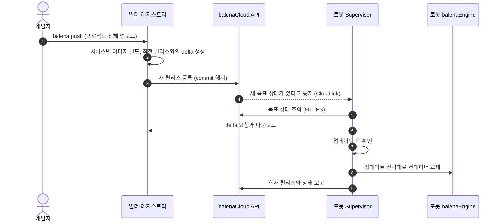
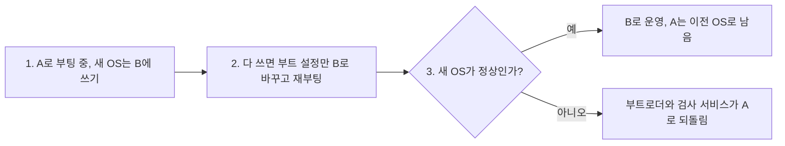
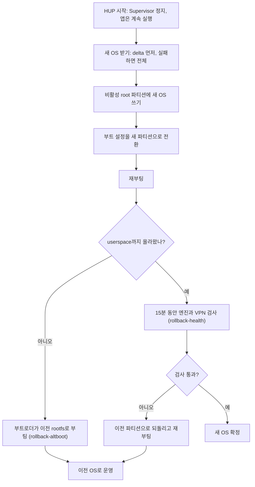
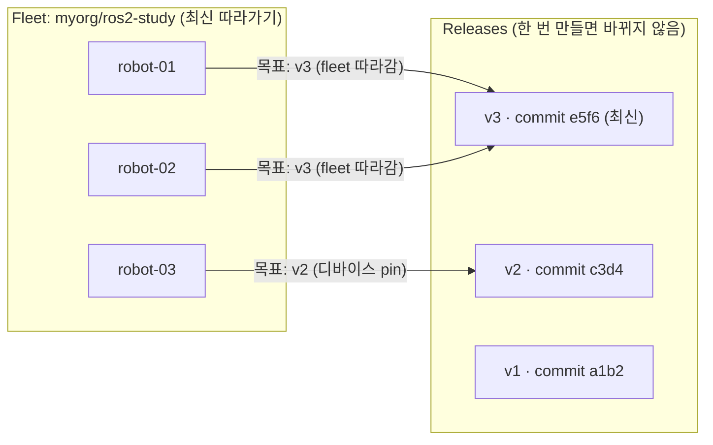
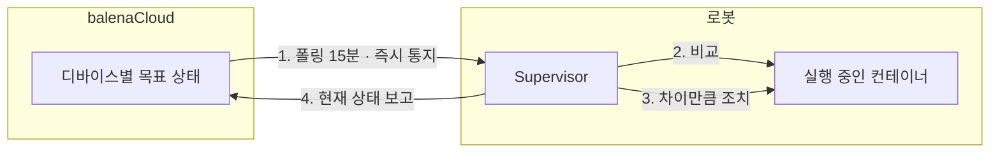
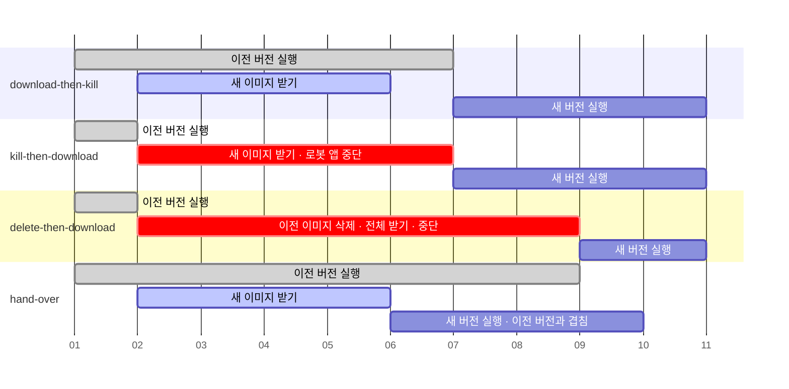
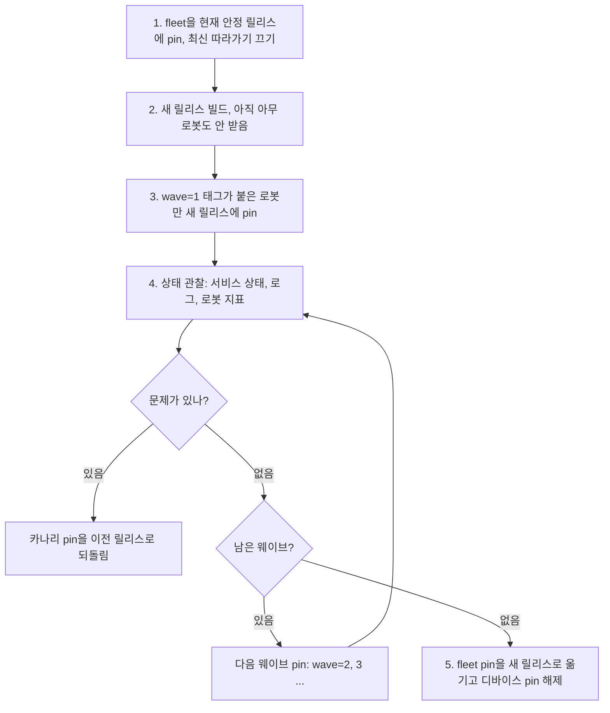
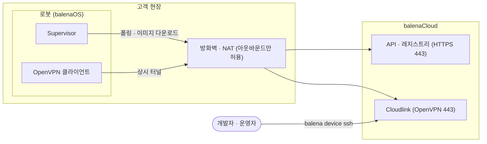
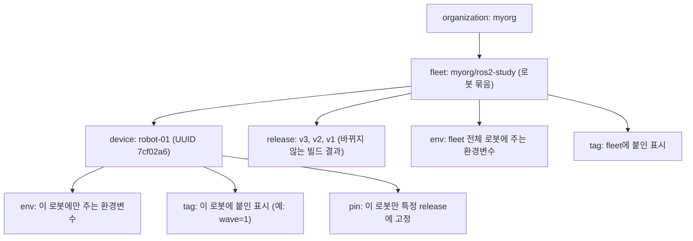

# 1. 들어가며

2026년 9월 22일부터 24일까지 토론토에서 ROSCon 2026이 열렸다. 1일차에 들은 스폰서 드롭인 세션 중 하나가 balena의 **"Scaling ROS Deployments in Production with Secure OTA Updates Using balena"** 였다. 발표는 balena의 Professional Services Lead인 Sam Duffield가 맡았다.

세션 소개는 이 문장으로 시작한다.

> Getting a ROS application working on a robot in the lab is one problem. Keeping it working across a fleet of autonomous robots in customer warehouses, behind someone else's firewall, with no engineer on site, is a different one entirely.

랩에서 로봇 하나에 ROS 앱을 돌리는 것과, 남의 방화벽 뒤 고객 창고에 흩어진 로봇 여러 대에서 그 앱을 엔지니어 없이 계속 돌리는 것은 전혀 다른 문제라는 뜻이다. 이 글은 세션을 계기로 balena 공식 문서, GitHub 저장소, 세션 데모 코드를 보며 다시 정리한 내용이다.

- **읽는 사람**: 컨테이너·Kubernetes와 ROS 2 기본 개념(노드, 토픽, DDS)을 아는 개발자
- **예제 코드**: 세션 공개 데모 [shaunmulligan/ros2-nvidia-demo](https://github.com/shaunmulligan/ros2-nvidia-demo)(카메라 → YOLO 검출 → 판단 → 시각화로 이어지는 ROS 2 파이프라인)와 [balenasolutions/ros-balena-supervisor](https://github.com/balenasolutions/ros-balena-supervisor)
- **기준 시점**: 2026년 10월. balena는 기능이 빠르게 바뀌고 있어서 버전과 날짜를 함께 적었다
- **다루지 않는 것**: GPU(NVIDIA container runtime), Secure Boot, 가격, 다른 OTA 제품과의 비교

# 2. 현장 로봇 OTA가 어려운 이유

## 2.1 랩의 로봇과 현장의 로봇

랩에서는 로봇 옆에 앉아 SSH로 들어가 빌드하고, 노드를 재시작하고, 안 되면 전원을 껐다 켜면 된다. 고객 창고나 건물에 깔린 로봇은 사정이 다르다.

- **고객 네트워크 뒤에 있다.** NAT와 방화벽 뒤라서 클라우드에서 로봇으로 들어가는 연결을 열 수 없고, 방화벽 정책도 고객이 정한다
- **현장에 엔지니어가 없다.** 업데이트하다가 부팅이 안 되면(벽돌이 되면) 사람이 가서 회수해야 한다
- **무선 링크가 좁고 불안정하다.** 수 GB짜리 이미지를 받다가 중간에 끊기기 쉽고, 셀룰러라면 받는 양이 곧 비용이다
- **로봇이 일하는 중이다.** 주행이나 작업 중에 아무 때나 프로세스를 내리면 안 된다
- **대수가 많다.** 한 대씩 들어가서 수동으로 올리는 방식은 수십 대에서 무너지고, 로봇마다 조금씩 다른 상태(drift)가 쌓인다

balena를 쓰는 로봇 회사 6 River Systems는 [NVIDIA GTC 2019 발표](https://developer.download.nvidia.com/video/gputechconf/gtc/2019/presentation/s9973-how-6-river-systems-leveraged-ros-and-the-nvidia-jetson-platform-tx1-tx2-to-build-a-fleet-of-autonomous-collaborative-robots.pdf)에서 도입 전 상황을 이렇게 정리했다. 업데이트가 수동이라 오래 걸렸고, 네트워크가 불안해서 한 대씩 업데이트해야 했고, 연결이 끊기면 로봇이 bad state에 빠졌다.

## 2.2 직접 만들면 필요한 것

이 문제를 직접 풀려면 다음을 모두 만들어야 한다.

1. **배포 단위**: 어떤 바이너리·설정 조합이 "버전 X"인지 묶어서 이름 붙이기
2. **디바이스 에이전트**: 로봇이 스스로 목표 버전을 받아 그 상태로 맞추기
3. **원자적 전환**: 받다가 끊겨도 반쯤 바뀐 상태가 되지 않기
4. **OS 업데이트와 롤백**: 앱뿐 아니라 OS 자체도 바꾸고, 새 OS가 망가지면 되돌리기
5. **적게 받기**: 바뀐 부분만 보내는 차분(delta) 전송
6. **원격 접속 경로**: 방화벽 뒤 로봇에 셸·로그로 닿기
7. **업데이트 시점 제어**: 일하는 중에는 업데이트하지 않기
8. **단계적 배포**: 일부 로봇에 먼저 내보내고 지켜본 뒤 넓히기

balena는 이 여덟 가지를 한 제품으로 묶어 제공한다. 다만 8번 단계적 배포는 완성된 기능이 아니라 부품으로 제공되고, 조립은 사용자가 한다(8.2).

## 2.3 balena의 답

| 문제 | balena의 답 | 자세히 |
|---|---|---|
| 방화벽·NAT 뒤 | 디바이스가 클라우드로 **먼저 접속**(아웃바운드 전용). 인바운드 포트 불필요 | 9.1 |
| 현장 엔지니어 없음 | OS를 A/B 두 벌로 두고, 새 OS가 망가지면 **자동 롤백** | 4.4 |
| 좁은 무선 링크 | 이미지 전체가 아니라 **바이너리 delta**만 전송 | 7.1 |
| 로봇이 일하는 중 | **업데이트 전략**과 **업데이트 락**으로 앱이 시점을 결정 | 7.2, 7.3 |
| 대수와 drift | fleet에 릴리스 하나를 지정하면 각 디바이스의 에이전트가 그 상태로 맞춤 | 5장 |

한 줄로 정리하면 다음과 같다.

> **balena는 디바이스 OS(balenaOS)까지 balena가 관리하고, 사용자 코드는 전부 컨테이너로 올리며, 디바이스의 에이전트(Supervisor)가 클라우드에서 받은 목표 상태로 컨테이너를 맞추는 플랫폼이다.**

# 3. balena 구성 요소와 반영 흐름

## 3.1 구성 요소

balena는 IoT·엣지 디바이스 fleet 관리 플랫폼을 만드는 회사다. 예전 이름이 resin.io였고, 그 흔적이 지금도 balenaOS 파티션 이름(`resin-boot` 등)에 남아 있다. SD 카드에 OS 이미지를 굽는 도구 balenaEtcher도 이 회사 제품이다.

| 구성 요소 | 어디서 도나 | 하는 일 | 라이선스 |
|---|---|---|---|
| balenaOS | 로봇 | 컨테이너를 돌리기 위한 최소 리눅스. balena가 빌드하고 통째로 교체함 (4장) | Apache-2.0 |
| Supervisor | 로봇 (컨테이너) | 클라우드에서 목표 상태를 받아 로봇의 컨테이너를 그 상태로 맞추는 에이전트 (5장) | Apache-2.0 |
| balenaCloud | 클라우드 (SaaS) | 빌더, 컨테이너 레지스트리, API, 웹 대시보드, 원격 접속 중계(Cloudlink) | 상용 SaaS |
| balena CLI | 개발자 PC | 빌드·배포(`balena push`), 원격 셸(`balena device ssh`), 관리 명령 (10장) | Apache-2.0 |

balenaCloud의 서버 쪽을 직접 운영하는 오픈소스 버전 openBalena(AGPL-3.0)도 있지만, 대시보드와 delta 업데이트가 없다. 이 글은 balenaCloud 기준이다.

사용자가 만드는 것은 **`docker-compose.yml` 하나와 서비스별 Dockerfile**뿐이다. OS 이미지, 설치 스크립트, 배포 서버는 만들지 않는다.

## 3.2 코드를 고쳐서 로봇에 반영되기까지



1. 개발자가 `balena push myorg/ros2-study`를 실행하면 소스 디렉터리 전체가 클라우드 빌더로 올라간다. `myorg/ros2-study`는 `<조직 handle>/<fleet 이름>` 형태의 fleet slug 예시다. 로컬에서는 빌드하지 않는다
2. 빌더가 compose 파일의 서비스마다 이미지를 빌드하고, 직전 릴리스와의 차이(delta)를 미리 만들어 둔다 (7.1)
3. 빌드가 끝나면 **릴리스** 하나가 생긴다. 이미지 묶음 전체가 commit 해시로 식별되고 다시 바뀌지 않는다 (5.1)
4. fleet이 최신 릴리스를 따라가도록 되어 있으면(기본값), 로봇들의 목표 상태가 새 릴리스로 바뀌고 Cloudlink로 바로 통지된다 (5.4)
5. 로봇의 Supervisor가 API에서 자기 목표 상태를 가져온다. 통지가 없어도 15분마다 폴링한다
6. 이미지 전체가 아니라 delta만 받는다
7. 앱이 업데이트 락을 잡고 있으면 여기서 기다린다 (7.3)
8. 서비스별로 정한 업데이트 전략에 따라 이전 컨테이너를 내리고 새 컨테이너를 올린다 (7.2)
9. 결과를 API에 보고하고, 대시보드에 로봇별 현재 릴리스가 표시된다

이 흐름에서 사용자가 신경 쓸 곳은 2번(빌드), 7번(락), 8번(전략) 세 군데이고 나머지는 balena가 맡는다.

# 4. balenaOS

## 4.1 왜 전용 OS인가

일반 Ubuntu 로봇을 `apt upgrade`로 업데이트한다고 해 보자.

- 패키지를 바꾸는 도중 전원이 나가면 반쯤 바뀐 OS가 남는다
- 로봇마다 업데이트 시점과 실패 지점이 달라서, 시간이 지나면 같은 버전이라는 로봇들의 실제 상태가 조금씩 달라진다
- 문제가 생겼을 때 "어제 상태"로 되돌릴 단위가 없다

balenaOS는 이 문제를 **OS를 고치지 않고 통째로 교체하는 방식**으로 피한다. balena 엔지니어가 디바이스 타입별로 빌드해 배포하고, 사용자는 OS를 직접 빌드하지도 수정하지도 않는다. 사용자 코드는 전부 그 위의 컨테이너로 들어간다.

## 4.2 Yocto로 만든 OS

balenaOS는 Yocto로 만든다. Yocto는 임베디드 기기용 리눅스 배포판을 직접 만들어 주는 빌드 도구 모음이다. Ubuntu처럼 완성된 배포판을 받아 쓰는 것이 아니라, "우리 보드 전용 OS 이미지"를 소스부터 빌드해 내는 공장에 가깝다. Linux Foundation 산하 오픈소스 프로젝트다.

| | Ubuntu·Debian | Yocto로 만든 OS |
|---|---|---|
| 정체 | 완성된 범용 배포판 | 배포판을 만드는 빌드 도구 |
| 패키지 | 빌드된 바이너리를 apt로 설치 | 필요한 것만 소스에서 크로스 컴파일 |
| 크기 | 범용이라 큼 | 필요한 것만 넣어 작음 |
| 기기에서 추가 | `apt install`로 바로 | 패키지 관리자 없음, 이미지 재빌드 |
| 같은 버전이면 | 설치 순서에 따라 기기마다 다를 수 있음 | 같은 이미지라 모든 기기가 동일 |

balena가 Yocto를 쓰는 이유는 다음과 같다.

- **수십 종 보드를 지원해야 한다.** 칩 벤더의 BSP 레이어 위에 공통 레이어 `meta-balena`를 얹어 보드마다 balenaOS를 만든다
- **작고 읽기 전용이고 모든 기기가 같아야** A/B 파티션으로 OS를 통째로 바꾸기 좋다
- **기기에서 패키지를 설치하지 않으니** 사용자 코드는 전부 컨테이너로 올리는 구조가 된다
- Yocto는 배우기 어렵고 빌드가 오래 걸리지만, 그 부담은 balena가 지고 사용자는 완성된 이미지만 받는다

## 4.3 구성과 파티션

balenaOS 안에는 systemd, Supervisor, balenaEngine(balena의 Docker(Moby) 포크, delta 적용 기능 포함), NetworkManager·ModemManager(이더넷, Wi-Fi, 셀룰러), chrony(NTP), OpenSSH(호스트 OS SSH, 포트 22222), OpenVPN(원격 접속 채널 Cloudlink의 클라이언트) 같은 구성 요소가 들어 있다. Supervisor는 사용자 앱과 같은 컨테이너 층에서 돌면서 balenaEngine을 통해 나머지 컨테이너를 만들고 교체한다.

디스크는 다음과 같이 나뉜다.

| 파티션 | 마운트 위치 | 내용 |
|---|---|---|
| `resin-boot` | `/mnt/boot` | 커널·부트로더, `config.json`(디바이스 설정), 네트워크 설정(`system-connections/`) |
| `resin-rootA` | `/mnt/sysroot/active` 또는 `inactive` | 읽기 전용 rootfs 한 벌 |
| `resin-rootB` | `/mnt/sysroot/active` 또는 `inactive` | 읽기 전용 rootfs 다른 한 벌 |
| `resin-state` | `/mnt/state` | 재부팅 후에도 남아야 하는 설정 |
| `resin-data` | `/mnt/data` | Supervisor, 컨테이너 이미지, 볼륨 |

- rootfs는 읽기 전용이고, 남겨야 하는 경로만 `resin-state`에서 bind mount 한다. 그래서 운영 중에 OS가 조금씩 바뀌는 일이 없다
- 컨테이너와 볼륨은 `resin-data`에 있으므로 OS를 바꿔도 앱 데이터는 남는다

## 4.4 A/B 업데이트: OS를 두 벌 두는 이유

rootfs 파티션이 A, B 두 개인 것이 balenaOS의 핵심이다.



- 지금 A로 부팅해 있다면, 새 OS는 **쓰지 않는 B에** 쓴다. 쓰는 동안에도 A는 그대로라서, 중간에 끊겨도 로봇은 지금 OS로 계속 돈다
- 다 쓴 뒤에 부트 설정만 B로 바꾸고 재부팅한다. 전환이 "부트 설정 한 줄" 단위라 반쯤 바뀐 상태가 생기지 않는다
- 새 OS가 부팅되지 않거나 비정상이면 이전 파티션으로 돌아간다

스마트폰 OS 업데이트(Android의 A/B seamless update)와 같은 발상이다.

balena는 호스트 OS 업데이트를 HUP(Host OS UPdate)라고 부른다. 자동 롤백까지 포함한 순서를 자세히 보면 다음과 같다.



**rollback-altboot: 새 OS가 userspace까지 못 올라온 경우** (커널 패닉 등)

- HUP가 boot 파티션의 `resinOS_uEnv.txt`에 `upgrade_available=1`을 쓴다
- 부트로더가 부팅할 때마다 bootcount를 올리고, 새 OS가 정상적으로 올라오면 userspace가 bootcount를 지운다
- bootcount가 1을 넘으면 "새 OS가 userspace까지 못 왔다"고 보고 부트로더가 이전 rootfs로 부팅한다
- 이어서 `rollback-altboot.service`가 이전 OS의 boot 파일을 boot 파티션에 복원한다

**rollback-health: 새 OS가 올라오긴 했지만 비정상인 경우**

- 새 OS 부팅 후 1분 간격으로 15분 동안 두 가지를 검사한다
  - balenaEngine healthcheck가 실패하는지
  - 이전 OS에서는 되던 VPN(Cloudlink) 연결이 안 되는지
- 실패하면 root 파티션 설정을 이전 파티션으로 되돌리고 재부팅한다
- **검사 대상은 엔진과 VPN뿐이다.** 새 OS에서 로봇 앱이 제대로 도는지는 보지 않는다

HUP가 실패하면 연속 2회 재시도하고, 그 뒤로는 2일 간격으로 재시도한다. 성공한 뒤에는 이전 OS로 내릴 수 없다(자동 롤백만 예외).

# 5. 배포 모델과 reconcile

## 5.1 네 가지 개념

| 개념 | 뜻 | 왜 이렇게 나눴나 |
|---|---|---|
| Fleet | 같은 소프트웨어를 돌리는 디바이스 묶음 | 배포 대상의 단위. 디바이스는 fleet 하나에만 속함 |
| Release | `docker-compose.yml` + 이미지들을 한 번 빌드한 결과. commit 해시로 식별되고 바뀌지 않음 | 같은 릴리스면 모든 로봇에서 이미지가 비트 단위로 같으므로 drift가 없음. 되돌리기는 이전 릴리스를 지정하는 것으로 끝남 |
| Service | 릴리스 안의 컨테이너 하나. ROS 2 로봇이라면 노드 하나(또는 노드 묶음) | 서비스별로 따로 빌드·재시작·업데이트 전략을 정할 수 있음 |
| Supervisor | 디바이스의 에이전트. 실행 중인 상태(running state)를 목표 상태(target state)에 맞춤 | 클라우드가 명령을 내리는 대신 상태를 선언하게 함 (5.2) |

fleet은 예전에 application이라고 불렀고, API 리소스 이름은 지금도 `application`이다.

네 개념의 관계를 그림으로 보면 다음과 같다. 화살표는 각 디바이스가 돌려야 할 목표 릴리스다.



- fleet이 최신 따라가기라서 robot-01, 02의 목표는 가장 최근 릴리스인 v3이다
- robot-03은 디바이스 pin으로 v2에 고정되어 fleet 정책을 따르지 않는다. 카나리 배포나 문제 로봇 격리가 이 방식이다 (8장)
- 릴리스마다 서비스 구성이 다를 수 있다
- 릴리스는 바뀌지 않으므로, 되돌리기는 화살표를 이전 릴리스로 옮기는 것으로 끝난다

## 5.2 명령이 아니라 목표 상태를 내려보낸다

OTA를 만드는 방법 중 하나는 서버가 로봇에게 명령을 보내는 구조다. "이 파일을 받아서 설치해라", "이 프로세스를 재시작해라" 같은 식이다. balena는 이런 명령을 보내지 않는다. 대신 "너는 이 릴리스를, 이 변수로 돌리고 있어야 한다"는 **목표 상태**를 내려보낸다. Supervisor는 지금 상태와 목표 상태를 비교해서 차이를 메운다. 이것을 reconcile이라고 한다.

| | 명령을 보내는 방식 | 목표 상태를 내려보내는 방식 (balena) |
|---|---|---|
| 서버가 보내는 것 | "업데이트해라", "재시작해라" | "이 릴리스·이 변수여야 한다" |
| 로봇이 오프라인이었다면 | 놓친 명령을 다시 보내고 순서도 맞춰야 함 | 다시 연결됐을 때 최신 목표 상태 하나만 보면 됨 |
| 같은 메시지를 두 번 받으면 | 두 번 실행될 수 있음 | 이미 맞춰져 있으면 아무 일도 안 함 (멱등) |
| 진행 상태의 기준 | 명령마다 성공·실패를 따로 추적 | 현재 상태와 목표 상태의 차이 |

목표 상태는 디바이스별로 계산된다. fleet의 목표 릴리스, 디바이스 pin(8.1), fleet·디바이스 변수(10.1)를 합쳐서 그 디바이스 몫이 만들어진다.

reconcile이 도는 모습은 다음과 같다.



1. Supervisor가 자기 목표 상태를 받는다. 15분마다 폴링하고, 새 릴리스가 나오면 즉시 통지도 받는다 (5.4)
2. 실행 중인 컨테이너와 목표 상태를 서비스별로 비교한다
3. 차이가 있는 서비스만 조치한다. 이미지가 바뀌었으면 받아서 교체하고(7장), 변수만 바뀌었으면 재시작한다. 차이가 없으면 아무것도 하지 않는다
4. 현재 상태를 보고하고, 다음 목표 상태를 기다린다. 오프라인이면 마지막 목표 상태를 유지한 채 다시 연결될 때까지 기다린다

## 5.3 Kubernetes와 비교하면

Kubernetes에 익숙하다면 이렇게 대응해 보면 이해가 빠르다. Supervisor가 하는 일은 kubelet이 PodSpec을 보고 컨테이너를 맞추는 것과 같은 발상이다.

| balena | Kubernetes에서 비슷한 것 | 다른 점 |
|---|---|---|
| Fleet | 같은 워크로드를 돌리는 노드 집합 (DaemonSet 대상 노드) | 스케줄링이 없음. fleet의 모든 디바이스가 같은 릴리스를 돌림 |
| Release | 이미지 digest까지 고정된 매니페스트 묶음 (Helm release revision) | 빌드와 배포 단위가 같음. compose 파일이 곧 배포 단위 |
| Service | Pod 안의 컨테이너 | 디바이스 한 대 = 컨테이너 묶음 하나 |
| Supervisor | kubelet | API 서버에 상시 연결하지 않고 클라우드에서 목표 상태를 폴링 |
| target state | PodSpec (desired state) | 디바이스별로 계산되어 내려옴 |

## 5.4 목표 상태를 받는 방법: 폴링 + 푸시

- **폴링**: Supervisor가 `GET /device/v3/{uuid}/state`를 `If-None-Match`(ETag)와 함께 호출한다. 바뀐 게 없으면 304로 끝나서 가볍다
  - 주기는 설정 변수 `BALENA_SUPERVISOR_POLL_INTERVAL`이고 기본 900000 ms(15분)이다
  - 랜덤 지터가 붙고, 오류가 나면 `15초 × 2^n`으로 백오프한다
- **푸시**: Cloudlink(9.1)가 연결돼 있으면 새 릴리스가 나왔을 때 바로 통지를 받고 폴링을 앞당긴다
  - `BALENA_SUPERVISOR_INSTANT_UPDATE_TRIGGER=false`로 두면 통지를 무시하고 폴링만 한다
  - 문서는 대규모 현장에서 업데이트 시점을 흩뜨리는 용도로 이 설정을 권한다. 수백 대가 같은 순간 같은 AP로 이미지를 받으면 현장 네트워크가 막히기 때문이다
- **오프라인**: 마지막으로 받은 목표 상태를 로컬 sqlite에 캐시하고, 그대로 컨테이너를 계속 돌린다. 재부팅해도 같다

대시보드는 디바이스의 연결 상태를 Cloudlink 연결과 heartbeat API 통신 두 가지로 판정한다([Device statuses](https://docs.balena.io/learn/manage/device-statuses/)).

| 상태 | 뜻 |
|---|---|
| Operational | 정상. 예상한 주기 안에 클라우드와 통신하고 있음 |
| Reduced Functionality | 둘 중 하나만 됨. Cloudlink만 되면 SSH는 되지만 새 변경을 받지 못하고, heartbeat만 되면 업데이트 폴링은 되지만 재시작 같은 즉시 동작을 못 함 |
| Disconnected | Cloudlink 연결이 없고, heartbeat가 API 폴링 주기보다 오래 끊김 |

그래서 로봇 전원이 나가도 폴링 주기가 지날 때까지는 대시보드에 연결된 것으로 보인다. 오프라인 표시가 실제보다 늦게 뜬다는 점을 알고 있어야 한다.

# 6. ROS 2 노드를 컨테이너로

## 6.1 노드마다 컨테이너 하나

세션 데모는 이렇게 생겼다.

```
ros2-nvidia-demo/
├── docker-compose.yml   # 배포 전체가 파일 하나에
├── camera/              # Dockerfile, entrypoint.sh, params.yaml
├── detection/           # Dockerfile, detect_node.py, yolo26s.onnx
├── logic/               # Dockerfile, presence_node.py
└── viz/                 # Dockerfile, entrypoint.sh
```

노드마다 디렉터리 하나, Dockerfile 하나를 둔다. 나누는 이유는 다음과 같다.

- **의존성이 섞이지 않는다.** 카메라 드라이버와 추론 라이브러리(PyTorch, TensorRT)는 버전 요구가 서로 부딪히기 쉽다
- **업데이트가 작아진다.** `logic/`만 고치면 그 이미지만 바뀌고, 수 GB짜리 `detection/` 이미지는 그대로다
- **서비스별로 재시작·업데이트 전략을 따로 정할 수 있다** (7.2)

`balena push`는 프로젝트 전체를 클라우드 빌더로 보내고, 모든 서비스가 함께 빌드되어 **바뀌지 않는 릴리스 하나**가 된다. 노드는 나뉘어 있어도 배포는 언제나 한 묶음이다.

## 6.2 compose 파일이 곧 배포 단위

데모의 camera 서비스에서 GPU 관련 줄을 빼면 다음과 같다.

```yaml
services:
  camera:
    build: ./camera
    image: ros2-demo/camera:0.2.0
    environment:
      RMW_IMPLEMENTATION: rmw_cyclonedds_cpp
      ROS_DOMAIN_ID: "42"
    networks: [rosnet]
    restart: unless-stopped
```

이 파일 하나가 다음을 모두 맡는다. 별도 프로비저닝 스크립트나 Ansible, `curl | bash` 설치가 필요 없다.

- **빌드**를 기술한다 (`build: ./camera`)
- **실행 환경**을 기술한다 (디바이스, 환경변수, 네트워크)
- **릴리스 단위**다. 파일을 바꾸면 새 릴리스가 된다
- **Supervisor가 맞춰야 할 목표**다

줄별로 보면 다음과 같다.

- `RMW_IMPLEMENTATION`, `ROS_DOMAIN_ID`: 모든 노드가 같은 값을 써야 한다 (6.4)
- `networks: [rosnet]`: 노드끼리 쓰는 bridge 네트워크다
- `restart: unless-stopped`: 노드가 죽으면 엔진이 다시 띄운다

Kubernetes 매니페스트나 Helm 차트 같은 배포 설정 파일은 따로 쓰지 않는다. 노드가 하나뿐이면 compose 없이 Dockerfile 하나만 둬도 된다.

## 6.3 balena compose의 제약

balena의 compose는 Docker Compose와 똑같지 않다. 모르고 쓰면 빌드나 배포에서 막힌다.

- **compose v2.4 기준**이라 v3에서 생긴 필드는 쓸 수 없다
- `env_file`, `container_name`, `logging`, `cpus`와 **변수 치환(`${VAR}`)을 지원하지 않는다.** 그래서 아키텍처별 이미지 이름 같은 값도 직접 써야 한다
- **volumes는 짧은 문법과 named volume만** 된다. 호스트 경로를 붙이는 bind mount는 `io.balena.features.*` 라벨로 허용된 경로에 한해서만 된다
- `healthcheck`는 지원하지만, 실패해도 릴리스를 되돌리지는 않는다 (8.3)

bind mount를 막는 이유는 4장과 이어진다. 호스트 OS는 balena가 통째로 교체하는 영역이라, 앱이 호스트 경로에 기대면 OS 업데이트 때 깨질 수 있기 때문이다.

대신 `privileged: true`로 전부 열지 않고 필요한 호스트 자원만 여는 라벨이 있다. 자주 쓰는 것만 추리면 다음과 같다.

| 라벨 | 하는 일 |
|---|---|
| `io.balena.features.supervisor-api` | Supervisor 로컬 API 주소와 키를 환경변수로 주입 (7.4) |
| `io.balena.features.balena-api` | `BALENA_API_KEY`, `BALENA_API_URL` 주입 |
| `io.balena.features.journal-logs` | journal 디렉터리를 읽기 전용 마운트 (로그 수집기용, 9.3) |
| `io.balena.features.dbus` | 호스트 `/run/dbus`를 `/host/run/dbus`로 마운트 |
| `io.balena.features.kernel-modules` | 호스트 `/lib/modules` 마운트 |

멀티컨테이너 fleet은 기본이 비특권이다. 장치 접근은 `privileged: true`로 전부 열거나, `cap_add` + `devices`로 필요한 것만 연다.

## 6.4 DDS가 컨테이너 사이에서 동작하게 하기

ROS 2 노드는 DDS(RMW 구현체)로 서로를 찾는다. 같은 `ROS_DOMAIN_ID` 안에서 UDP 멀티캐스트로 "나 여기 있다"를 알리고(discovery), 같은 호스트라고 판단되면 공유메모리(SHM)로 데이터를 넘겨 복사를 줄인다. 컨테이너는 각자 네트워크·IPC namespace를 갖기 때문에 이 가정이 깨질 수 있다. 데모 저장소와 Supervisor ROS 2 노드 README에 정리된 실전 내용은 다음과 같다.

- **한 디바이스 안에서는 bridge 네트워크로 충분하다.** `rosnet` 같은 bridge 위에서 멀티캐스트 discovery가 된다
- **Fast DDS SHM은 컨테이너 경계를 넘지 못한다.** 같은 호스트라고 판단해 SHM으로 보내려다 실패하므로, UDP로 강제하거나 `ipc: host`를 써야 한다
- **RMW나 `ROS_DOMAIN_ID`가 다르면 에러 없이 서로 안 보인다.** 가장 흔한 "토픽이 안 와요" 원인이다
- **CycloneDDS는 네트워크 인터페이스 하나만 자동으로 고른다.** host 네트워크에 둔 컨테이너는 eth0/wlan0을 잡아서 `rosnet` 쪽 노드를 보지 못한다
- bridge를 쓰면 호스트 OS 셸에서는 토픽이 안 보인다. 확인은 컨테이너 안에서 해야 한다
- Zenoh(`rmw_zenoh_cpp`)를 쓰면 router(`rmw_zenohd`)가 따로 필요하다

| 네트워크 모드 | 맞는 경우 | 주의 |
|---|---|---|
| bridge (`rosnet`) | 노드가 모두 한 디바이스 안에 있을 때 | 호스트·외부 기기에서는 토픽이 안 보임 |
| `network_mode: host` | Bluetooth 같은 호스트 기능이 필요할 때 | CycloneDDS 인터페이스 선택, `hand-over` 전략의 포트 충돌(7.2) |

# 7. 업데이트

이 장의 목표는 세 가지다. 적게 받고(7.1), 안전하게 바꾸고(7.2), 바꾸는 시점을 앱이 정하는 것(7.3)이다.

## 7.1 delta 업데이트

일반 업데이트는 Docker pull처럼 디바이스에 없는 **레이어**를 통째로 받는다. Docker 이미지는 Dockerfile 명령 하나마다 레이어가 쌓이는 구조라, 아래쪽 레이어가 바뀌면 그 위 레이어도 전부 새로 만들어진다. 예를 들어 `COPY detect_node.py`가 PyTorch 설치보다 앞에 있으면, 파이썬 파일 한 줄만 고쳐도 그 위의 수 GB 레이어를 다시 받는다.

```dockerfile
FROM ros:jazzy-ros-base
COPY detect_node.py /app/        # 여기를 한 줄 수정
RUN pip install torch ...        # 위가 바뀌어서 이 레이어도 다시 빌드됨
```

delta 업데이트는 레이어 대신 **이미지 내용 전체를 바이너리로 비교**한다.

| | Docker 레이어 pull | balena delta |
|---|---|---|
| `COPY` 레이어 | 새 레이어라 전체 받음 (작음) | 바뀐 바이트만 |
| PyTorch 레이어 | 다시 빌드되어 digest가 바뀜 → 레이어 전체를 다시 받음 | 내용은 거의 같으므로 차이만 받음 |

- 디바이스가 balena 서버에 "지금 가진 이미지와 새 이미지의 차이만 달라"고 요청한다
- 디바이스는 받은 delta를 기존 이미지 위에 적용해 새 이미지를 완성하고 새 컨테이너를 띄운다. 로봇에서 빌드가 도는 것이 아니라 조립만 한다
- 받는 양, 업데이트에 필요한 디스크, 걸리는 시간이 모두 줄어든다. 최악의 경우 크기는 전체 pull과 같다

원리는 rsync와 같다. 로봇은 이전 이미지를 이미 갖고 있으므로, 서버는 새 이미지를 보내는 대신 "이전 파일의 몇 번 조각을 그대로 써라, 여기에는 이 바이트를 새로 써라" 같은 지시서만 보낸다. 조각 크기를 4바이트로 잡은 작은 예다.

```
이전 파일:  [AAAA][BBBB][CCCC]      조각 1, 2, 3
새 파일:     AAAA  BBXB  CCCC

AAAA → 조각 1과 같음  → COPY 1
BBXB → 같은 조각 없음  → LITERAL "BBXB"
CCCC → 조각 3과 같음  → COPY 3

delta = COPY 1, LITERAL "BBXB", COPY 3     (12바이트 중 실제 내용은 4바이트만 전송)
```

balena는 이전 릴리스 이미지와 새 릴리스 이미지를 둘 다 레지스트리에 갖고 있어서 delta를 미리 계산할 수 있다. balenaEngine은 rsync 알고리즘을 Go로 다시 구현한 `librsync-go`를 쓴다.

delta를 만드는 시점은 두 가지다([Delta updates](https://docs.balena.io/learn/deploy/delta/)).

- **build-time delta**: 빌더가 직전 성공 릴리스와 새 릴리스 사이를 미리 만든다. 대부분의 디바이스는 이것을 받는다
- **on-demand delta**: 디바이스가 처음 보는 조합(예: 오래 꺼져 있다가 몇 릴리스를 건너뛴 디바이스)을 요청하면 그때 만든다. 만드는 동안 디바이스는 기다리고, 이미지가 크면 오래 걸린다

그 밖에 알아 둘 것은 다음과 같다.

- balenaOS 2.47.1 이상이면 모든 디바이스에서 쓸 수 있다. delta를 써도 업데이트 전략(7.2)은 그대로 따른다
- 이미지가 그대로인 서비스는 아무것도 받지 않고, 설정도 같으면 재시작도 하지 않는다
- 다음 경우에는 delta를 못 쓰고 일반 pull로 받는다. Supervisor 소스(2026-10 master 기준)에서 확인한 동작이다

| 경우 | 동작 |
|---|---|
| 로봇에 그 서비스 이미지가 아직 없음 (첫 설치, 새로 추가한 서비스) | 기준 이미지가 없어서 일반 pull |
| compose에서 서비스 이름을 바꿈 | 기준을 서비스 이름으로 찾으므로 일반 pull |
| `delete-then-download` 전략 | 이전 이미지를 먼저 지우므로 일반 pull |
| delta 서버 오류, 적용 실패 | 실패로 끝나지 않고 일반 pull로 대체 |

delta가 있어도 자주 바뀌는 `COPY`는 Dockerfile 뒤쪽에 두는 편이 좋다. 빌드 시간은 여전히 레이어 캐시에 달려 있고, delta를 못 쓰는 경우에는 레이어 단위로 받기 때문이다.

## 7.2 업데이트 전략: 어떻게 바꿀 것인가

새 이미지를 받은 뒤 이전 컨테이너를 언제 내리고 새 컨테이너를 언제 올릴지를 서비스별 라벨로 정한다.

```yaml
labels:
  io.balena.update.strategy: hand-over
  io.balena.update.handover-timeout: "60000"
```

네 가지 전략을 시간축에 놓으면 차이가 잘 보인다. 가로축 숫자는 순서만 나타내고 실제 시간이 아니며, 빨간 막대가 로봇 앱이 멈춰 있는 구간이다.



| 전략 | 순서 | 쓰는 경우 | 비용 |
|---|---|---|---|
| `download-then-kill` (기본) | 새 이미지 받기 → 기존 컨테이너 종료 → 새 컨테이너 시작 → 이전 이미지 삭제 | 일반적인 경우. 다운타임을 짧게 | 받는 동안 기존 컨테이너가 돌아서 RAM을 더 씀 |
| `kill-then-download` | 기존 종료 → 새 이미지 받기 → 시작 | RAM이 빠듯하거나 이미지가 매우 클 때 | 받는 시간만큼 다운타임 |
| `delete-then-download` | 기존 종료 + 이전 이미지 삭제 → 받기 → 시작 | delta조차 들어갈 공간이 없는 극단적인 저장 공간 부족 | 다운타임이 가장 길고, 이전 이미지가 없으니 delta를 못 써서 대역폭도 더 씀 |
| `hand-over` | 새 이미지 받기 → 새 컨테이너를 **이전 것과 함께** 시작 → 넘겨받기 완료 신호 → 이전 종료 | 다운타임 0이 꼭 필요할 때 | 넘겨받기 코드를 직접 짜야 함 |

- 전략은 서비스별로 지정하지만, `download-then-kill`에서 Supervisor는 **릴리스의 모든 이미지를 다 받은 뒤에야** 기존 서비스를 종료한다. 받다가 끊겨도 돌던 앱은 그대로다
- `hand-over`는 이전 버전과 새 버전이 서로 통신해서, 이전 버전이 장치 파일이나 DB 락 같은 자원을 놓아줘야 한다. 통신 방법은 앱이 정한다
  - 넘겨받기가 끝나면 `BALENA_SERVICE_HANDOVER_COMPLETE_PATH`가 가리키는 경로에 파일을 만들어 신호를 보낸다. 신호가 없으면 `handover-timeout`(기본 60000 ms) 뒤에 이전 버전을 종료한다
  - **두 컨테이너가 동시에 뜨므로 자원이 겹치면 안 된다.** 이전 컨테이너가 host 네트워크에 포트를 열고 있으면 새 컨테이너는 `port is already allocated`로 뜨지 못한다. `network_mode: host`로 띄운 ROS 노드나 `/dev/ttyUSB0`를 독점하는 드라이버 노드는 그냥 쓰면 충돌한다

## 7.3 업데이트 락: 언제 바꿀 것인가

업데이트 전략이 "어떻게" 바꿀지를 정한다면, 업데이트 락은 "언제" 바꿀지를 **앱이 정하게** 한다. 로봇이 주행 중이거나 물건을 집는 중이면 앱이 락을 잡고, 끝나면 놓는다. 움직이는 로봇이라면 보통 둘 다 필요하다.

락이 잡혀 있어도 Supervisor는 새 이미지를 **미리 다운로드해 둔다.** 컨테이너 교체만 락이 풀릴 때까지 기다리므로, 락을 풀면 곧바로 교체된다.

락은 `/tmp/balena/updates.lock` 파일 하나로 잡는다. 그런데 같은 파일을 **서로 다른 두 방식으로 "잠겨 있다"고 판정**하고, 판정하는 쪽도 다르다.

| | 1. lockfile 방식 | 2. flock 방식 |
|---|---|---|
| "잠김" 판정 기준 | 그 파일이 배타적으로 **생성되어 존재하는가** | 어떤 프로세스가 그 파일에 **커널 잠금(`flock`)을 걸고 있는가** |
| 확인하는 쪽 | balena Supervisor | 호스트 OS 업데이트 스크립트 |
| 막는 것 | 앱 업데이트(컨테이너 교체), 설정 변경으로 인한 재부팅 | 호스트 OS 업데이트(HUP) 재부팅 (4.4) |
| 풀리는 때 | 파일을 지울 때, 또는 재부팅 | 잠금을 건 프로세스가 파일을 닫거나 종료될 때 |

그래서 무엇을 했느냐에 따라 막히는 범위가 달라진다.

| 앱이 한 일 | 앱 업데이트 | OS 업데이트 재부팅 |
|---|---|---|
| 파일만 만듦 (`lockfile` 명령, Python `lockfile` 라이브러리, `O_CREAT\|O_EXCL`) | 막힘 | **안 막힘** |
| 파일을 만들고 배타 flock도 잡고 있음 | 막힘 | 막힘 |

둘 다 잡으려면 이렇게 쓴다.

```python
import os, fcntl

path = "/tmp/balena/updates.lock"
fd = os.open(path, os.O_CREAT | os.O_EXCL | os.O_RDWR)  # 1. 파일 생성: 이미 있으면 실패 → 앱 업데이트 막기
fcntl.flock(fd, fcntl.LOCK_EX)                          # 2. 배타 flock → OS 업데이트 재부팅 막기
try:
    execute_safety_critical_maneuver()
finally:
    fcntl.flock(fd, fcntl.LOCK_UN)
    os.close(fd)
    os.remove(path)
```

- `O_CREAT | O_EXCL`은 "없으면 만들고, 이미 있으면 실패"를 한 번에 처리한다. 다른 프로세스와 동시에 잡으려 해도 한쪽만 성공한다
- `touch /tmp/balena/updates.lock`으로는 부족하다. 배타 플래그 없이 만든 파일은 락으로 쳐 주지 않는다
- 호스트 OS 쪽은 배타(`LOCK_EX`) flock만 인정하고 공유(`LOCK_SH`) flock은 무시한다
- 컨테이너 안의 `/tmp/balena`는 호스트 디렉터리를 bind mount 한 것이고, 컨테이너는 호스트와 같은 커널을 쓴다. 그래서 컨테이너 안에서 건 flock을 호스트의 업데이트 스크립트가 알아챈다

운영할 때 주의할 점은 다음과 같다.

- 멀티컨테이너 릴리스에서는 **서비스 하나의 락이 릴리스 전체를 막는다.** 내비게이션 노드가 락을 잡으면 카메라 노드도 업데이트되지 않는다
- `/tmp`는 재부팅하면 비므로, 앱이 시작할 때마다 필요하면 다시 잡아야 한다
- 강제로 무시하는 방법이 두 가지 있다. 설정 변수 `BALENA_SUPERVISOR_OVERRIDE_LOCK`, 그리고 한 번만 무시하는 Supervisor API `/v1/update`의 `{"force": true}`이다
- **락은 advisory이다.** override 설정 하나로 무력화되므로, 안전 기능을 락에만 맡기면 안 된다

## 7.4 ROS 2에서 락 잡기: Supervisor ROS 2 노드

Supervisor는 컨테이너 안의 앱이 일을 시킬 수 있는 로컬 HTTP API(포트 48484)를 제공한다. 그런데 ROS 2 로봇에서 업데이트 시점을 판단하는 것은 보통 behavior tree나 내비게이션 노드이고, 이들은 HTTP가 아니라 토픽과 서비스로 일한다. [ros-balena-supervisor](https://github.com/balenasolutions/ros-balena-supervisor)는 Supervisor API를 ROS 2 토픽과 서비스로 감싸서, 로봇 앱이 ROS 방식 그대로 balena 디바이스를 다루게 하는 노드다. 2026-10 기준 README에 experimental(v1.0.0 이전)이라고 적혀 있다.

```yaml
balena-supervisor-node:
  image: bh.cr/balenasolutions/ros-balena-supervisor-jazzy-aarch64/0.1.0
  network_mode: host
  labels:
    io.balena.features.supervisor-api: '1'   # 필수: 주소와 API 키를 환경변수로 주입
  environment:
    ROS_DOMAIN_ID: '0'
    RMW_IMPLEMENTATION: rmw_fastrtps_cpp     # 또는 cyclonedds, zenoh
```

```bash
# balena 디바이스 상태 보기 (latched 토픽이라 QoS 를 맞춰 구독)
ros2 topic echo --qos-durability transient_local /balena_supervisor/device_state
# 업데이트 막기
ros2 service call /balena_supervisor/take_update_lock balena_supervisor_msgs/srv/TakeUpdateLock
```

- 이미지는 `{humble|jazzy|lyrical}-{aarch64|amd64}` 조합으로 나온다. compose 변수 치환이 안 되므로(6.3) distro와 arch를 직접 써야 한다
- `take_update_lock` 하나로 7.3의 두 락(lockfile, flock)을 같은 파일에 모두 걸어 준다
- `reboot`, `shutdown`, `purge_data` 같은 위험한 서비스는 `SUPERVISOR_NODE_ENABLE_*` 환경변수를 켜지 않으면 `ros2 service list`에도 나오지 않는다. 실수로 호출할 길 자체를 없앤 설계다
- 노드 자신은 Fast DDS SHM을 끄고 UDP로 강제해서 `ipc: host` 없이 동작한다
- README는 `network_mode: host`를 쓰지만, 데모 compose는 이 노드를 `rosnet` bridge에 둔다. 6.4의 CycloneDDS 인터페이스 문제 때문이고, Supervisor API 연결은 `supervisor-api` 라벨이 `supervisor0` 네트워크를 자동으로 붙여 해결한다

업데이트를 막기만 하려면 이 노드는 거의 필요 없다. 파일 락은 어느 노드에서든 직접 잡을 수 있기 때문이다. 쓸모가 생기는 곳은 **업데이트 상태를 ROS 쪽에서 알아야 할 때**다. 미션 관리 노드가 "지금 작업 중인지"를 알고 있고, 원하는 동작이 이렇다고 해 보자.

1. 작업 중에 새 릴리스가 나와도 노드를 내리지 않는다
2. 새 버전 다운로드가 끝났다는 것을 알면, 지금 작업을 마친 뒤 새 작업을 받지 않고 도킹한다
3. 도킹하면 업데이트를 허용하고, 업데이트 뒤 다시 작업을 받는다

| 시점 | 일어나는 일 |
|---|---|
| 07:00 | 개발자가 새 릴리스를 push |
| 07:01 | Supervisor가 새 이미지 다운로드 시작 (락이 잡혀 있어도 다운로드는 진행됨) |
| 07:05 | 다운로드 완료. 락 때문에 교체는 대기하고, `device_state` 토픽에 업데이트 대기가 표시됨 |
| 07:05 | 미션 노드가 토픽을 보고 새 작업 접수를 멈춤 |
| 07:20 | 현재 작업 완료 → 도킹 → `release_update_lock` 호출 |
| 07:21 | Supervisor가 컨테이너 교체 |
| 07:22 | 새 버전 노드들이 시작되고, 미션 노드가 다시 `take_update_lock`을 잡은 뒤 작업 재개 |

1번과 3번은 노드가 있든 없든 몇 줄이면 된다. 차이는 2번에서 난다. 노드가 없으면 미션 노드 안에 Supervisor HTTP API(`/v2/state/status`)를 주기적으로 호출하는 클라이언트를 따로 짜야 하고, 노드가 있으면 다른 토픽처럼 구독하면 끝이다.

# 8. 단계적 배포와 롤백

## 8.1 릴리스 정책: 최신 따라가기와 pin

어느 디바이스가 어느 릴리스를 돌릴지 정하는 규칙이다.

- **fleet 기본값은 track latest**이다. 새 final 릴리스가 생기면 모든 디바이스가 따라간다
- **fleet을 특정 릴리스에 pin**하면, pin 되지 않은 모든 디바이스가 그 릴리스로 맞춰진다. 새 릴리스를 만들어도 아무도 따라가지 않는다
- **디바이스 하나를 pin**하면 그 디바이스는 fleet 정책을 따르지 않는다. 카나리와 문제 로봇 격리에 쓴다

```bash
balena fleet pin <FLEET_SLUG> <RELEASE_COMMIT>
balena fleet track-latest <FLEET_SLUG>
balena device pin <UUID> <RELEASE_COMMIT>
balena device track-fleet <UUID>
```

`balena push --draft`로 만든 draft 릴리스는 최신 따라가기 대상에서 빠지고 pin 한 디바이스에만 배포된다. 시험용 릴리스를 만들 때 쓴다. `balena release invalidate`로 무효화한 릴리스는 자동 배포에서 빠진다.

## 8.2 단계적 배포는 pin과 태그로 조립

**balenaCloud에는 "10% 먼저" 같은 단계적 배포 기능이 없다.** 8.1의 pin과 디바이스 태그, API를 조합해서 만든다. 공식 문서가 권하는 흐름은 다음과 같다.



```bash
# 카나리로 쓸 로봇에 wave=1 표시
balena tag set wave 1 --device <UUID>
# 그 로봇만 새 릴리스로 고정 → 이 로봇만 업데이트
balena device pin <UUID> <NEW_RELEASE>
# 이상하면 이전 릴리스로 다시 고정 → 롤백
balena device pin <UUID> <OLD_RELEASE>
```

wave=1 로봇이 많으면 API로 태그를 조회해 한꺼번에 pin 한다.

```bash
# wave=1 태그가 붙은 디바이스 조회
curl -s -H "Authorization: Bearer $BALENA_TOKEN" \
  "https://api.balena-cloud.com/v7/device?\$select=uuid&\$filter=device_tag/any(t:t/tag_key%20eq%20'wave'%20and%20t/value%20eq%20'1')"

# 각 디바이스를 새 릴리스에 pin
curl -X PATCH -H "Authorization: Bearer $BALENA_TOKEN" -H "Content-Type: application/json" \
  "https://api.balena-cloud.com/v7/device(uuid='<UUID>')" \
  --data '{"is_pinned_on__release": <NEW_RELEASE_ID>}'
```

- [balenalabs/staged-releases](https://github.com/balenalabs/staged-releases) 스크립트가 이 흐름을 curl로 구현해 두었다
- "상태 관찰" 단계는 balena가 판단해 주지 않는다. 어떤 지표로 성공을 볼지(서비스 상태, 로봇의 작업 성공률 등)는 운영하는 쪽이 정해야 한다
- 다른 방법도 있다. 카나리용 fleet을 따로 두고 디바이스를 옮기거나(CPU 아키텍처가 같아야 함), draft 릴리스를 카나리에 pin 해서 시험한 뒤 finalize 해서 전체가 따라가게 할 수 있다

## 8.3 앱은 자동 롤백이 없다

| 대상 | 자동 롤백 | 되돌리는 방법 |
|---|---|---|
| 앱 (컨테이너 릴리스) | **없음** | fleet이나 디바이스를 이전 릴리스로 직접 pin |
| 호스트 OS | **있음** (`rollback-altboot`, `rollback-health`) | 조건에 걸리면 자동으로 이전 rootfs로 부팅 (4.4) |

새 앱 릴리스가 뜨자마자 죽거나 `healthcheck`가 실패해도 balena는 이전 릴리스로 돌아가지 않는다. 그래서 8.2의 카나리가 사실상 앱 쪽 안전장치다.

앱을 되돌릴 때는 fleet의 최신 따라가기를 끄고 이전 commit으로 pin 해야 한다. 최신 따라가기를 켜 둔 채로 pin만 바꾸면 다음 릴리스가 나올 때 다시 덮어씌워진다. 되돌린 릴리스는 `invalidate` 해 두면 실수로 다시 배포되지 않는다.

## 8.4 앱 릴리스와 호스트 OS는 따로 배포된다

**릴리스를 내도 호스트 OS는 바뀌지 않는다.** 릴리스에는 `docker-compose.yml`의 서비스 이미지만 들어 있고, balenaOS·balenaEngine·커널은 HUP(4.4)로 따로 올린다.

| | 앱 릴리스 | 호스트 OS (HUP) |
|---|---|---|
| 들어 있는 것 | compose의 서비스 이미지 | balenaOS, balenaEngine, 커널, 부트 파일, Supervisor |
| 만드는 쪽 | 사용자 (`balena push`, `balena deploy`) | balena (디바이스 타입별 OS 버전) |
| 배포가 시작되는 때 | fleet이 최신 따라가기면 빌드가 끝나자마자 자동 | 사람이 디바이스를 골라 요청할 때만 |
| 범위를 정하는 단위 | fleet pin, 디바이스 pin | 디바이스 (여러 대를 한꺼번에 고를 수 있음) |
| 자동 롤백 | 없음 | 있음 |

OS 업데이트는 대시보드에서 디바이스를 골라 요청하거나 CLI로 요청한다.

```bash
balena device os-update <UUID> --version <balenaOS 버전>
```

운영하다 보면 이런 일이 생긴다.

- **fleet 안에 OS 버전이 섞인다.** 같은 릴리스를 돌려도 로봇마다 balenaOS, Supervisor 버전이 다를 수 있다
- **새 앱이 호스트 쪽 기능에 기대면 OS를 먼저 올려야 한다.** 새 Supervisor에서 지원하기 시작한 compose 필드를 쓰는 경우가 그렇다
- **반대로 OS만 올리면 앱은 그대로다.** OS 자동 롤백은 엔진과 VPN만 보므로, 새 OS에서 앱이 제대로 도는지는 직접 확인해야 한다

순서를 놓칠 때를 대비해 요구 조건 라벨을 걸어 둔다. 조건이 맞지 않는 디바이스에서는 **릴리스 전체가 거부되고 기존 릴리스가 계속 돈다.**

```yaml
labels:
  io.balena.features.requires.sw.l4t: '>=36.4.0'
  io.balena.features.requires.sw.supervisor: '>=19.3.0'
  io.balena.features.requires.hw.device-type: 'jetson-orin-nano-devkit-nvme'
```

`requires.sw.l4t`는 Jetson BSP(L4T) 버전 조건이다. 이 밖에 `requires.arch.sw`(CPU 아키텍처), `requires.sw.balena-os`, `requires.sw.linux`가 있고, 버전은 semver 범위로 쓴다.

# 9. 연결과 원격 접속

## 9.1 연결은 디바이스가 먼저 건다

고객망의 방화벽은 대개 "안에서 밖으로 나가는 연결"만 허용한다. 그래서 balena의 모든 연결은 **디바이스에서 바깥으로** 연다. 인바운드 규칙이나 포트포워딩이 필요 없고, 운영자의 SSH 같은 들어오는 요청은 디바이스가 미리 열어 둔 터널을 거꾸로 타고 들어간다. 아래 그림의 화살표는 연결을 여는 방향이다.



디바이스와 balenaCloud 사이 채널은 두 개다.

| 채널 | 용도 | 이 채널만 막히면 |
|---|---|---|
| HTTPS (API, 레지스트리) | heartbeat, 목표 상태 폴링, 이미지·delta 다운로드 | SSH는 되지만 새 릴리스를 적용하지 못함 |
| Cloudlink (OpenVPN over 443) | 원격 SSH, 즉시 업데이트 통지, Supervisor 프록시, public URL | 폴링으로 업데이트는 되지만 SSH·즉시 액션·public URL이 안 됨 |

Cloudlink의 예전 이름은 "VPN"이고, 내부는 그대로 OpenVPN이다. 로봇 호스트 OS의 OpenVPN 클라이언트가 Cloudlink로 먼저 접속해 터널을 계속 열어 두고, 끊기면 다시 붙는다. 접속하면 로봇에 가상 네트워크 인터페이스와 VPN 안의 사설 IP가 생겨서, NAT 뒤 로봇도 클라우드에서 같은 사설망의 장비처럼 보인다. 계속 열어 둔 채널이라는 점은 WebSocket과 같지만, WebSocket이 두 프로그램 사이의 메시지를 나른다면 OpenVPN은 IP 패킷을 나른다. 그래서 SSH 같은 기존 도구를 고치지 않고 그대로 쓴다.

- **필요한 포트**: 443/TCP(API, 레지스트리, Cloudlink), 123/UDP(NTP), 53/UDP(DNS). 현장에 NTP·DNS 서버가 있으면 123, 53은 막아도 된다
- **필요한 도메인**: `*.balena-cloud.com`. 와일드카드를 못 쓰는 방화벽이면 `https://api.balena-cloud.com/os/v1/network-endpoints`에서 목록을 받아 주기적으로 갱신한다
- **SNI 방화벽 함정**: Cloudlink는 443 포트를 쓰지만 TLS가 아니라 OpenVPN 트래픽이라 SNI(TLS 핸드셰이크에 실리는 호스트명)가 없다. 호스트명으로 거르는 방화벽은 이 연결을 알아보지 못하므로 `cloudlink.balena-cloud.com`의 IP를 따로 허용해야 한다. 이 IP는 로드밸런서 주소라 바뀔 수 있다
- **격리**: Cloudlink로는 디바이스끼리 통신할 수 없고, 디바이스의 인터넷 트래픽도 이 채널로 나가지 않는다
- **고가용성이 아니다.** 트래픽이 많으면 throttle 될 수 있어서, 문서는 앱의 핵심 경로에 두지 말라고 명시한다
- **프록시**: 고객망이 프록시를 강제하면 redsocks로 우회한다. Supervisor API의 host-config나 `/mnt/boot/system-proxy/redsocks.conf`로 설정한다

## 9.2 좁은 링크에서 대역폭 줄이기

업데이트가 없을 때도 디바이스는 계속 통신한다. 문서가 셀룰러에서 잰 월간 사용량(balenaOS v2.108.18 기준)이다.

| 설정 | 기능 | 월 사용량 |
|---|---|---|
| `BALENA_SUPERVISOR_VPN_CONTROL` | Cloudlink | 80MB |
| `BALENA_SUPERVISOR_HARDWARE_METRICS` | CPU·메모리 메트릭 보고 | 72MB |
| `BALENA_SUPERVISOR_POLL_INTERVAL` | 목표 상태 폴링 | 15분 주기 28MB, 하루 1회 1MB |
| `BALENA_SUPERVISOR_LOG_CONTROL` | 로그 전송 | 8MB |

전부 끄면 월 1MB 정도까지 줄어든다. 대신 원격 SSH와 로그를 잃는다. 로봇 수백 대를 셀룰러로 운영한다면 이 표가 회선 요금 계산의 출발점이다.

## 9.3 셸 접속과 로그

- **셸 접속**
  - 호스트 OS: `balena device ssh <UUID>`
  - 서비스 컨테이너: `balena device ssh <UUID> <service>`. 들어가서 `ros2 topic list` 등으로 확인한다
  - 대시보드의 웹 터미널로도 들어갈 수 있다
  - SSH 공개키를 balenaCloud 계정에 등록해야 한다 (`balena ssh-key add <이름> ~/.ssh/id_ed25519.pub`)
  - 모두 Cloudlink를 거치므로 9.1의 "고가용성 아님" 제약을 그대로 받는다
- **로그**
  - `balena device logs <UUID> --tail --service <svc>` 또는 대시보드로 본다
  - 대시보드 로그는 API에 1000줄까지만 남는 디버그 용도다
  - balenaOS의 journald는 기본으로 RAM 버퍼에만 쓴다. 재부팅 뒤에도 남기려면 `BALENA_SUPERVISOR_PERSISTENT_LOGGING=true`를 켠다
  - 오래 보관하려면 `io.balena.features.journal-logs` 라벨을 붙인 promtail 같은 수집기 서비스를 직접 둔다

## 9.4 rosbag 회수

현장 문제를 재현하려면 rosbag(MCAP) 파일을 가져와야 할 때가 많다. balena에는 `scp` 명령이 따로 없어서, 터널을 열고 일반 scp를 쓴다.

```bash
# 1. 디바이스의 호스트 SSH(22222)를 로컬 4321 로 터널
balena device tunnel <UUID> -p 22222:4321

# 2. 다른 터미널에서 named volume 안의 파일을 가져옴
scp -P 4321 <balena-username>@127.0.0.1:/var/lib/docker/volumes/<APP_ID>_<volume>/_data/<bag>.mcap .
```

named volume은 호스트 OS의 `/var/lib/docker/volumes/<APP_ID>_<volume>/_data`에 있다. 예제 저장소 [samuel-duffield1/balena-ros2-jazzy](https://github.com/samuel-duffield1/balena-ros2-jazzy)는 `ros2 bag record` 결과(MCAP)를 named volume에 쓴다.

## 9.5 무엇을 어디서 보나

| 보고 싶은 것 | 경로 |
|---|---|
| 실시간 토픽, 카메라, 포인트클라우드 | Foxglove Remote Access (`foxglove_bridge`가 WebRTC로 아웃바운드 연결, 2026-08 정식 출시, 유료 플랜) |
| 셸, 프로세스 상태 | `balena device ssh`, 웹 터미널 (Cloudlink) |
| 로그 | 대시보드 (1000줄), 장기 보관은 journal-logs 라벨 + 수집기 |
| rosbag·파일 | `device tunnel` + scp |
| 디바이스·앱 상태 | 대시보드, Supervisor ROS 2 노드의 `device_state` 토픽 (7.4) |

Foxglove Remote Access도 로봇이 바깥으로 연결을 여는 방식이라, balena와 같은 발상으로 창고 NAT 뒤에서 동작한다.

# 10. CLI와 로봇 등록

## 10.1 CLI 읽는 법

balena CLI는 `gh pr create`처럼 **`balena <대상> <동작>`** 순서로 읽으면 된다. fleet, device, release가 대상이고, env와 tag는 그 대상에 붙는다.



tag와 env의 차이가 가장 헷갈리는 부분이다.

- **env**는 컨테이너 안으로 들어가는 값이다. 바꾸면 해당 서비스가 재시작된다. 우선순위는 디바이스+특정 서비스 > 디바이스 전체 > fleet+특정 서비스 > fleet 전체 순이다
- **tag**는 사람이나 스크립트가 로봇을 **고르기 위한 표시**다. Kubernetes의 label과 비슷하다. "wave=1인 로봇만 새 릴리스에 pin"(8.2) 같은 데 쓴다

```bash
balena login                                            # CLI 를 balenaCloud 계정에 로그인
balena fleet create ros2-study --type generic-amd64     # fleet 만들기 (하드웨어는 x86 PC)
balena push myorg/ros2-study                            # 소스를 올려 클라우드에서 빌드 → 새 릴리스 배포
balena device list --fleet myorg/ros2-study             # 이 fleet 의 로봇 목록 (UUID 확인)
balena release list myorg/ros2-study                    # 릴리스 목록 (commit 확인)
balena device ssh 7cf02a6 viz                           # 로봇 7cf02a6 의 viz 컨테이너에 접속
balena device pin 7cf02a6 c3d4e5f                       # 이 로봇만 릴리스 c3d4e5f 에 고정

# tag: --fleet / --device / --release 중 하나로 붙일 곳을 고름
balena tag set wave 1 --device 7cf02a6
# env: --fleet / --device 로 범위를 고르고, --service 로 컨테이너를 좁힘
balena env set ROS_DOMAIN_ID 42 --fleet myorg/ros2-study
balena env set FOXGLOVE_REMOTE_ACCESS true --device 7cf02a6 --service viz
```

UUID, commit 값은 예시다. 실제 값은 `balena device list`, `balena release list` 결과나 대시보드에서 가져온다.

## 10.2 로봇을 fleet에 넣기

로봇을 추가하는 명령은 따로 없다. **fleet 설정을 넣은 balenaOS 이미지를 로봇에 구우면**, 전원과 네트워크만 연결해도 로봇이 부팅하면서 스스로 그 fleet에 등록된다.

```bash
# 1. fleet 만들기
balena fleet create ros2-study --type generic-amd64
# 2. 그 디바이스 타입용 balenaOS 설치 이미지 받기
balena os download generic-amd64 -o balena.img --type installation-media
# 3. 이미지에 "이 fleet 에 붙어라"는 설정 넣기
balena os configure balena.img --fleet myorg/ros2-study
# 4. 로봇 디스크(SD·USB·내장)에 굽고 부팅 → 로봇이 fleet 에 나타남
balena device list --fleet myorg/ros2-study
```

- 3번에서 넣는 설정은 boot 파티션의 `config.json`(fleet 정보와 키)이다. 대시보드의 Add device 버튼으로도 같은 이미지를 받을 수 있다
- 등록되면 fleet의 목표 릴리스를 받아 컨테이너를 띄운다
- 로봇마다 UUID를 미리 정해 두고 싶다면 `balena device register`로 UUID를 먼저 등록하고, `balena config generate --device <UUID>`로 만든 설정을 이미지에 넣습니다([Advanced CLI masterclass](https://docs.balena.io/learn/more/masterclasses/advanced-cli/))
- 이미 balenaOS가 깔린 로봇은 대시보드의 Move나 `balena device move <UUID> --fleet <다른 fleet>`으로 다른 fleet에 옮긴다

# 11. 설계해 둘 실패 지점

세션 소개는 "처음부터 설계해 둘 만한 실패 지점(the failure modes worth designing around from the start)"을 알려 주겠다는 문장으로 끝났다. 지금까지 본 내용을 실패 지점 기준으로 다시 묶으면 다음과 같다. balena를 쓰지 않더라도 OTA 체계를 설계할 때 확인 목록으로 쓸 수 있다.

| 실패 지점 | balena의 대응 | 남는 숙제 |
|---|---|---|
| 업데이트 중 회선이 끊김 | delta, 재시도, 이미지를 다 받은 뒤에야 전환 | on-demand delta는 생성 대기가 김 |
| 새 OS가 부팅되지 않음 | A/B + `rollback-altboot` | |
| 새 OS는 부팅되지만 망가짐 | `rollback-health` | 엔진·VPN만 검사. 로봇 앱이 도는지는 안 봄 |
| 새 앱 릴리스가 망가짐 | 자동 롤백 없음 | 카나리 + pin을 직접 조립 (8.2) |
| 주행 중 재시작 | 업데이트 락, `hand-over` | 락은 advisory라 override 설정 하나로 무력화됨. lockfile만 잡으면 OS 재부팅은 못 막음 |
| 저장 공간 부족 | `kill-then-download`, `delete-then-download` | 다운타임과 대역폭 증가 |
| 로봇마다 OS·Supervisor 버전이 다름 | 요구 조건 라벨 | OS를 앱보다 먼저 올리는 순서는 운영자가 챙김 |
| 고객 방화벽 | 아웃바운드 전용, 프록시 지원 | SNI 방화벽에서 Cloudlink가 막힘 |
| 원격 접속 경로가 하나뿐 | Cloudlink | 고가용성 아님. 별도 경로를 함께 둠 |
| 수백 대가 동시에 업데이트 | 폴링 지터, instant trigger 끄기 | 현장 AP 대역폭은 따로 계산 |
| DDS가 조용히 안 보임 | 없음 | RMW·Domain 통일, SHM 끄기, 인터페이스 지정 |
| fleet 변수 하나로 전 대수 재시작 | 없음 | 서비스·디바이스 범위 변수로 좁혀 쓰기 |

# 12. 마무리

## 12.1 정리: 움직이는 로봇을 죽이지 않으려면

- 받는 것은 delta로 줄이고, 받는 동안은 기존 앱이 계속 돈다 (`download-then-kill`)
- 바꾸는 시점은 앱이 락으로 정한다. 주행·작업 중에는 lockfile과 flock을 둘 다 잡는다
- 끊기면 안 되는 노드는 `hand-over`를 쓰되, 포트·장치 충돌을 먼저 정리한다
- 앱은 자동으로 되돌아가지 않으므로 카나리 + pin으로 범위를 좁혀서 내보낸다
- OS는 A/B와 자동 롤백이 지켜 주지만, 앱이 새 OS에서 잘 도는지는 직접 확인해야 한다

## 12.2 느낀 점

- 많은 로봇에 배포하고 운영·관리하려면 서버 운영처럼 관리할 수 있는 솔루션이 있다는 것을 알게 되었다
- 로봇 배포·운영에서 겪는 어려운 점을 잘 해결했다는 생각이 들었다
- 이런 솔루션을 만들려면 로봇 쪽 도메인에 대한 지식과 경험이 많이 필요하겠다는 생각이 들었다

# 13. FAQ

## 13.1 Q. `balena push`를 하면 무엇이 올라가는가?

도커 이미지가 아니라 소스 디렉터리다. CLI가 프로젝트 폴더를 tar로 묶어 balenaCloud 빌드 서버로 보내고, 이미지는 서버에서 빌드된다. 올라가는 범위는 `.dockerignore`로 정하고, `.gitignore`는 보지 않는다. 데이터셋이나 rosbag 같은 큰 파일은 `.dockerignore`에 넣지 않으면 그대로 올라간다.

| 명령 | 빌드하는 곳 | balena로 올라가는 것 |
|---|---|---|
| `balena push myorg/ros2-study` | balenaCloud 빌드 서버 | 소스 코드 (tar) |
| `balena build` + `balena deploy myorg/ros2-study` | 개발자 PC나 자체 CI의 Docker | 완성된 이미지 (소스는 안 올라감) |
| `balena push 192.168.0.31` | 같은 LAN의 개발용 디바이스 (local mode) | 소스 코드가 디바이스로 감 |

소스를 외부 빌드 서버에 올리기 꺼려지거나 자체 CI에서 빌드하고 싶다면 `balena deploy`를 쓴다. 대신 ARM 이미지를 x86 PC에서 빌드하면 qemu 에뮬레이션으로 돌아서 느리다.

## 13.2 Q. 새 릴리스를 올리면 로봇은 바뀐 것만 받는가?

네. 줄이는 단계가 두 번 있다. 먼저 이미지가 바뀌지 않은 서비스는 아무것도 받지 않는다. 바뀐 이미지도 로봇에 이미 있는 같은 서비스 이름의 이전 이미지와 비교한 차이(delta)만 받는다. 데모 구성으로 예를 들면 다음과 같다.

| 서비스 | 이번 릴리스에서 | 로봇이 받는 것 |
|---|---|---|
| camera | 변경 없음 | 없음 (재시작도 안 함) |
| detection | 변경 없음 | 없음 |
| logic | `presence_node.py` 한 줄 수정 | logic 이미지의 바뀐 바이트만 |
| viz | 변경 없음 | 없음 |

delta를 못 쓰고 전체를 받는 경우는 7.1에 정리했다.

## 13.3 Q. 로봇에서 도커 빌드를 다시 하는가?

하지 않는다. 도커 이미지는 balenaCloud 빌더가 빌드하고, delta는 소스가 아니라 **빌드가 끝난 이미지끼리** 비교한 결과다. 로봇의 Supervisor는 balenaEngine에게 delta 적용만 시키고, 결과물은 클라우드 빌더가 만든 이미지와 바이트까지 같다. 빌드는 `apt install`, `colcon build`처럼 CPU와 네트워크를 많이 쓰지만, delta 적용은 지시서대로 조각을 복사하고 바이트를 쓰는 조립 작업이다. 로봇에서 빌드가 도는 경우는 개발용 local mode 하나뿐이다.

## 13.4 Q. 업데이트하려면 Supervisor ROS 2 노드가 필요한가?

필요 없다. 업데이트를 판단하고 실행하는 것은 balenaOS에 기본으로 들어 있는 balena Supervisor이다. 이름이 비슷해서 헷갈리기 쉽지만 둘은 다른 것이다.

| 판단 | 누가 하나 | ROS 2 노드가 필요한가 |
|---|---|---|
| **무엇을** 바꿀지 | Supervisor가 목표 상태와 현재 상태를 비교해 자동으로 정함 (5.2) | 필요 없음 |
| **어떻게** 바꿀지 | compose의 업데이트 전략 라벨대로 (7.2) | 필요 없음 |
| **언제** 바꿀지 | 기본은 받는 즉시. 앱이 업데이트 락을 잡으면 풀릴 때까지 미룸 (7.3) | 필요 없음. 락은 파일로 직접 잡을 수 있음 |

ROS 2 노드는 Supervisor 로컬 API를 토픽·서비스로 바꿔 주는 선택 부품이다. 쓸모가 있는 경우는 7.4에 정리했다.

# 14. 참고

**balena 공식 문서**

- [balenaOS 개요](https://docs.balena.io/reference/os/overview)
- [호스트 OS 업데이트 과정](https://docs.balena.io/reference/os/updates/update-process), [롤백](https://docs.balena.io/reference/os/updates/rollbacks)
- [Supervisor API](https://docs.balena.io/reference/supervisor/supervisor-api), [docker-compose 지원 필드와 라벨](https://docs.balena.io/reference/supervisor/docker-compose)
- [delta 업데이트](https://docs.balena.io/learn/deploy/delta/)
- [업데이트 전략](https://docs.balena.io/learn/deploy/release-strategy/update-strategies), [업데이트 락](https://docs.balena.io/learn/deploy/release-strategy/update-locking), [릴리스 정책](https://docs.balena.io/learn/deploy/release-strategy/release-policy)
- [Device statuses](https://docs.balena.io/learn/manage/device-statuses/)
- [네트워크 요구사항](https://docs.balena.io/reference/os/network), [대역폭 줄이기](https://docs.balena.io/reference/supervisor/bandwidth-reduction)
- [SSH 접속](https://docs.balena.io/learn/manage/ssh-access), [디바이스 로그](https://docs.balena.io/learn/manage/device-logs)
- [변수](https://docs.balena.io/learn/manage/variables), [필터와 태그](https://docs.balena.io/learn/manage/filters-tags)
- [CLI 레퍼런스](https://docs.balena.io/reference/balena-cli/latest), [Advanced CLI masterclass](https://docs.balena.io/learn/more/masterclasses/advanced-cli/)

**GitHub**

- [shaunmulligan/ros2-nvidia-demo](https://github.com/shaunmulligan/ros2-nvidia-demo): 세션 데모
- [balenasolutions/ros-balena-supervisor](https://github.com/balenasolutions/ros-balena-supervisor): Supervisor ROS 2 노드
- [samuel-duffield1/balena-ros2-jazzy](https://github.com/samuel-duffield1/balena-ros2-jazzy): ROS 2 Jazzy 예제
- [balenalabs/staged-releases](https://github.com/balenalabs/staged-releases): 단계적 배포 스크립트
- [balena-os/balena-supervisor](https://github.com/balena-os/balena-supervisor), [balena-os/balena-engine](https://github.com/balena-os/balena-engine)
- [balena-os/meta-balena 롤백 동작 문서](https://github.com/balena-os/meta-balena/blob/master/docs/rollbacks.md)

**기타**

- [6 River Systems, NVIDIA GTC 2019 발표 자료](https://developer.download.nvidia.com/video/gputechconf/gtc/2019/presentation/s9973-how-6-river-systems-leveraged-ros-and-the-nvidia-jetson-platform-tx1-tx2-to-build-a-fleet-of-autonomous-collaborative-robots.pdf)
- [Foxglove Remote Access](https://docs.foxglove.dev/docs/visualization/connecting/live/remote-access)
