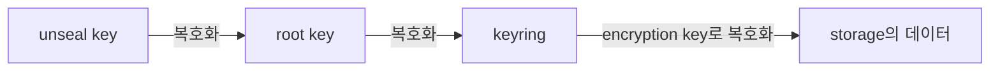
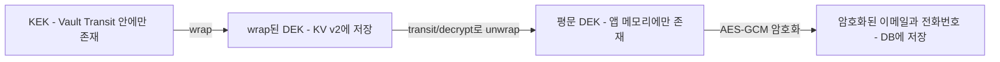
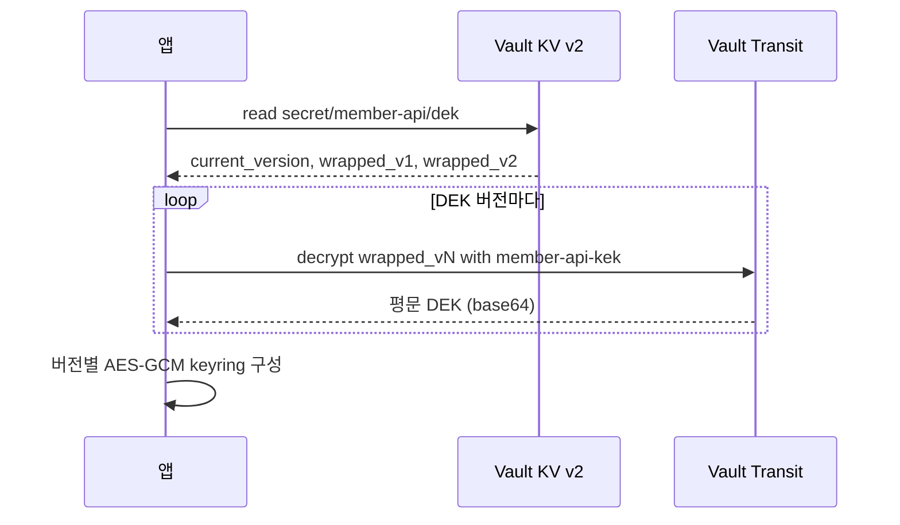

# 1. 들어가며

회원 테이블에 이메일과 전화번호를 저장해야 한다고 해 보자. DB 백업 파일이 밖으로 새거나 읽기 권한이 잘못 열리면 개인정보가 그대로 노출되므로, 이런 컬럼은 애플리케이션에서 암호화한 뒤 저장하는 경우가 많다. 그런데 암호화를 하기로 정하는 순간 바로 다음 질문이 생긴다. **암호화 키는 어디에 둘 것인가?**

가장 쉬운 방법은 키를 코드나 설정 파일, 환경 변수에 넣는 것이다. 하지만 이 방법에는 문제가 있다.

- 코드에 상수로 넣으면 git 히스토리에 영원히 남는다
- 설정 파일이나 환경 변수에 두면 배포 설정을 볼 수 있는 사람은 모두 키를 볼 수 있다
- 키를 바꾸려면 다시 배포해야 하고, 누가 언제 키를 읽었는지 기록이 남지 않는다
- DB 덤프와 설정 파일이 함께 새면 암호화한 의미가 없어진다

이 글은 암호화 키를 HashiCorp Vault에서 관리하는 방법을 다룬다. 앱은 실행할 때 Vault에서 키를 받아 메모리에만 두고, 키 자체는 Vault 안의 다른 키로 한 번 더 감싸서 보관한다. 이 구조를 envelope encryption이라고 부른다.

예전에 [Kubernetes 환경에서 Secret 안전하게 관리하기](/kubernetes-환경에서-secret-안전하게-관리하기/)에서 Sealed Secrets를 다룬 적이 있다. Sealed Secrets는 Kubernetes Secret을 git에 암호문으로 안전하게 두기 위한 도구다. 반면 Vault는 시크릿을 저장하는 저장소이면서 암호화 연산을 API로 제공하는 서비스다. 둘은 해결하는 문제의 범위가 달라서, 자세한 비교는 시리즈 3편에서 다룬다.

시리즈 구성은 다음과 같다.

| 편 | 제목 | 다루는 상황 |
|----|------|-------------|
| **1편 (이 글)** | 핵심 개념과 Transit으로 구현하는 Envelope Encryption | DB에 저장할 개인정보를 필드 단위로 암호화한다 |
| 2편 | Kubernetes에 Vault 구성하고 Agent Injector로 암호화 키 전달하기 | 1편의 앱을 Kubernetes에서 운영한다 |
| 3편 | VSO로 애플리케이션 시크릿 관리하고 Sealed Secrets에서 이전하기 | 앱 실행에 필요한 설정 시크릿을 관리한다 |

이 글에서는 다음 내용을 다룬다.

- Vault의 핵심 개념: seal/unseal, secret engine(KV v2, Transit), auth method와 token, policy
- docker compose로 로컬 dev 서버 띄우기
- envelope encryption의 구조와 키를 다루는 세 가지 방식 비교
- Go로 DEK 발급, 부팅 시 로드, 필드 암복호화, 키 회전과 재암호화 구현
- policy로 앱과 migration 역할을 나누기
- dev 모드에서 Vault를 재시작하면 데이터를 잃는 이유

> 이 글에서 사용한 전체 코드는 [GitHub](https://github.com/kenshin579/tutorials-go/tree/master/cloud/vault)에서 확인할 수 있다.

# 2. Vault 핵심 개념

## 2.1 아키텍처와 seal/unseal

Vault는 데이터를 storage backend(파일, Integrated Storage(Raft) 등)에 저장한다. 그런데 Vault는 storage backend를 신뢰하지 않는다. 공식 문서는 storage backend가 barrier 바깥에 있기 때문에 신뢰할 수 없는 대상으로 본다고 설명한다. barrier는 Vault 데이터를 암호화하고 복호화하는 계층이다. storage에는 barrier를 거쳐 암호화된 데이터만 내려간다.

이 암호화는 키 세 개가 사슬처럼 이어진 구조다.



- 데이터는 keyring 안의 encryption key로 암호화한다
- keyring은 root key로 암호화되어 있다
- root key는 unseal key로 암호화되어 있다

Vault 서버는 **sealed 상태로 시작한다.** 이 상태에서는 storage에 접근할 수는 있지만 데이터를 복호화하지 못한다. 할 수 있는 일은 unseal과 상태 확인뿐이다. unseal key를 넣어 root key를 풀어야 비로소 데이터를 읽을 수 있다. 이 과정을 unseal이라고 한다.

unseal key는 한 사람이 들고 있지 않도록 Shamir's Secret Sharing으로 여러 조각으로 나눈다. `vault operator init`의 기본값은 5개로 나누고(`-key-shares=5`) 그중 3개가 모여야(`-key-threshold=3`) root key를 복원할 수 있다. 사람이 조각을 넣는 대신 신뢰할 수 있는 장치나 클라우드 KMS 같은 서비스에 unseal을 맡기는 방식은 auto-unseal이라고 부른다.

참고로 Vault 내부의 keyring과 이 글 예제 코드의 `Keyring` 타입은 이름만 같고 서로 다른 것이다.

## 2.2 Secret Engine: KV v2와 Transit

secret engine은 Vault가 제공하는 기능 단위다. 경로에 마운트해서 쓰며, 이 글에서는 두 가지를 쓴다.

**KV v2**는 key-value 형태로 시크릿을 저장한다. 같은 키에 여러 번 쓰면 버전을 쌓아 두고(기본 10개), check-and-set(`cas`)으로 동시 쓰기를 막을 수 있다. `cas`에 현재 버전을 넘기면 그 버전일 때만 쓰기가 되고, `cas=0`이면 키가 없을 때만 쓸 수 있다. KV v2는 API 경로가 데이터(`secret/data/...`)와 메타데이터(`secret/metadata/...`)로 나뉜다. 그래서 policy에도 `secret/member-api/dek`가 아니라 `secret/data/member-api/dek`를 적어야 한다. dev 서버에는 KV v2가 `secret/`에 미리 마운트되어 있다.

**Transit**은 공식 문서 표현으로 "encryption as a service"다. 앱이 보낸 데이터를 암호화하거나 복호화해서 돌려줄 뿐, 그 데이터를 저장하지 않는다. Transit 키의 기본 타입은 `aes256-gcm96`이고, 기본 설정(`exportable=false`)에서는 키를 Vault 밖으로 꺼낼 수 없다.

이 글에서 쓰는 Transit 엔드포인트는 다음과 같다.

| 엔드포인트 | 하는 일 |
|---|---|
| `transit/keys/:name` | 키를 만든다 |
| `transit/datakey/wrapped/:name` | 새 데이터 키를 만들어 `:name` 키로 암호화한 값만 돌려준다 |
| `transit/decrypt/:name` | `:name` 키로 복호화한다 |
| `transit/keys/:name/rotate` | 키의 새 버전을 추가한다. 이후 암호화는 새 버전으로 하고, 옛 버전 암호문도 계속 복호화할 수 있다 |

`datakey`에는 `plaintext`와 `wrapped` 두 가지 타입이 있다. `plaintext`는 평문 키와 암호화된 키를 함께 돌려주고, `wrapped`는 암호화된 키만 돌려준다. 키 길이(`bits`)는 128, 256, 512 중에서 고르며 기본값은 256이다.

## 2.3 Auth Method와 Token

Vault에서 인증의 중심은 token이다. token에 붙은 policy가 그 token으로 무엇을 할 수 있는지 정한다. root token을 제외한 모든 token에는 TTL(유효 기간)이 있다. root token은 모든 권한을 가지므로, 공식 문서는 초기 설정에 필요한 만큼만 쓰고 필요가 없어지면 바로 revoke하라고 권한다.

auth method는 외부 신원을 Vault token으로 바꿔 준다. 예를 들어 Kubernetes auth method는 Pod의 ServiceAccount token을 받아 Kubernetes TokenReview API로 검증한 뒤 Vault token을 발급한다. 이 방식은 2편에서 직접 구성한다.

이 글은 개념에 집중하기 위해 auth method를 쓰지 않는다. 대신 root token으로 역할별 policy를 가진 token을 직접 발급해서 쓴다.

## 2.4 Policy

policy는 경로별로 허용할 동작(capability)을 적은 규칙이다.

```hcl
path "transit/decrypt/member-api-kek" {
  capabilities = ["update"]
}
```

- **기본은 거부다.** policy에 적지 않은 경로는 아무것도 할 수 없다
- capability는 `create`, `read`, `update`, `patch`, `delete`, `list`, `sudo`, `deny` 등이 있고, `deny`는 다른 모든 capability보다 우선한다
- capability는 HTTP 메서드에 대응하고, Vault는 POST와 PUT을 같게 취급한다. `transit/decrypt`처럼 POST로 호출하는 엔드포인트에는 `update` capability가 필요하다

# 3. 로컬 환경 구성

## 3.1 dev 서버 실행

예제는 docker compose로 Vault dev 서버를 띄운다. 이미지는 `hashicorp/vault:2.2.1`을 쓴다.

```yaml
services:
  vault:
    image: hashicorp/vault:2.2.1
    container_name: vault-envelope-demo
    # dev 모드: 메모리 스토리지, 자동 unseal, root token 고정. 학습용으로만 쓴다
    command: server -dev -dev-root-token-id=root -dev-listen-address=0.0.0.0:8200
    ports:
      - "8200:8200"
```

```bash
cd cloud/vault
docker compose up -d
docker compose logs vault | grep -E "Unseal Key|Root Token"
```

```
vault-envelope-demo  | Unseal Key: ri+uVsICdOC4WDE4/ZhY8z0r52vntcGHdok5Np7Z2dI=
vault-envelope-demo  | Root Token: root
```

dev 서버는 이미 unseal된 상태로 시작하고, 확인용으로 unseal key와 root token을 로그에 출력한다. seal 상태 API로 보면 스토리지가 메모리(`inmem`)이고 unseal key가 1개(`n=1`, `t=1`)인 것을 확인할 수 있다.

```bash
curl -s http://127.0.0.1:8200/v1/sys/seal-status | jq -c '{sealed,t,n,type,version,storage_type}'
```

```
{"sealed":false,"t":1,"n":1,"type":"shamir","version":"2.2.1","storage_type":"inmem"}
```

브라우저에서 `http://127.0.0.1:8200/ui`에 접속해 token `root`로 로그인하면 UI도 쓸 수 있다.

## 3.2 초기 설정 스크립트

`scripts/setup.sh`는 예제에 필요한 Vault 설정을 한 번에 만든다. 로컬에 `vault` CLI를 설치하지 않아도 되도록 컨테이너 안의 CLI를 `docker compose exec`로 호출한다.

```bash
vault() {
  docker compose exec -T \
    -e VAULT_ADDR=http://127.0.0.1:8200 \
    -e VAULT_TOKEN=root \
    vault vault "$@"
}

if ! vault secrets list -format=json | grep -q '"transit/"'; then
  vault secrets enable transit
fi

vault write -f transit/keys/member-api-kek > /dev/null

vault policy write member-api - < policies/member-api.hcl
vault policy write member-api-migration - < policies/member-api-migration.hcl

vault token create -policy=member-api -ttl=24h -field=token > .tokens/app.token
vault token create -policy=member-api-migration -ttl=24h -field=token > .tokens/migration.token
```

```bash
./scripts/setup.sh
```

```
Success! Enabled the transit secrets engine at: transit/
Transit KEK ready: member-api-kek
Success! Uploaded policy: member-api
Success! Uploaded policy: member-api-migration
setup done: .tokens/app.token, .tokens/migration.token
```

하는 일은 네 가지다.

- Transit secrets engine을 켠다. 이미 켜져 있으면 건너뛴다
- KEK로 쓸 Transit 키 `member-api-kek`를 만든다
- 앱용 policy `member-api`와 migration용 policy `member-api-migration`을 등록한다
- 각 policy만 가진 token을 하나씩 발급해 `.tokens/`에 저장한다

root token은 이 초기 설정에만 쓰고, 이후 명령은 모두 역할별 token으로 실행한다. 아래 명령에서 쓸 환경 변수를 미리 잡아 둔다.

```bash
export VAULT_ADDR=http://127.0.0.1:8200
APP_TOKEN=$(cat .tokens/app.token)
MIGRATION_TOKEN=$(cat .tokens/migration.token)
```

# 4. Envelope Encryption 이해하기

## 4.1 DEK와 KEK

envelope encryption은 키를 두 겹으로 쓴다.

- **DEK(Data Encryption Key)**: 실제 데이터(이메일, 전화번호)를 암호화하는 키다. 이 예제에서는 AES-256 키다
- **KEK(Key Encryption Key)**: DEK를 암호화하는 키다. Vault Transit 안에 있고 밖으로 나오지 않는다

DEK는 KEK로 암호화(wrap)한 상태로만 저장한다. 그래서 저장소에 있는 DEK를 누가 가져가도 KEK 없이는 풀 수 없다. 앱은 실행할 때 wrap된 DEK를 Vault에 보내 풀어 달라고 요청하고, 받은 평문 DEK는 메모리에만 둔다.



## 4.2 키를 다루는 세 가지 방식

Vault로 앱 데이터를 암호화하는 방법은 크게 세 가지다.

| | A. KV에 평문 DEK 저장 | B. Transit datakey(wrapped) + KV 저장 | C. Transit encrypt/decrypt 직접 호출 |
|---|---|---|---|
| 앱이 평문 키를 갖는가 | 갖는다 | 갖는다(메모리에만) | 갖지 않는다 |
| KV 읽기 권한만으로 키를 얻는가 | 얻는다 | 못 얻는다(Transit decrypt 권한도 필요) | 해당 없음 |
| 요청마다 Vault를 호출하는가 | 아니다 | 아니다(부팅할 때만) | 그렇다 |
| Vault가 멈추면 | 이미 키를 받은 앱은 계속 동작 | 이미 키를 받은 앱은 계속 동작 | 암복호화가 바로 멈춘다 |
| 키 회전 | KV 버전으로 직접 관리 | DEK는 KV 버전 필드로, KEK는 Transit rotate로 | Transit rotate와 rewrap |

C가 키를 가장 엄격하게 지킨다. 평문 키가 Vault 밖으로 나오지 않기 때문이다. 대신 모든 암복호화가 네트워크 왕복이 되어 지연이 생기고, Vault 가용성에 서비스가 그대로 묶인다.

A는 가장 단순하지만 KV를 읽을 수 있는 token 하나만 새도 키가 넘어간다.

## 4.3 이 글이 B를 고른 이유

이 글은 B를 구현한다.

- DEK를 `transit/datakey/wrapped`로 발급하면 응답에 wrap된 DEK만 온다. 발급 과정에서 평문 DEK가 노출되지 않는다
- KV에는 wrap된 DEK만 있으므로, 키를 얻으려면 KV 읽기 권한과 Transit decrypt 권한이 **둘 다** 필요하다
- 암복호화는 앱 메모리에서 하므로 요청마다 Vault를 호출하지 않는다

대가도 있다. 실행 중인 앱의 메모리에는 평문 DEK가 있고, DEK를 바꾼 뒤 기존 데이터를 새 DEK로 다시 암호화하는 일은 앱 쪽에서 직접 해야 한다.

KV v2 문서 `secret/member-api/dek`에는 다음 필드를 둔다. DEK를 회전해도 옛 버전 필드는 지우지 않아야 옛 데이터를 계속 복호화할 수 있다.

```
current_version = "2"           # 암호화에 쓰는 DEK 버전
wrapped_v1      = "vault:v1:…"  # KEK로 wrap된 DEK v1
wrapped_v2      = "vault:v1:…"  # KEK로 wrap된 DEK v2
```

`vault:v1:` 접두사는 Transit이 붙이는 것으로, 이 DEK를 wrap한 **KEK의 버전**이다. `wrapped_v2`의 `v2`는 **DEK의 버전**이다. 둘은 서로 다른 버전 번호다.

# 5. Go로 구현하기

코드는 세 패키지로 나뉜다.

| 패키지 | 역할 |
|---|---|
| `envelope` | `Keyring`(버전별 AES-GCM)과 Vault 연동(`InitDEK`, `RotateDEK`, `LoadKeyring`) |
| `member` | 회원 이메일·전화번호를 필드 단위로 암호화하는 JSON 파일 저장소 |
| `cmd/member-cli` | 예제 CLI. 앱 역할(`put`, `get`)과 migration 역할(`init-dek`, `rotate-dek`, `reencrypt`) |

Vault 클라이언트는 공식 `github.com/hashicorp/vault/api`(v1.23.0)를 쓴다. 회원 저장소는 예제를 단순하게 하려고 DB 대신 JSON 파일로 만들었다.

## 5.1 KEK 생성과 DEK 발급

KEK는 3.2절의 `setup.sh`가 이미 만들었다. DEK 발급은 `RotateDEK`가 맡는다. 현재 KV 문서를 읽고, Transit에 새 DEK를 요청한 뒤, 기존 필드를 모두 유지한 채 새 버전 필드를 더해서 쓴다.

```go
resp, err := c.Logical().WriteWithContext(ctx, "transit/datakey/wrapped/"+cfg.KEKName, map[string]interface{}{
	"bits": dekBits, // 256
})
if err != nil {
	return 0, fmt.Errorf("generate DEK with %s: %w", cfg.KEKName, err)
}
wrapped, _ := resp.Data["ciphertext"].(string)

data[wrappedField(next)] = wrapped
data[currentVersionField] = strconv.Itoa(int(next))
if err := writeDEK(ctx, c, cfg, data, cas); err != nil {
	return 0, err
}
```

KV에 쓸 때는 check-and-set(CAS)을 건다. 읽을 때 본 KV 버전을 `cas`로 넘기면, 그 사이에 누가 먼저 썼을 경우 Vault가 쓰기를 거부한다. migration이 동시에 두 번 돌아도 한쪽이 만든 DEK 버전을 다른 쪽이 덮어쓰지 않는다.

```go
func writeDEK(ctx context.Context, c *vaultapi.Client, cfg Config, data map[string]interface{}, cas int) error {
	if _, err := c.KVv2(cfg.KVMount).Put(ctx, cfg.KVPath, data, vaultapi.WithCheckAndSet(cas)); err != nil {
		return fmt.Errorf("write DEK %s/%s: %w", cfg.KVMount, cfg.KVPath, err)
	}
	return nil
}
```

`InitDEK`는 문서가 없을 때만 `RotateDEK`를 불러 v1을 만든다. 두 번 실행해도 결과가 같다.

```bash
VAULT_TOKEN=$MIGRATION_TOKEN go run ./cmd/member-cli init-dek
VAULT_TOKEN=$MIGRATION_TOKEN go run ./cmd/member-cli init-dek
```

```
DEK v1 created
DEK already exists, skipped
```

KV에는 wrap된 DEK만 들어 있다.

```bash
vault kv get secret/member-api/dek   # root token
```

```
========= Data =========
Key                Value
---                -----
current_version    1
wrapped_v1         vault:v1:8zDaIVly51ZlcQq+ulUFAlf0gSV9w7QEj0Cva0TSWp/F5uXVnvVVrwMSK7enqhcqZuO2mQpmco6xe2bz
```

## 5.2 앱 부팅 시 DEK 로드

앱은 시작할 때 `LoadKeyring`을 호출한다. KV에서 wrap된 DEK를 모두 읽고, 버전마다 `transit/decrypt`로 풀어서 keyring을 만든다.



```go
func LoadKeyring(ctx context.Context, c *vaultapi.Client, cfg Config) (*Keyring, error) {
	secret, err := c.KVv2(cfg.KVMount).Get(ctx, cfg.KVPath)
	if errors.Is(err, vaultapi.ErrSecretNotFound) {
		return nil, fmt.Errorf("%w: %s/%s", ErrDEKNotInitialized, cfg.KVMount, cfg.KVPath)
	}
	if err != nil {
		return nil, fmt.Errorf("read DEK %s/%s: %w", cfg.KVMount, cfg.KVPath, err)
	}

	current, wrapped, err := parseDEKData(secret.Data)
	if err != nil {
		return nil, err
	}

	keys := make(map[uint8][]byte, len(wrapped))
	for version, ciphertext := range wrapped {
		key, err := unwrapDEK(ctx, c, cfg.KEKName, ciphertext)
		if err != nil {
			return nil, fmt.Errorf("unwrap DEK v%d: %w", version, err)
		}
		keys[version] = key
	}
	return NewKeyring(current, keys)
}
```

옛 버전 DEK까지 모두 푸는 이유는 옛 버전으로 암호화된 데이터를 읽어야 하기 때문이다. 암호화는 항상 `current_version`으로만 한다.

이 구조에서는 **Vault에 접속할 수 없으면 앱이 시작하지 못한다.** 부팅할 때 DEK를 받아야 하기 때문이다. Kubernetes에서 이 지점이 어떤 문제를 만드는지는 2편에서 다룬다.

## 5.3 필드 암복호화

`Keyring`은 AES-256-GCM으로 암호화한다. 암호문 맨 앞 1바이트에 DEK 버전을 적어 두기 때문에, 복호화할 때 어떤 버전의 키를 써야 하는지 암호문만 보고 알 수 있다.

```
[1바이트 DEK 버전][12바이트 nonce][AES-GCM 암호문 + 16바이트 tag]
```

```go
func (k *Keyring) Encrypt(plaintext []byte) ([]byte, error) {
	nonce := make([]byte, nonceSize)
	if _, err := rand.Read(nonce); err != nil {
		return nil, err
	}

	blob := make([]byte, 0, 1+nonceSize+len(plaintext)+tagSize)
	blob = append(blob, k.current)
	blob = append(blob, nonce...)
	return k.aeads[k.current].Seal(blob, nonce, plaintext, nil), nil
}
```

GCM은 nonce를 같은 키로 재사용하면 안전성이 깨지므로 암호화할 때마다 `crypto/rand`로 새로 만든다. 그래서 같은 이메일을 두 번 암호화해도 결과가 매번 다르다.

app token으로 회원을 저장하고 다시 읽어 보자.

```bash
VAULT_TOKEN=$APP_TOKEN go run ./cmd/member-cli put --id alice --email alice@example.com --phone 010-1234-5678
cat data/members.json
VAULT_TOKEN=$APP_TOKEN go run ./cmd/member-cli get --id alice
```

```
saved alice
{
  "members": [
    {
      "id": "alice",
      "email": "ATeT5t1JI4YWCFzDNaCQXN21ibPaigQLYfyTcF1quCVhNrizk+3NCv3m15CpJA==",
      "phone": "AUKZZ/P0spGkjhQx3XN5qcW2fEF2uIC0iaz2zWeAX6KAxmZia+jwq+At"
    }
  ]
}
id=alice email=alice@example.com phone=010-1234-5678
```

파일에는 base64로 인코딩한 암호문만 있다. 두 필드 모두 `A`로 시작하는데, 첫 바이트가 DEK 버전 `0x01`이기 때문이다.

## 5.4 키 회전과 재암호화

DEK를 바꾸는 순서는 다음과 같다.

1. `rotate-dek`로 DEK v2를 추가하고 `current_version`을 2로 올린다. v1은 그대로 남는다
2. 앱이 keyring을 다시 로드하면 새 데이터는 v2로 암호화되고, 기존 데이터는 v1로 계속 읽힌다
3. `reencrypt`로 v1 데이터를 v2로 다시 암호화한다

```bash
VAULT_TOKEN=$MIGRATION_TOKEN go run ./cmd/member-cli rotate-dek
jq -r '.members[0].email' data/members.json | base64 -d | head -c 1 | xxd -p   # 암호문의 DEK 버전
VAULT_TOKEN=$MIGRATION_TOKEN go run ./cmd/member-cli reencrypt
jq -r '.members[0].email' data/members.json | base64 -d | head -c 1 | xxd -p
VAULT_TOKEN=$MIGRATION_TOKEN go run ./cmd/member-cli reencrypt
VAULT_TOKEN=$APP_TOKEN go run ./cmd/member-cli get --id alice
```

```
DEK rotated: current_version=2
01
re-encrypted 1 member(s)
02
re-encrypted 0 member(s)
id=alice email=alice@example.com phone=010-1234-5678
```

재암호화는 현재 버전이 아닌 필드만 다시 암호화하므로, 두 번째 실행에서는 0건이다. 회전한 뒤에도 KV의 `wrapped_v1`은 그대로 남아 있다.

```
current_version    2
wrapped_v1         vault:v1:8zDaIVly51ZlcQq+ulUFAlf0gSV9w7QEj0Cva0TSWp/F5uXVnvVVrwMSK7enqhcqZuO2mQpmco6xe2bz
wrapped_v2         vault:v1:P61i73WJPrO2k57+v3KNGZO978qZv13qvxmxpdAn4TZtu+tEGSfh0bB8JVwbYbbrxMsXDyPzkX1pN26O
```

`wrapped_v1`은 v1로 암호화된 데이터가 하나도 남지 않은 것을 확인한 뒤에 지워야 한다. 먼저 지우면 아직 재암호화하지 못한 데이터를 읽을 수 없게 된다.

## 5.5 policy로 역할 나누기

이 예제는 앱과 migration에 서로 다른 policy를 준다.

```hcl
# policies/member-api.hcl: 앱은 wrap된 DEK를 읽고 KEK로 unwrap만 한다
path "secret/data/member-api/dek" {
  capabilities = ["read"]
}

path "transit/decrypt/member-api-kek" {
  capabilities = ["update"]
}
```

```hcl
# policies/member-api-migration.hcl: DEK 발급·적재·교체와 재암호화에 필요한 만큼만 준다
path "transit/datakey/wrapped/member-api-kek" {
  capabilities = ["update"]
}

path "transit/decrypt/member-api-kek" {
  capabilities = ["update"]
}

path "secret/data/member-api/dek" {
  capabilities = ["create", "update", "read"]
}
```

| 역할 | 할 수 있는 일 | 할 수 없는 일 |
|---|---|---|
| 앱(`member-api`) | DEK 읽기와 unwrap, 데이터 암복호화 | DEK 발급·교체 |
| migration(`member-api-migration`) | DEK 발급·적재·교체, 재암호화 | KEK 생성·회전·삭제 |
| 관리자(이 예제에서는 root) | KEK 관리, policy 관리 | - |

앱이 털리더라도 DEK를 바꿔치기할 수 없고, migration 작업이 KEK를 건드릴 수도 없다. 실제로 app token으로 DEK를 바꾸려고 하면 403이 난다.

```bash
VAULT_TOKEN=$APP_TOKEN go run ./cmd/member-cli rotate-dek
```

```
error: generate DEK with member-api-kek: Error making API request.

URL: PUT http://127.0.0.1:8200/v1/transit/datakey/wrapped/member-api-kek
Code: 403. Errors:

* 1 error occurred:
	* permission denied
```

migration token으로 KEK를 회전하려고 해도 마찬가지로 거부된다.

```bash
vault write -f transit/keys/member-api-kek/rotate   # migration token
```

```
Error writing data to transit/keys/member-api-kek/rotate: Error making API request.

URL: PUT http://127.0.0.1:8200/v1/transit/keys/member-api-kek/rotate
Code: 403. Errors:

* 1 error occurred:
	* permission denied
```

두 경우는 `envelope/vault_integration_test.go`에서 testcontainers로 띄운 Vault에 대해 테스트로도 확인한다.

# 6. dev 모드가 감추는 것

지금까지 쓴 dev 서버는 데이터를 메모리에만 둔다. Vault를 재시작하면 어떻게 되는지 보자.

```bash
docker compose restart vault
./scripts/setup.sh
APP_TOKEN=$(cat .tokens/app.token); MIGRATION_TOKEN=$(cat .tokens/migration.token)

VAULT_TOKEN=$APP_TOKEN go run ./cmd/member-cli get --id alice
VAULT_TOKEN=$MIGRATION_TOKEN go run ./cmd/member-cli init-dek
VAULT_TOKEN=$APP_TOKEN go run ./cmd/member-cli get --id alice
VAULT_TOKEN=$MIGRATION_TOKEN go run ./cmd/member-cli rotate-dek
VAULT_TOKEN=$APP_TOKEN go run ./cmd/member-cli get --id alice
```

```
error: DEK not initialized: secret/member-api/dek
DEK v1 created
error: decrypt email of alice: unknown key version: 2
DEK rotated: current_version=2
error: decrypt email of alice: cipher: message authentication failed
```

세 번의 실패는 원인이 각각 다르다.

- 첫 번째: 재시작하면서 KV가 비었다
- 두 번째: 파일의 데이터는 DEK v2로 암호화되어 있는데, 새로 만든 DEK에는 v1만 있다
- 세 번째: 버전 번호(v2)는 같지만 완전히 다른 키다. AES-GCM이 인증 실패로 복호화를 거부한다

`setup.sh`를 다시 실행하면 이름이 같은 `member-api-kek`가 생기지만, 재시작 전의 KEK와는 다른 키다. 그 KEK로 wrap했던 DEK도, 그 DEK로 암호화한 데이터도 이제 풀 방법이 없다. `data/members.json`은 그대로 남아 있지만 더는 읽을 수 없다. 이것은 키 회전이 아니라 **키 분실**이다.

실제 운영에서는 이렇게 되지 않도록 다음을 갖춘다.

- 데이터를 Integrated Storage(Raft) 같은 영구 스토리지에 저장한다. 재시작해도 KEK와 DEK가 그대로 남는다
- 처음 한 번 `vault operator init`으로 초기화하면 unseal key 조각과 root token이 나온다. 이 조각들을 안전하게 나눠 보관한다
- 재시작한 Vault는 sealed 상태로 뜬다. unseal key 조각을 모아 unseal하거나 auto-unseal을 구성해야 다시 쓸 수 있다
- Transit 키는 기본 설정에서 Vault 밖으로 꺼낼 수 없다. 그래서 Vault 스토리지를 백업하는 것이 곧 KEK를 백업하는 것이다

2편에서는 Kubernetes에 Raft 스토리지로 Vault를 띄우고 init과 unseal을 직접 해 본다.

# 7. FAQ

## 7.1 Transit encrypt API를 바로 쓰면 더 안전하지 않은가?

그렇다. `transit/encrypt`와 `transit/decrypt`로 데이터를 직접 암복호화하면 평문 키가 Vault 밖으로 나오지 않는다(4.2절의 C). 대신 모든 암복호화가 Vault 호출이 되어 지연이 늘고, Vault가 멈추면 암복호화도 바로 멈춘다. 처리량이 적거나 키 노출을 특히 엄격하게 막아야 하는 데이터라면 C가 맞고, 요청이 많은 서비스라면 이 글의 B가 현실적인 선택이다.

## 7.2 앱 메모리에 평문 DEK가 있어도 괜찮은가?

이 구조가 막는 것은 DB나 백업 파일, 설정 파일이 새는 경우다. 실행 중인 앱 프로세스 자체를 공격자가 장악하는 경우는 막지 못한다. 그런 경우라면 공격자가 앱의 권한으로 데이터를 복호화할 수 있기 때문이다. 그래서 앱 token에는 5.5절처럼 필요한 최소 권한만 주고, DEK를 바꾸는 권한은 따로 떼어 둔다.

## 7.3 KEK는 회전하지 않아도 되는가?

KEK도 회전할 수 있다. Transit의 `transit/keys/:name/rotate`는 KEK의 새 버전을 추가하고, 이후 새로 wrap하는 DEK는 새 버전으로 암호화된다. 이미 KV에 있는 wrap된 DEK는 `transit/rewrap/:name`으로 최신 KEK 버전으로 다시 감쌀 수 있다. 공식 문서는 rewrap이 평문을 돌려주지 않기 때문에 신뢰할 수 없는 사용자나 스크립트에게 맡겨도 된다고 설명한다. 이 예제에서는 KEK 관리를 관리자 역할로 남겨 두고 구현하지 않았다.

## 7.4 암호화한 이메일로 회원을 검색하려면 어떻게 하는가?

이 예제의 암호문은 같은 이메일이라도 매번 달라서 `WHERE email = ?` 같은 검색을 할 수 없다. 검색이 필요하다면 암호문과 별도로 이메일의 HMAC 값을 저장해 두고 그 값으로 찾는 방법이 있다. Transit에는 지정한 키로 HMAC을 계산하는 `transit/hmac/:name` 엔드포인트가 있다. 다만 HMAC 값이 같으면 원문도 같다는 정보가 드러나므로, 어떤 컬럼에 적용할지는 따져 봐야 한다.

# 8. 마무리

정리하면 다음과 같다.

- 암호화 키를 코드나 설정에 두면 설정이 새는 순간 암호화한 의미가 사라진다
- envelope encryption은 데이터를 DEK로, DEK를 KEK로 암호화하고 wrap된 DEK만 저장한다
- Vault Transit의 `datakey/wrapped`로 DEK를 발급하면 평문 DEK가 발급 과정에서 노출되지 않는다
- DEK는 KV v2에 버전 필드로 쌓고, 옛 버전은 재암호화가 끝난 뒤에 지운다
- policy로 앱과 migration의 권한을 나누면 한쪽이 털려도 피해 범위가 줄어든다
- dev 모드는 재시작하면 KEK를 잃는다. 실제 운영에는 영구 스토리지와 백업이 필요하다

다음 2편에서는 이 앱을 Kubernetes에 올린다. Vault를 Raft 스토리지로 운영하듯 구성하고, 앱 Pod가 Vault token을 직접 다루지 않도록 Agent Injector로 DEK를 전달하는 방법을 다룬다.

# 9. 참고

- [Seal/Unseal - HashiCorp Vault](https://developer.hashicorp.com/vault/docs/concepts/seal)
- [Architecture - HashiCorp Vault](https://developer.hashicorp.com/vault/docs/internals/architecture)
- [operator init - Command](https://developer.hashicorp.com/vault/docs/commands/operator/init)
- ["Dev" server mode](https://developer.hashicorp.com/vault/docs/concepts/dev-server)
- [KV secrets engine](https://developer.hashicorp.com/vault/docs/secrets/kv)
- [KV secrets engine - version 2 (API)](https://developer.hashicorp.com/vault/api-docs/secret/kv/kv-v2)
- [Transit secrets engine](https://developer.hashicorp.com/vault/docs/secrets/transit)
- [Transit secrets engine (API)](https://developer.hashicorp.com/vault/api-docs/secret/transit)
- [Policies](https://developer.hashicorp.com/vault/docs/concepts/policies)
- [Tokens](https://developer.hashicorp.com/vault/docs/concepts/tokens)
- [Authentication](https://developer.hashicorp.com/vault/docs/concepts/auth)
- [Kubernetes auth method](https://developer.hashicorp.com/vault/docs/auth/kubernetes)
- [Kubernetes 환경에서 Secret 안전하게 관리하기](/kubernetes-환경에서-secret-안전하게-관리하기/)
- [예제 코드: tutorials-go/cloud/vault](https://github.com/kenshin579/tutorials-go/tree/master/cloud/vault)
