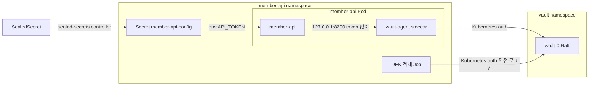
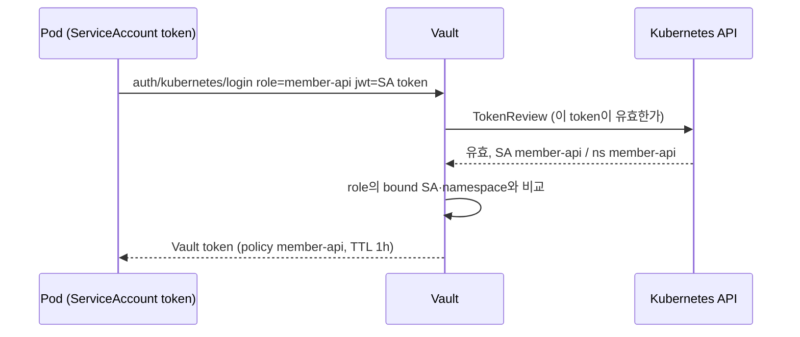
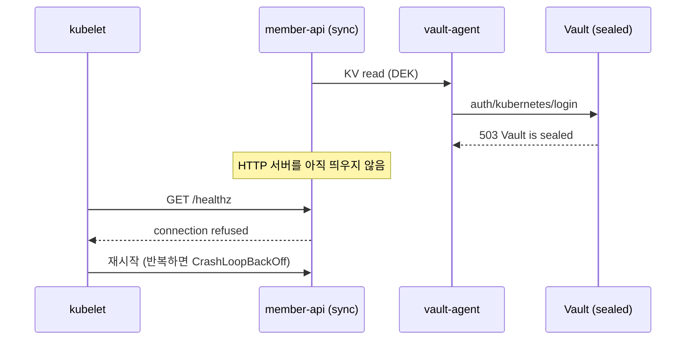

# 1. 들어가며

[1편](/hashicorp-vault-실전-가이드-1-핵심-개념과-transit-envelope-encryption/)에서는 회원 이메일과 전화번호를 필드 단위로 암호화하는 envelope encryption을 Docker 위의 Vault dev 서버로 구현했다. KEK는 Vault Transit 안에 두고, KEK로 wrap한 DEK만 KV v2에 저장하고, 앱은 부팅할 때 DEK를 받아 메모리에만 둔다.

이번 글은 같은 앱을 **Kubernetes 위에서** 운영하는 상황을 다룬다. 가장 쉬운 방법은 DEK를 Kubernetes Secret에 넣고 env로 받는 것이다. 하지만 그러면 평문 DEK가 etcd에 저장되고, Secret을 읽을 권한이 있는 사람은 누구나 DEK를 볼 수 있다. 1편에서 DEK를 메모리에만 두려고 했던 이유가 사라진다. 또한 앱이 Vault token을 직접 발급받고 갱신하는 코드도 줄이고 싶다.

이 글은 이 두 가지를 Vault Agent Injector로 해결한다. Pod에 Vault Agent sidecar를 붙이면, Agent가 Pod의 ServiceAccount로 Vault에 로그인하고 token을 관리한다. 앱은 `127.0.0.1:8200`으로 token 없이 Vault API를 호출하고, DEK는 앱 메모리에만 남는다.

| 편 | 제목 | 다루는 상황 |
|----|------|-------------|
| 1편 | 핵심 개념과 Transit으로 구현하는 Envelope Encryption | DB에 저장할 개인정보를 필드 단위로 암호화한다 |
| **2편 (이 글)** | Kubernetes에 Vault 구성하고 Agent Injector로 암호화 키 전달하기 | 1편의 앱을 Kubernetes에서 운영한다 |
| 3편 | VSO로 애플리케이션 시크릿 관리하고 Sealed Secrets에서 이전하기 | 앱 실행에 필요한 설정 시크릿을 관리한다 |

이 글에서는 다음 내용을 다룬다.

- Kubernetes에서 Vault를 쓰는 방법 네 가지와 이 글이 Agent Injector를 고른 이유
- Helm chart로 Raft 스토리지를 쓰는 Vault를 띄우고 init, unseal, audit, snapshot까지 운영처럼 구성하기
- Kubernetes auth의 동작 흐름과 역할별 권한 분리
- Agent Injector 어노테이션과 sidecar 전용(proxy) 구성
- Vault가 sealed일 때 생기는 부팅 블로킹을 재현하고 비동기 로드와 readinessProbe로 해결하기

> 이 글에서 사용한 전체 코드는 [GitHub](https://github.com/kenshin579/argocd-charts-sample/tree/main/secret-management)에서 확인할 수 있다. ArgoCD가 GitHub에서 chart를 가져오고 SealedSecret은 봉인한 클러스터의 키로만 풀리므로, 직접 따라 하려면 저장소를 fork해서 `make seal` 결과를 push해야 한다. 절차는 README에 정리했다.

전체 구성은 다음과 같다.



설정 시크릿(외부 API 토큰)은 기존처럼 SealedSecret으로 두었다. Sealed Secrets는 예전에 쓴 [Kubernetes 환경에서 Secret 안전하게 관리하기](/kubernetes-환경에서-secret-안전하게-관리하기/)에서 다뤘고, 이 시크릿을 Vault로 옮기는 과정은 3편에서 다룬다.

# 2. Kubernetes에서 Vault를 쓰는 방법

HashiCorp 공식 문서는 Kubernetes 워크로드에 Vault 시크릿을 전달하는 방법으로 Agent Injector, CSI provider, Vault Secrets Operator(VSO)를 비교한다. 여기에 앱이 Vault API를 직접 호출하는 방법을 더하면 네 가지다.

| 방법 | 시크릿이 놓이는 곳 | 앱 수정 | 적합한 경우 |
|---|---|---|---|
| Agent Injector | Pod의 ephemeral volume 또는 Agent 메모리 | 필요(파일이나 localhost로 읽음) | 여러 시크릿을 템플릿으로 묶거나 다양한 auth method가 필요한 앱 |
| CSI provider | ephemeral volume | Pod spec 수정 | Vault 외의 시크릿 저장소도 함께 쓰는 조직 |
| VSO | Kubernetes Secret(기본은 etcd에 저장) | 없음 | Kubernetes 방식 그대로 쓰고 싶은 팀 |
| 앱이 직접 호출 | 앱 메모리 | SDK 연동, token 관리 코드 필요 | 팀이 직접 소유한 앱 |

위 세 방식의 "시크릿이 놓이는 곳"과 "적합한 경우"는 공식 비교 문서를 따랐고, "앱이 직접 호출" 행과 "앱 수정" 열은 이 글의 판단이다.

공식 문서는 기본 권장 방식을 정하지 않는다. 선택을 가르는 질문은 "이 시크릿이 Kubernetes Secret(etcd)에 평문으로 남아도 되는가"다. DEK는 etcd에 남으면 안 되는 시크릿이고, 앱이 Transit API(`transit/decrypt`)를 직접 호출해야 하므로 이 글은 **Agent Injector를 API proxy로** 쓴다. 남아도 되는 설정 시크릿을 VSO로 다루는 방법은 3편에서 본다.

# 3. Vault를 운영처럼 배포하기

## 3.1 Helm chart의 Raft 모드

Vault는 공식 Helm chart(0.34.1)로 설치하고 ArgoCD Application으로 관리한다. chart의 standalone 모드는 file storage backend를 쓴다. 이 글은 운영 환경에서 쓰는 Integrated Storage(Raft)를 쓰려고 chart의 Raft 모드를 replica 1로 켰다. 실습용 kind 클러스터가 노드 1개라 여러 대를 띄워도 의미가 없기 때문이다.

```yaml
server:
  image:
    tag: "2.2.1"
  dataStorage:
    size: 1Gi
  # chart 의 raft 모드를 replica 1 로 쓴다(단일 노드 Integrated Storage)
  ha:
    enabled: true
    replicas: 1
    raft:
      enabled: true
injector:
  agentImage:
    tag: "2.2.1"
```

chart 기본값은 TLS를 끈 상태(`tls_disable = 1`)다. 공식 문서는 단일 서버로 도는 standalone 모드가 운영 구성에 맞지 않는다고 명시하는데, 이 글의 replica 1 Raft도 같은 이유로 실습용이다. 운영에서는 3대 이상의 Raft와 auto-unseal을 구성하고, **TLS는 필수다.** TLS가 없으면 Agent와 Vault 사이에서 unwrap된 DEK, ServiceAccount token, Vault token이 평문 HTTP로 지나간다. 이 글에서 "DEK는 앱 메모리에만 남는다"는 말은 저장 위치에 대한 것이고, 전송 구간은 TLS로 보호해야 한다.

Agent Injector는 실행 중에 MutatingWebhookConfiguration의 `caBundle`을 직접 채운다. ArgoCD의 selfHeal이 이 값을 원래대로 되돌리지 않도록 비교 대상에서 뺐다.

```yaml
ignoreDifferences:
  - group: admissionregistration.k8s.io
    kind: MutatingWebhookConfiguration
    jqPathExpressions:
      - .webhooks[]?.clientConfig.caBundle
```

## 3.2 init과 unseal

설치 직후 `vault-0`은 `0/1`이다. chart의 readinessProbe가 `vault status`의 종료 코드를 보는데, 초기화 전이거나 sealed면 실패하기 때문이다.

```
NAME                                    READY   STATUS    RESTARTS   AGE
vault-0                                 0/1     Running   0          66s
vault-agent-injector-7cf96b9c79-rdwg9   1/1     Running   0          66s
```

`make vault-init`은 unseal key를 3개로 나누고 2개가 모이면 unseal할 수 있게 초기화한다(`-key-shares=3 -key-threshold=2`). 출력(unseal key, root token)은 `.vault/init.json`에 저장한다. 이미 초기화된 Vault에서 다시 실행하면 아무것도 쓰지 않는다. 기존 unseal key를 덮어쓰면 복구할 방법이 없기 때문이다.

```bash
make vault-init
make vault-unseal
make vault-status
```

```
initialized: unseal key 3개(threshold 2)와 root token 을 .../secret-management/.vault/init.json 에 저장했다
unsealed: sealed=false
Key                     Value
---                     -----
Seal Type               shamir
Initialized             true
Sealed                  false
Total Shares            3
Threshold               2
Version                 2.2.1
...
Storage Type            raft
...
HA Enabled              true
...
HA Mode                 active
...
```

1편의 dev 서버와 가장 크게 다른 점은 재시작했을 때 드러난다. `vault-0`을 지우면 Raft 데이터가 PVC에 남아 있으므로 초기화 상태는 그대로이고, Vault는 sealed 상태로 다시 시작한다.

```
$ kubectl --context kind-argo-cluster -n vault delete pod vault-0
$ kubectl --context kind-argo-cluster -n vault wait --for=jsonpath='{.status.phase}'=Running pod/vault-0 --timeout=120s
$ make vault-status | grep -E "Initialized|Sealed"
Initialized             true
Sealed                  true
```

1편에서는 재시작하면 KEK가 사라졌지만, 여기서는 unseal만 하면 같은 KEK를 그대로 쓴다. 대신 **누군가 unseal하기 전까지 Vault는 아무 요청도 처리하지 않는다.** 이 점이 6절의 부팅 블로킹으로 이어진다.

## 3.3 root token과 audit

root token은 모든 권한을 가지므로 초기 설정에만 쓴다. `make vault-setup`이 root token으로 secret engine(kv-v2, Transit), KEK, policy, Kubernetes auth를 만들고, 그 뒤의 접근은 모두 ServiceAccount 기반 로그인으로 한다. 실습 편의상 root token은 `.vault/init.json`에 남겨 두지만, 운영에서는 초기 설정이 끝나면 revoke한다.

같은 스크립트에서 audit device도 켠다. 컨테이너 환경에서는 공식 문서대로 stdout에 남기는 방식이 편하다.

```bash
vault audit enable file file_path=stdout
```

이후 모든 요청과 응답이 `vault-0`의 로그에 JSON으로 남는다. 누가 어떤 경로를 읽었는지는 3편에서 Sealed Secrets와 비교할 때 다시 본다.

# 4. Kubernetes auth 이해하기

## 4.1 로그인 흐름

Kubernetes auth method는 Pod의 ServiceAccount token을 받아 Vault token으로 바꿔 준다.



Vault가 같은 클러스터 안에 있으면 설정은 `kubernetes_host` 하나면 된다. `token_reviewer_jwt`를 생략하면 Vault는 자기 Pod의 ServiceAccount token으로 TokenReview API를 호출하고, Helm chart는 그 권한(`system:auth-delegator`)을 Vault ServiceAccount에 묶는 ClusterRoleBinding을 기본으로 만든다.

## 4.2 role 설정

```bash
vault write auth/kubernetes/config kubernetes_host=https://kubernetes.default.svc

vault write auth/kubernetes/role/member-api \
  bound_service_account_names=member-api \
  bound_service_account_namespaces=member-api \
  token_policies=member-api \
  token_ttl=1h

vault write auth/kubernetes/role/member-api-migration \
  bound_service_account_names=member-api-migration \
  bound_service_account_namespaces=member-api \
  token_policies=member-api-migration \
  token_ttl=10m
```

공식 문서 예시는 `policies`와 `ttl`을 쓰지만, API 문서에서 두 필드는 deprecated이고 `token_policies`와 `token_ttl`을 쓰라고 안내한다. role을 만들 때 다음 경고가 나온다.

```
WARNING! The following warnings were returned from Vault:

  * Role member-api does not have an audience configured. While audiences are
  not required, consider specifying one if your use case would benefit from
  additional JWT claim verification.
```

`audience`는 필수가 아니다. 지정하면 ServiceAccount token의 `aud` claim까지 검증한다.

role에 묶인 ServiceAccount의 token으로 로그인하면 해당 policy를 가진 Vault token이 발급된다.

```
$ JWT=$(kubectl --context kind-argo-cluster -n member-api create token member-api)
$ kubectl --context kind-argo-cluster -n vault exec -i vault-0 -- vault write auth/kubernetes/login role=member-api jwt="$JWT"
Key                                       Value
---                                       -----
token                                     hvs.****
...
token_duration                            1h
...
token_policies                            ["default" "member-api"]
...
token_meta_role                           member-api
token_meta_service_account_name           member-api
token_meta_service_account_namespace      member-api
...
```

다른 ServiceAccount의 token으로 같은 role에 로그인하면 거부된다.

```
Code: 403. Errors:

* service account name not authorized
```

## 4.3 역할별 권한

1편에서 token으로 나눴던 역할을 여기서는 ServiceAccount로 나눈다.

| 역할 | 주체 | 권한 |
|---|---|---|
| 인프라 담당 | root token으로 `vault-setup` 실행 | secret engine, KEK, policy, auth 설정 |
| DEK 적재 | Job, SA `member-api-migration` | DEK 발급·적재(`transit/datakey/wrapped`, KV 쓰기) |
| 앱 | Pod, SA `member-api` | DEK 읽기와 unwrap(KV 읽기, `transit/decrypt`) |

앱 Pod가 침해되더라도 DEK를 다른 키로 교체할 수 없고, DEK 적재 Job은 KEK를 변경할 수 없다.

# 5. Agent Injector로 DEK 전달하기

## 5.1 어노테이션

Agent Injector는 Pod 생성 요청을 가로채는 mutating webhook이다. Pod 템플릿에 붙인 어노테이션을 보고 Vault Agent 컨테이너를 추가한다.

```yaml
annotations:
  vault.hashicorp.com/agent-inject: "true"
  vault.hashicorp.com/role: "member-api"
  # init container 없이 sidecar 만 둔다. sidecar 는 API proxy(127.0.0.1:8200)로만 쓴다
  vault.hashicorp.com/agent-pre-populate: "false"
  vault.hashicorp.com/agent-cache-enable: "true"
  vault.hashicorp.com/agent-cache-use-auto-auth-token: "true"
  vault.hashicorp.com/auth-max-backoff: "10s"
  vault.hashicorp.com/agent-image: "hashicorp/vault:2.2.1"
```

| 어노테이션 | 의미 |
|---|---|
| `agent-inject` | Agent를 주입한다 |
| `role` | Agent가 Kubernetes auth로 로그인할 role |
| `agent-pre-populate` | init container를 넣을지 정한다. 기본값은 `true` |
| `agent-cache-enable` | Agent의 cache와 API proxy 리스너(`127.0.0.1:8200`)를 켠다 |
| `agent-cache-use-auto-auth-token` | token이 없는 요청에 Agent가 로그인해서 받은 token을 붙인다 |
| `auth-max-backoff` | 로그인 재시도 간격의 최대값. 기본값은 5분이다 |

`agent-cache-use-auto-auth-token`은 공식 문서에는 "기본 비활성"으로 되어 있지만, vault-k8s 소스의 기본값은 `"true"`다. 문서와 소스의 기본값이 어긋나므로 값을 명시했다. `auth-max-backoff`를 줄인 이유는 6절에서 나온다.

Injector는 앱 컨테이너에 `VAULT_ADDR`를 넣어 주지 않는다(vault-k8s 소스 기준). 그래서 앱 컨테이너에 직접 넣었다.

```yaml
env:
  - name: VAULT_ADDR
    value: http://127.0.0.1:8200
```

## 5.2 init container와 sidecar

Injector가 넣는 Agent는 두 종류다. init container는 앱보다 먼저 떠서 시크릿을 파일로 렌더링한 뒤 종료하고, sidecar는 앱과 함께 떠서 시크릿을 갱신한다. 기본값은 둘 다 넣는 것이다.

이 앱은 시크릿을 파일로 받지 않고 Vault API(KV 읽기, `transit/decrypt`)를 직접 호출하므로 sidecar의 proxy만 있으면 된다. `agent-pre-populate: "false"`로 init container를 뺐다.

```
init=[] containers=[member-api vault-agent]
```

앱 코드는 1편과 거의 같다. 다른 점은 Vault token을 두지 않는다는 것뿐이다.

```go
// VAULT_ADDR 는 Agent 의 리스너(http://127.0.0.1:8200)다. Agent 가 auto-auth token 을 붙여 주므로 token 을 두지 않는다
client, err := vaultapi.NewClient(vaultapi.DefaultConfig())
if err != nil {
	return err
}
client.ClearToken()
```

## 5.3 DEK 적재 Job과 sync-wave

DEK는 앱이 시작하기 전에 있어야 한다. 처음에는 ArgoCD의 PreSync hook Job으로 적재하려고 했지만 설계를 바꿨다.

- **PreSync는 일반 리소스보다 먼저 실행된다.** Job이 쓰는 ServiceAccount가 일반 리소스면 첫 sync에서 아직 없다. 이것이 바꾼 주된 이유다
- **hook으로 만든 리소스는 실습 환경에서 기대와 다르게 동작했다.** ArgoCD v2.14.11에서 Application의 `operation` 필드로 sync를 요청했을 때(`make app-sync`), ServiceAccount를 hook으로 만들자 반복 sync 뒤 Job이 `serviceaccount "member-api-migration" not found`로 실패했고, 이름을 고정한 hook Job은 수동 sync 세 번 중 두 번 다시 만들어지지 않았다. 공식 문서상 `BeforeHookCreation`은 기존 hook을 지우고 새로 만들어야 하므로, sync를 요청한 방식이 영향을 줬을 수 있다. 원인은 확인하지 못했다

그래서 ServiceAccount는 일반 리소스로 두고, Sync 단계 hook을 sync-wave로 정렬하고, Job 이름은 ArgoCD 문서 예제처럼 `generateName`으로 만들어 sync마다 새 Job이 생기게 했다.

| wave | 리소스 |
|---|---|
| -1 | ServiceAccount 2개, SealedSecret |
| 0 | DEK 적재 Job (`argocd.argoproj.io/hook: Sync`, `generateName`) |
| 1 | Deployment, Service, PVC |

```yaml
apiVersion: batch/v1
kind: Job
metadata:
  generateName: member-api-init-dek-
  annotations:
    argocd.argoproj.io/hook: Sync
    argocd.argoproj.io/sync-wave: "0"
spec:
  backoffLimit: 2
  # 끝난 Job 은 10분 뒤 지운다
  ttlSecondsAfterFinished: 600
  template:
    metadata:
      annotations:
        # Job 은 Agent 없이 코드에서 Kubernetes auth 로 직접 로그인한다
        vault.hashicorp.com/agent-inject: "false"
```

Job에는 Agent를 붙이지 않는다. Agent sidecar는 계속 실행되므로 Job이 끝나지 않기 때문이다. 대신 Go 코드에서 Kubernetes auth로 직접 로그인한다.

```go
// 기본 경로(/var/run/secrets/kubernetes.io/serviceaccount/token)의 ServiceAccount token 으로 로그인한다
auth, err := kubernetes.NewKubernetesAuth(getenv("VAULT_ROLE", "member-api-migration"))
if err != nil {
	return err
}
secret, err := client.Auth().Login(ctx, auth)
```

DEK는 KV check-and-set(`cas=0`)으로 문서가 없을 때만 쓴다. Job이 sync마다 다시 실행되거나 두 Job이 동시에 실행되어도 DEK는 한 번만 만들어진다.

처음 배포했을 때 Job 로그에는 `DEK v1 created`가 남고, 이후 sync에서는 건너뛴다.

```
$ make init-dek-logs
job.batch/member-api-init-dek-5e557f8-sync-1793629183
DEK already exists, skipped
```

## 5.4 배포 결과

```
$ kubectl --context kind-argo-cluster -n member-api logs deploy/member-api -c member-api
time=2026-11-02T14:09:07.828Z level=INFO msg=listening addr=:8080 load_mode=async
time=2026-11-02T14:09:08.998Z level=INFO msg="keyring loaded" attempt=1 dek_version=1

$ curl -s -X POST localhost:8081/members -d '{"id":"alice","email":"alice@example.com","phone":"010-1234-5678"}'
{"id":"alice"}
$ curl -s localhost:8081/members/alice
{"id":"alice","email":"alice@example.com","phone":"010-1234-5678"}
$ curl -s localhost:8081/config
{"api_token":"de****","length":17}
```

PVC에 저장된 파일에는 암호문만 있다.

```
$ kubectl --context kind-argo-cluster -n member-api exec deploy/member-api -c member-api -- cat /data/members.json
{
  "members": [
    {
      "id": "alice",
      "email": "AWAdLO+hsa5WvN+gx6nQ8VvpaRkHBHtI4A1f4ljtsP7Pn5rUT/AVBRT5IhHJfg==",
      "phone": "ATZQFpIogexu9CGs/CgDlqDF0SueuLeNHpPY10e2uBl/rv3ZBEUVpNpF"
    }
  ]
}
```

`/config`가 보여 주는 API 토큰은 SealedSecret에서 온 설정 시크릿이다. DEK와 달리 이 값은 Kubernetes Secret에 있다.

# 6. 부팅 블로킹 재현과 해결

## 6.1 동기 로드: Vault가 sealed면 Pod가 계속 죽는다

부팅할 때 DEK를 받아야 하는 앱은 "DEK를 받을 때까지 무엇을 하고 있을 것인가"를 정해야 한다. 가장 단순한 방법은 DEK를 받은 다음에 HTTP 서버를 띄우는 것이다(`LOAD_MODE=sync`).

```go
case "sync":
	// keyring 을 받을 때까지 HTTP 서버를 띄우지 않는다. 그동안 livenessProbe 는 연결 거부로 실패한다
	slog.Info("loading keyring before starting HTTP server", "load_mode", mode)
	if err := s.LoadSync(ctx, load, retry); err != nil {
		return err
	}
```

Vault가 정상일 때는 문제가 없다. sidecar proxy 구성에서 문제가 되는 것은 **앱이 시작할 때 Agent가 아직 Vault에 로그인하지 못한 경우**다. Vault가 sealed인 경우가 대표적이고, 여러 Pod가 한꺼번에 로그인을 시도해 응답이 늦어지는 경우에도 생길 수 있다. 여기서는 Vault를 seal해서 이 상황을 매번 같은 결과가 나오게 재현했다.

```bash
make load-mode MODE=sync     # Vault 가 unseal 된 상태에서 바꾼다(6.3절)
make vault-seal
kubectl --context kind-argo-cluster -n member-api delete pod -l app=member-api
```

10초 간격으로 본 Pod 상태다.

```
t=10s 1/2 Running restarts=0
t=20s 1/2 Running restarts=1
t=30s 1/2 Running restarts=2
t=40s 1/2 Running restarts=2
t=50s 1/2 Running restarts=3
t=60s 1/2 CrashLoopBackOff restarts=3
t=70s 1/2 CrashLoopBackOff restarts=3
t=80s 1/2 CrashLoopBackOff restarts=3
t=90s 1/2 Running restarts=4
t=100s 1/2 CrashLoopBackOff restarts=4
t=110s 1/2 CrashLoopBackOff restarts=4
```

HTTP 서버가 시작되지 않았으므로 livenessProbe가 연결 거부로 실패하고, kubelet이 컨테이너를 재시작한다.

```
Warning Unhealthy ... Liveness probe failed: Get "http://10.244.0.32:8080/healthz": dial tcp 10.244.0.32:8080: connect: connection refused
Normal Killing ... Container member-api failed liveness probe, will be restarted
```

같은 시각 vault-agent 로그에는 로그인 실패와 재시도 간격이 남았다.

```
  | Code: 503. Errors:
  | * Vault is sealed
   backoff=8.3s
```

앱 로그를 보면 첫 keyring 로드 요청이 약 12초 동안 응답하지 않다가, 컨테이너가 종료되면서 `context canceled`로 끝났다.

```
time=2026-11-02T14:23:15.548Z level=INFO msg="loading keyring before starting HTTP server" load_mode=sync
time=2026-11-02T14:23:27.644Z level=WARN msg="keyring load failed, will retry" attempt=1 retry_in=1s error="read DEK secret/member-api/dek: error encountered while reading secret at secret/data/member-api/dek: context canceled"
```

unseal하고 나서도 바로 회복되지 않는다. 재시작이 반복될수록 kubelet이 다음 재시작까지 기다리는 시간이 늘어나기 때문이다.

```
unsealed: sealed=false
t=10s 1/2 CrashLoopBackOff restarts=4
t=20s 1/2 CrashLoopBackOff restarts=4
t=30s 2/2 Running restarts=5
```



## 6.2 비동기 로드와 readinessProbe

해결 방법은 **HTTP 서버를 먼저 띄우고 DEK는 백그라운드에서 재시도하는 것**이다(`LOAD_MODE=async`). 그리고 두 probe의 역할을 나눈다.

- livenessProbe(`/healthz`): 프로세스가 살아 있는지만 본다. DEK가 없어도 200
- readinessProbe(`/readyz`): DEK를 로드했는지 본다. 로드하기 전에는 503

```go
// LoadSync 는 keyring 로드에 성공할 때까지 재시도하고, ctx 가 끝나면 ctx 의 에러를 돌려준다.
func (s *Server) LoadSync(ctx context.Context, load Loader, r Retry) error {
	wait := r.Initial
	for attempt := 1; ; attempt++ {
		k, err := load(ctx)
		if err == nil {
			s.repo.Store(member.NewRepository(s.dataPath, k))
			slog.Info("keyring loaded", "attempt", attempt, "dek_version", k.Current())
			return nil
		}
		slog.Warn("keyring load failed, will retry", "attempt", attempt, "retry_in", wait.String(), "error", err)

		select {
		case <-ctx.Done():
			return ctx.Err()
		case <-time.After(wait):
		}
		wait = min(wait*2, r.Max)
	}
}

// LoadAsync 는 LoadSync 를 goroutine 으로 실행한다. HTTP 서버를 먼저 띄울 때 쓴다.
func (s *Server) LoadAsync(ctx context.Context, load Loader, r Retry) {
	go func() {
		if err := s.LoadSync(ctx, load, r); err != nil {
			slog.Error("keyring load stopped", "error", err)
		}
	}()
}
```

같은 조건(Vault sealed 상태에서 Pod 재생성)으로 다시 해 보았다.

```bash
make load-mode MODE=async
make vault-seal
kubectl --context kind-argo-cluster -n member-api delete pod -l app=member-api
make app-port-forward   # port-forward 는 시작할 때의 Pod 에 묶이므로 Pod 를 지운 뒤에는 다시 실행한다
```

```
NAME                        READY   STATUS    RESTARTS   AGE
member-api-98c4f487-86vcv   1/2     Running   0          28s

$ curl -s localhost:8081/readyz
{"error":"keyring not loaded"}            # 503
$ curl -s localhost:8081/members/alice
{"error":"keyring not loaded"}            # 503
$ curl -s localhost:8081/healthz
ok                                        # 200
```

Pod는 재시작되지 않고, Service의 엔드포인트에서만 제외된 채로 기다린다. unseal하고 7초 뒤 `/readyz`가 200이 됐다.

```
level=WARN msg="keyring load failed, will retry" attempt=1 retry_in=1s error="... GET http://127.0.0.1:8200/v1/secret/data/member-api/dek\nCode: 403. Errors:\n\n* permission denied"
level=INFO msg="keyring loaded" attempt=2 dek_version=1
```

첫 요청은 unseal 직후에 `403 permission denied`로 실패했다. Agent가 아직 로그인을 마치지 못해 token 없이 Vault로 전달된 것으로 보이고, 1초 뒤 재시도에서 성공했다. 여기서 두 가지를 알 수 있다.

- **로드 실패를 한 번으로 끝내면 안 된다.** Agent가 준비되기 전의 403이나 503은 잠시 뒤 해소되는 일시적인 에러다
- **Agent의 재시도 간격도 함께 봐야 한다.** auto-auth 재시도 간격은 실패할 때마다 두 배로 늘어나고 기본 최대값은 5분이다. 그대로 두면 unseal한 뒤에도 Agent가 최대 5분 동안 로그인을 다시 시도하지 않을 수 있어서 `auth-max-backoff: "10s"`로 줄였다

## 6.3 비동기 로드의 대가

비동기 로드에도 대가가 있다. DEK를 받기 전까지 회원 API는 503을 돌려준다. readinessProbe가 실패하는 동안 Service가 그 Pod로 트래픽을 보내지 않으므로, 다른 Pod가 정상이라면 사용자는 문제를 겪지 않는다. 하지만 모든 Pod가 같은 Vault에 의존하므로, Vault가 오래 sealed라면 결국 서비스 전체가 멈춘다. 배포도 같은 영향을 받는다. Vault가 sealed인 동안에는 wave 0의 DEK 적재 Job이 로그인하지 못해 sync가 실패하므로, 이미지나 설정을 바꿔도 Deployment(wave 1)에 반영되지 않는다. 6.1절과 6.2절에서 로드 모드를 Vault를 seal하기 전에 바꾼 것도 이 때문이다. 앱 쪽에서 할 수 있는 일은 재시작되지 않고 기다리는 것까지이고, Vault 자체의 가용성(HA, auto-unseal)은 운영 구성으로 해결해야 한다.

# 7. Vault 재시작과 키 보존

## 7.1 재시작

데이터가 있는 상태에서 `vault-0`을 지워 보았다.

```
$ kubectl --context kind-argo-cluster -n vault delete pod vault-0
$ kubectl --context kind-argo-cluster -n vault wait --for=jsonpath='{.status.phase}'=Running pod/vault-0 --timeout=120s
$ make vault-status | grep -E "Initialized|Sealed"
Initialized             true
Sealed                  true
$ curl -s localhost:8081/members/alice
{"id":"alice","email":"alice@example.com","phone":"010-1234-5678"}
```

Vault가 sealed여도 이미 실행 중인 앱은 메모리의 keyring으로 계속 동작한다. unseal한 뒤 앱 Pod를 새로 시작하면 같은 KEK와 DEK로 기존 데이터를 읽는다.

```
$ make vault-unseal
unsealed: sealed=false
$ kubectl --context kind-argo-cluster -n member-api delete pod -l app=member-api
$ kubectl --context kind-argo-cluster -n member-api wait --for=condition=Ready pod -l app=member-api --timeout=120s
$ make app-port-forward     # port-forward 는 시작할 때의 Pod 에 묶이므로 다시 연결한다
$ curl -s localhost:8081/members/alice
{"id":"alice","email":"alice@example.com","phone":"010-1234-5678"}
```

1편의 dev 모드에서는 같은 상황에서 KEK를 잃어 복호화할 수 없었다. 이것이 영구 스토리지와 unseal의 차이다.

## 7.2 Raft snapshot

Transit KEK는 기본 설정에서 Vault 밖으로 꺼낼 수 없으므로, Vault 스토리지의 snapshot이 곧 KEK 백업이다.

```bash
make snapshot-save
kubectl --context kind-argo-cluster -n vault exec -i vault-0 -- env VAULT_TOKEN=... vault kv put secret/demo/after-snapshot note="snapshot 이후에 쓴 값"
make snapshot-restore SNAPSHOT=.vault/snapshots/vault-20261102232650.snap
```

```
saved: .vault/snapshots/vault-20261102232650.snap (69660 bytes)
restored: .vault/snapshots/vault-20261102232650.snap (Vault 로그에 'post-unseal setup complete' 가 나올 때까지 기다린다)
2026-11-02T14:26:51.776Z [INFO] storage.raft: restored user snapshot: index=217
2026-11-02T14:26:56.798Z [INFO] core: post-unseal setup complete
Sealed                  false
No value found at secret/data/demo/after-snapshot
```

snapshot 이후에 쓴 값은 사라지고, 그 전에 있던 DEK와 회원 데이터는 그대로 남았다. 복구 명령은 Vault가 snapshot을 받아들이면 바로 끝나므로, 공식 문서 안내대로 로그에 `post-unseal setup complete`와 `vault is unsealed`가 나온 것을 확인한 뒤 사용한다. 이 실습은 같은 클러스터의 snapshot이라 복구한 뒤에도 unseal 상태가 그대로 유지됐고, 로그에는 `post-unseal setup complete`만 다시 기록됐다. 새 클러스터에 복구할 때는 원래 클러스터의 unseal key가 필요하므로 snapshot과 unseal key를 함께 보관해야 한다.

# 8. FAQ

## 8.1 Agent 없이 앱이 직접 Kubernetes auth로 로그인하면 안 되나?

된다. 이 글의 DEK 적재 Job이 그렇게 한다. 다만 오래 실행되는 앱이라면 token 갱신, 만료 처리, 재로그인을 앱 코드가 모두 맡아야 한다. Agent sidecar를 쓰면 이 일을 Agent가 하고, 앱은 token을 전혀 몰라도 된다. 한 번 실행하고 끝나는 Job은 Agent sidecar가 끝나지 않는 문제가 있어 직접 로그인하는 편이 맞다.

## 8.2 DEK를 Kubernetes Secret에 넣으면 왜 안 되는가?

Kubernetes Secret의 값은 etcd에 저장되고, Secret 읽기 권한이 있는 사람이나 워크로드는 평문을 볼 수 있다. DEK가 거기 있으면 KEK로 DEK를 wrap해 둔 의미가 사라진다. 앱 실행에 필요한 일반 설정 시크릿은 Kubernetes Secret에 두는 경우가 많고, 이 경우 VSO로 원본을 Vault에서 관리할 수 있다. 3편에서 다룬다.

## 8.3 Pod마다 sidecar가 붙으면 부담이 크지 않나?

공식 비교 문서도 Agent Injector를 세 방식 중 부하가 가장 큰 방식으로 꼽는다. Pod마다 sidecar가 하나씩 붙고, Pod마다 Vault에 따로 연결하기 때문이다. Pod가 많으면 Vault 로그인이 한꺼번에 몰리는데, 6절의 부팅 블로킹이 이런 상황에서도 생길 수 있다. 시크릿이 etcd에 남아도 되는 경우라면 VSO가 더 가볍다.

## 8.4 운영에서 Vault가 sealed인 시간을 줄이려면 어떻게 하는가?

Raft를 3대 이상으로 구성해서 한 대가 재시작해도 나머지가 요청을 처리하게 하고, auto-unseal로 재시작한 노드가 운영자의 개입 없이 unseal되게 한다. auto-unseal은 클라우드 KMS 같은 외부 서비스가 필요해서 이 글에서는 구성하지 않았다.

# 9. 마무리

정리하면 다음과 같다.

- DEK처럼 etcd에 남으면 안 되는 시크릿은 Agent Injector로 앱 메모리까지만 전달한다
- Helm chart의 Raft 모드와 init/unseal로 운영처럼 구성하면 재시작해도 KEK가 남지만, unseal 전까지 Vault는 요청을 처리하지 않는다
- Kubernetes auth는 ServiceAccount 단위로 역할을 나눈다. 앱은 DEK 읽기, Job은 DEK 적재, 관리자는 KEK와 policy를 맡는다
- sidecar를 API proxy로만 쓰려면 `agent-pre-populate: "false"`, `agent-cache-enable`, `agent-cache-use-auto-auth-token`을 함께 설정하고 `VAULT_ADDR`는 앱에 직접 넣는다
- 부팅할 때 DEK를 받는 앱은 동기 로드 대신 비동기 로드와 readinessProbe를 쓰고, Agent의 `auth-max-backoff`도 함께 조정한다
- ArgoCD에서 DEK 적재처럼 순서가 중요한 작업은 ServiceAccount 같은 의존 리소스를 일반 리소스로 먼저 만들고, Sync hook과 sync-wave로 순서를 맞췄다

3편에서는 SealedSecret으로 관리하던 설정 시크릿을 Vault Secrets Operator로 옮긴다. 두 방식을 비교하고, 앱을 고치지 않고 이전하는 절차를 다룬다.

# 10. 참고

- [Kubernetes integrations comparison](https://developer.hashicorp.com/vault/docs/deploy/kubernetes/comparisons)
- [Vault Helm Configuration](https://developer.hashicorp.com/vault/docs/deploy/kubernetes/helm/configuration)
- [Run Vault on Kubernetes (Helm)](https://developer.hashicorp.com/vault/docs/deploy/kubernetes/helm/run)
- [Kubernetes auth method](https://developer.hashicorp.com/vault/docs/auth/kubernetes)
- [Kubernetes auth method (API)](https://developer.hashicorp.com/vault/api-docs/auth/kubernetes)
- [Agent Sidecar Injector](https://developer.hashicorp.com/vault/docs/deploy/kubernetes/injector)
- [Agent Sidecar Injector annotations](https://developer.hashicorp.com/vault/docs/deploy/kubernetes/injector/annotations)
- [Vault Agent auto-auth](https://developer.hashicorp.com/vault/docs/agent-and-proxy/autoauth)
- [Vault Agent API proxy](https://developer.hashicorp.com/vault/docs/agent-and-proxy/agent/apiproxy)
- [File audit device](https://developer.hashicorp.com/vault/docs/audit/file)
- [operator raft - Command](https://developer.hashicorp.com/vault/docs/commands/operator/raft)
- [Restore a snapshot](https://developer.hashicorp.com/vault/docs/sysadmin/snapshots/restore)
- [vault-k8s agent 기본값 (agent.go)](https://github.com/hashicorp/vault-k8s/blob/v1.7.7/agent-inject/agent/agent.go)
- [HashiCorp Vault 실전 가이드 1편](/hashicorp-vault-실전-가이드-1-핵심-개념과-transit-envelope-encryption/)
- [Kubernetes 환경에서 Secret 안전하게 관리하기](/kubernetes-환경에서-secret-안전하게-관리하기/)
- [예제 코드: argocd-charts-sample/secret-management](https://github.com/kenshin579/argocd-charts-sample/tree/main/secret-management)
