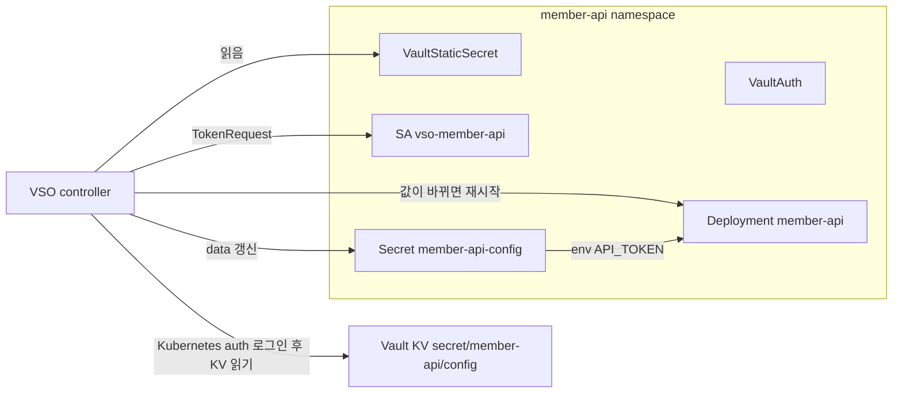
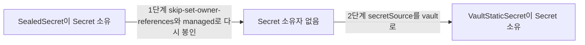
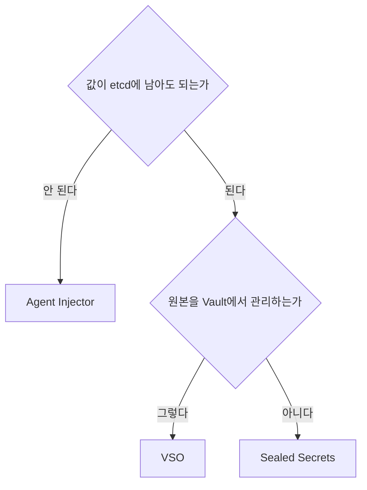

# 1. 들어가며

앱이 실행되려면 DB 접속 암호, 외부 API 키, OAuth client secret 같은 설정 시크릿이 필요하다. Kubernetes에서는 보통 이런 값을 Secret에 두고 env나 volume으로 넘긴다. 직접 만든 앱뿐 아니라 MySQL, Redis처럼 외부 Helm chart로 설치하는 앱도 Secret을 읽는 방식으로 만들어져 있어서, 앱이 Vault API를 직접 호출하도록 바꾸기는 어렵다.

[2편](/hashicorp-vault-실전-가이드-2-kubernetes-agent-injector/)에서는 이 설정 시크릿을 SealedSecret으로 두었다. Sealed Secrets는 git에 암호문을 안전하게 두는 데는 충분하지만, 값을 바꾸려면 다시 봉인해 커밋해야 하고 암호문은 봉인한 클러스터의 키로만 풀린다. 이 글은 같은 설정 시크릿의 원본을 Vault로 옮긴다. 앱은 지금처럼 Kubernetes Secret을 읽고, 그 Secret의 내용을 Vault Secrets Operator(VSO)가 Vault에서 가져와 채운다.

| 편 | 제목 | 다루는 상황 |
|----|------|-------------|
| 1편 | [핵심 개념과 Transit으로 구현하는 Envelope Encryption](/hashicorp-vault-실전-가이드-1-핵심-개념과-transit-envelope-encryption/) | DB에 저장할 개인정보를 필드 단위로 암호화한다 |
| 2편 | [Kubernetes에 Vault 구성하고 Agent Injector로 암호화 키 전달하기](/hashicorp-vault-실전-가이드-2-kubernetes-agent-injector/) | 1편의 앱을 Kubernetes에서 운영한다 |
| **3편 (이 글)** | VSO로 애플리케이션 시크릿 관리하고 Sealed Secrets에서 이전하기 | 앱 실행에 필요한 설정 시크릿을 관리한다 |

이 글에서는 다음 내용을 다룬다.

- VSO의 리소스(`VaultConnection`, `VaultAuth`, `VaultStaticSecret`)와 동기화 방식
- Sealed Secrets와 VSO의 같은 점과 다른 점
- SealedSecret이 만든 Secret을 앱 수정·재시작 없이 VSO로 넘기는 2단계 이전 절차
- 값 변경, 롤백, Vault 장애 때 실제로 일어난 일
- audit log로 Vault에 남는 기록 확인하기
- Agent Injector와 VSO 중 무엇을 고를지

실습은 2편의 kind 클러스터를 그대로 이어서 쓴다.

> 이 글에서 사용한 전체 코드는 [GitHub](https://github.com/kenshin579/argocd-charts-sample/tree/main/secret-management)에서 확인할 수 있다. 3편의 실행 절차는 README의 9~16단계에 정리했다.

# 2. VSO 동작 원리

## 2.1 리소스 세 가지

VSO는 Vault의 값을 Kubernetes Secret으로 동기화하는 operator다. 사용자는 다음 세 가지 커스텀 리소스를 만든다.

| 리소스 | 하는 일 |
|---|---|
| `VaultConnection` | Vault 주소, TLS 설정 |
| `VaultAuth` | 어떤 auth method로 로그인할지. Kubernetes auth면 role과 ServiceAccount |
| `VaultStaticSecret` | 어떤 KV 경로를 어떤 Secret으로 동기화할지, 얼마나 자주 다시 읽을지 |



`VaultAuth`에 적는 ServiceAccount는 `VaultStaticSecret`과 같은 namespace에 있어야 한다. VSO controller는 그 ServiceAccount의 token을 TokenRequest로 받아 Vault에 로그인한다. 그래서 Vault 쪽에서 보면 로그인한 주체는 VSO controller가 아니라 앱 namespace의 ServiceAccount다.

## 2.2 다시 읽기와 재시작

`VaultStaticSecret`은 `refreshAfter` 주기마다 KV를 다시 읽는다(최대 10%의 jitter가 붙는다). VSO 1.6.2 소스 코드(`controllers/vaultstaticsecret_controller.go`)를 보면, 다음 세 경우에 Secret을 다시 쓰고 `rolloutRestartTargets`에 적은 Deployment를 재시작한다.

- Vault에서 읽은 값의 HMAC이 지난번 동기화 때와 다르다
- 누군가 Secret을 직접 고쳐서 Vault의 값과 달라졌다(drift)
- `VaultStaticSecret`의 spec이 바뀌었다

재시작은 Deployment의 Pod 템플릿에 `vso.secrets.hashicorp.com/restartedAt` 어노테이션을 넣는 방식이라 `kubectl rollout restart`와 같은 효과를 낸다. 첫 동기화 때는 비교할 HMAC이 아직 없으므로 Secret만 쓰고 재시작하지 않는다.

이벤트를 받아 바로 갱신하는 instant update는 Vault Enterprise 기능이다. 이 글은 `refreshAfter` 주기 갱신만 쓴다.

## 2.3 시크릿은 결국 etcd에 남는다

VSO의 결과물은 평범한 Kubernetes Secret이다. 앱과 chart를 고치지 않아도 되는 이유가 이것이지만, 값이 etcd에 평문으로 남는다는 점도 그대로다. 2편에서 DEK를 Secret에 두지 않으려고 Agent Injector를 쓴 이유가 여기에 있다. 설정 시크릿처럼 Secret에 두어도 되는 값에 VSO를 쓴다.

# 3. VSO 설치와 첫 동기화

## 3.1 설치

VSO는 공식 Helm chart(1.6.2)를 ArgoCD Application으로 설치했다. Vault 연결 정보는 앱 chart의 `VaultConnection`에 두므로 chart의 기본 연결은 껐다.

```yaml
source:
  repoURL: https://helm.releases.hashicorp.com
  chart: vault-secrets-operator
  targetRevision: 1.6.2
  helm:
    valuesObject:
      # Vault 연결 정보는 member-api chart 의 VaultConnection 이 가진다
      defaultVaultConnection:
        enabled: false
```

처음에는 CRD가 클 때를 대비해 `ServerSideApply=true`를 켰다. 그러자 ArgoCD v2.14.11이 Kubernetes 1.37 Deployment의 새 status 필드(`.status.terminatingReplicas`)를 스키마에서 찾지 못해 비교에 실패했고, Application의 sync 상태가 `Unknown`이 됐다.

```
{
  "sync": "Unknown",
  "health": "Healthy",
  "conditions": [
    {
      "type": "ComparisonError",
      "message": "Failed to compare desired state to live state: failed to calculate diff: error calculating structured merge diff: error building typed value from live resource: .status.terminatingReplicas: field not declared in schema"
    }
  ],
  ...
}
```

옵션을 빼고 CRD까지 지운 뒤 처음부터 다시 설치하자 `Synced/Healthy`가 됐다. VSO 1.6.2의 CRD는 SSA 없이도 문제없이 적용됐다.

## 3.2 Vault 쪽 준비

VSO가 쓸 policy는 설정 시크릿을 읽는 것만 허용한다.

```hcl
# VSO 가 member-api 설정 시크릿을 Kubernetes Secret 으로 동기화할 때 쓰는 권한: 설정 값 읽기만 한다
path "secret/data/member-api/config" {
  capabilities = ["read"]
}
```

```bash
vault write auth/kubernetes/role/vso-member-api \
  bound_service_account_names=vso-member-api \
  bound_service_account_namespaces=member-api \
  token_policies=vso-member-api \
  token_ttl=1h

vault kv put secret/member-api/config api-token=demo-api-token-v1
```

이 role로 받은 token은 설정 시크릿은 읽지만 2편의 DEK는 읽지 못한다. ServiceAccount `vso-member-api`는 뒤에서 chart가 만들기 때문에, 확인할 때는 같은 이름의 ServiceAccount를 잠시 만들어 로그인했다(확인한 뒤에는 지웠다).

```bash
kubectl --context kind-argo-cluster -n member-api create serviceaccount vso-member-api
JWT=$(kubectl --context kind-argo-cluster -n member-api create token vso-member-api)
OUT=$(kubectl --context kind-argo-cluster -n vault exec -i vault-0 -- vault write -format=json auth/kubernetes/login role=vso-member-api jwt="$JWT")
echo "$OUT" | jq -c '{policies: .auth.policies, ttl: .auth.lease_duration, sa: .auth.metadata.service_account_name}'
VSO_TOKEN=$(echo "$OUT" | jq -r .auth.client_token)
```

```
{"policies":["default","vso-member-api"],"ttl":3600,"sa":"vso-member-api"}
$ kubectl --context kind-argo-cluster -n vault exec -i vault-0 -- env VAULT_TOKEN=$VSO_TOKEN vault kv get -field=api-token secret/member-api/config
demo-api-token-v1
$ kubectl --context kind-argo-cluster -n vault exec -i vault-0 -- env VAULT_TOKEN=$VSO_TOKEN vault kv get secret/member-api/dek
Code: 403. Errors:
	* permission denied
```

## 3.3 앱 chart의 VSO 리소스

member-api chart에 `secretSource: vault`일 때만 렌더링되는 리소스를 추가했다. 핵심은 `VaultStaticSecret`이다.

```yaml
apiVersion: secrets.hashicorp.com/v1beta1
kind: VaultStaticSecret
metadata:
  name: member-api-config
  annotations:
    argocd.argoproj.io/sync-wave: "-1"
spec:
  vaultAuthRef: member-api
  type: kv-v2
  mount: secret
  path: member-api/config
  refreshAfter: 30s
  destination:
    name: member-api-config
    create: true
    # 기존 Secret 을 넘겨받는다. ownerReference·label·annotation 을 VSO 것으로 바꾼다
    overwrite: true
    transformation:
      excludeRaw: true
  # 값이 바뀌면 Deployment 를 재시작해 새 env 를 읽게 한다(첫 동기화 때는 재시작하지 않는다)
  rolloutRestartTargets:
    - kind: Deployment
      name: member-api
```

- `destination.name`을 SealedSecret이 만들던 Secret과 같은 `member-api-config`로 두었다. Deployment는 지금처럼 이 Secret의 `api-token` 키를 읽으므로 바뀌지 않는다
- `overwrite: true`와 `excludeRaw: true`를 켠 이유는 5절에서 나온다

`VaultConnection`, `VaultAuth`, ServiceAccount는 wave -2, `VaultStaticSecret`은 wave -1에 두었다. 처음에 모두 같은 wave(-1)에 두었더니 `VaultStaticSecret`이 `VaultConnection`보다 먼저 처리되어 Warning 이벤트가 2건 났다. 동기화는 바로 뒤에 성공했다.

```
$ kubectl --context kind-argo-cluster -n member-api get events --field-selector involvedObject.kind=VaultStaticSecret
LAST SEEN   TYPE      REASON                   OBJECT                                MESSAGE
14s         Warning   Unrecoverable            vaultstaticsecret/member-api-config   Failed to get cacheKey from obj, err=VaultConnection.secrets.hashicorp.com "vault" not found
14s         Warning   VaultClientConfigError   vaultstaticsecret/member-api-config   Failed to get Vault auth login: VaultConnection.secrets.hashicorp.com "vault" not found
14s         Normal    SecretSynced             vaultstaticsecret/member-api-config   Secret synced
```

# 4. Sealed Secrets와 비교하기

두 방식은 앱 쪽에서 보면 결과가 같다. 둘 다 결국 같은 이름의 Kubernetes Secret을 만들고, 앱은 그 Secret을 읽는다. 다른 것은 원본을 어디에 두고 어떻게 바꾸느냐다.

| | Sealed Secrets | VSO |
|---|---|---|
| 원본 | git의 암호문(SealedSecret) | Vault KV |
| git에 들어가는 것 | 값의 암호문 | 경로 참조(VaultStaticSecret). 값은 암호문도 없다 |
| 클러스터 안의 결과 | Kubernetes Secret(etcd) | Kubernetes Secret(etcd) |
| 값을 바꾸는 흐름 | kubeseal → commit → PR → sync | `vault kv put` → `refreshAfter` 뒤 반영 |
| 앱에 반영 | 재시작을 따로 챙긴다 | `rolloutRestartTargets`로 재시작 |
| 남는 기록 | git 이력(누가 언제 바꿨나) | Vault audit log(누가 Vault에서 값을 바꾸고 가져갔나) |
| 클러스터 키 의존 | 봉인한 클러스터의 키로만 풀린다 | 없다 |
| 런타임 의존 | sealed-secrets controller | Vault와 VSO. Vault가 멈추면 갱신이 멈춘다 |
| 동적 시크릿 | 없다 | `VaultDynamicSecret` |
| 가장 중요한 백업 | controller 개인키 | Vault 데이터와 unseal key |

같은 점도 분명히 해 둘 필요가 있다.

- 둘 다 Kubernetes Secret을 만들기 때문에, Secret 읽기 권한이 있는 사람에게는 평문이 보인다
- git 쓰기 권한을 가진 공격자가 같은 namespace에 워크로드를 배포하는 경우는 둘 다 막지 못한다. Sealed Secrets라면 그 워크로드가 Secret을 읽고, VSO라면 같은 ServiceAccount로 Vault에 로그인할 수 있다

그래서 두 방식은 대체 관계라기보다 역할이 다르다고 보는 편이 맞다. 2편의 구성처럼 일반 설정 시크릿은 SealedSecret으로, 앱이 직접 쓰는 암호화 키는 Vault Agent로 나눠 다룰 수도 있다. 설정 시크릿까지 Vault에서 관리하고 싶어지는 시점은 값을 자주 바꾸거나, 여러 클러스터가 같은 값을 쓰거나, 값을 바꾸고 가져간 기록을 Vault 한곳에 모아야 할 때다.

# 5. Sealed Secrets에서 Vault로 이전하기

아래 출력은 kind 클러스터에서 실제로 실행한 결과다. `...`는 생략한 부분이고, "관찰 스크립트 출력"이라고 적은 블록은 상태를 일정 간격으로 찍는 셸 루프의 출력이다.

이전 절차는 두 번 실행했다. 처음 실행에서 롤백 문제(5.2)와 `_raw` 문제(5.4)를 찾아 고친 뒤 처음부터 다시 실행했다. 따로 적지 않은 출력은 다시 실행한 결과이고, 처음 실행 때의 출력에는 그렇다고 밝혀 두었다.

## 5.1 바로 바꾸면 안 되는 이유

SealedSecret이 만든 Secret에는 SealedSecret을 가리키는 ownerReference가 붙어 있다.

```
$ kubectl --context kind-argo-cluster -n member-api get secret member-api-config -o json | jq -c '{uid: .metadata.uid, ownerReferences: [.metadata.ownerReferences[]? | {kind, controller}], annotations: (.metadata.annotations // {} | keys)}'
{"uid":"d1c50c29-2753-4090-b810-d0dad61122c7","ownerReferences":[{"kind":"SealedSecret","controller":true}],"annotations":[]}
```

그래서 SealedSecret을 지우면 Kubernetes의 garbage collector가 Secret도 지운다. 처음 실행할 때 별도 namespace에서 확인해 보았다.

```
$ kubectl --context kind-argo-cluster -n sealed-demo get secret demo-config -o jsonpath="{.metadata.ownerReferences[0].kind} controller={.metadata.ownerReferences[0].controller}"
SealedSecret controller=true
$ kubectl --context kind-argo-cluster -n sealed-demo delete sealedsecret demo-config
sealedsecret.bitnami.com "demo-config" deleted from sealed-demo namespace
$ kubectl --context kind-argo-cluster -n sealed-demo get secret demo-config
Error from server (NotFound): secrets "demo-config" not found
```

chart의 `secretSource`를 바로 `vault`로 바꾸면 ArgoCD가 SealedSecret을 prune하면서 Secret이 함께 지워질 수 있다. 그 사이에 새로 시작하는 Pod는 Secret을 찾지 못한다. 그래서 다음 두 단계로 옮겼다. 예제의 `make secret-source SOURCE=vault`는 Secret에 SealedSecret의 ownerReference가 남아 있으면 parameter를 바꾸지 않고 멈춘다.



## 5.2 1단계: 소유 관계 끊기

Sealed Secrets는 kubeseal에 넣는 Secret에 `sealedsecrets.bitnami.com/skip-set-owner-references: "true"` 어노테이션이 있으면 ownerReference를 붙이지 않는다. 그런데 이 어노테이션만 넣으면 문제가 생긴다. 컨트롤러는 Secret이 자기 소유(ownerReference)도 아니고 `sealedsecrets.bitnami.com/managed: "true"` 어노테이션도 없으면, 그 Secret을 다른 누군가의 것으로 보고 갱신을 거부한다. ownerReference를 붙이지 않게 해 놓고, ownerReference가 없다는 이유로 그 Secret을 관리하지 않는 것이다.

처음 실습에서는 skip 어노테이션만 넣었다. 그 상태로 롤백(5.5)하자 SealedSecret이 Secret을 새로 만들기는 했지만 status가 `Synced=False`가 되었고, ArgoCD의 member-api Application은 `Degraded`가 됐다.

```
$ kubectl --context kind-argo-cluster -n member-api get sealedsecret member-api-config -o jsonpath='{range .status.conditions[*]}{.type}={.status} {.message}{"\n"}{end}'
Synced=False failed update: Resource "member-api-config" already exists and is not managed by SealedSecret

$ kubectl --context kind-argo-cluster -n argocd get application member-api -o jsonpath='{.status.sync.status}/{.status.health.status}'
Synced/Degraded
```

Sealed Secrets README도 skip 어노테이션과 함께 `managed`를 달면 SealedSecret이 바뀔 때 Secret도 갱신된다고 설명한다. 그래서 두 어노테이션을 함께 넣어 봉인했다. 어노테이션은 SealedSecret의 `spec.template.metadata.annotations`로 들어간다.

```yaml
spec:
  template:
    metadata:
      annotations:
        sealedsecrets.bitnami.com/managed: "true"
        sealedsecrets.bitnami.com/skip-set-owner-references: "true"
      name: member-api-config
      namespace: member-api
```

봉인하는 값은 지금 Secret에 들어 있는 값과 같아야 한다. 예제의 `make config-check`는 Secret과 Vault KV의 값을 sha256으로 비교하고, `make seal`도 봉인한 값의 sha256을 출력한다. 두 값이 같은지 확인하고 커밋했다.

```
$ make config-check
./scripts/config-check.sh
match: secret=f7f38d53815f vault=f7f38d53815f

$ SKIP_OWNER_REFS=1 API_TOKEN=demo-api-token-v3 make seal
./scripts/seal.sh
sealed: .../charts/member-api/templates/sealedsecret.yaml (api-token sha256=f7f38d53815f)
```

커밋을 push하고 ArgoCD가 그 커밋으로 sync하자, 컨트롤러가 기존 Secret에서 ownerReference를 뗐다. uid는 그대로다.

```
$ kubectl --context kind-argo-cluster -n member-api get sealedsecret member-api-config -o jsonpath='{range .status.conditions[*]}{.type}={.status}{end}'
Synced=True
$ kubectl --context kind-argo-cluster -n member-api get secret member-api-config -o json | jq -c '{uid: .metadata.uid, ownerReferences: [.metadata.ownerReferences[]? | {kind, controller}], annotations: (.metadata.annotations // {} | keys)}'
{"uid":"d1c50c29-2753-4090-b810-d0dad61122c7","ownerReferences":[],"annotations":["sealedsecrets.bitnami.com/managed","sealedsecrets.bitnami.com/skip-set-owner-references"]}
```

이미 `Degraded`가 됐다면, 남아 있는 Secret에 `managed` 어노테이션을 달고 sealed-secrets controller를 재시작한다. 어노테이션만 달아서는 회복되지 않았다. controller 로그를 보면 실패한 항목은 `Error updating, giving up`으로 끝났고, 그 뒤 SealedSecret의 메타데이터만 바꿔 보았을 때는 `update suppressed, no changes in spec`으로 넘어갔다. controller를 재시작한 뒤에야 `Synced=True`가 됐다.

```bash
kubectl --context kind-argo-cluster -n member-api annotate secret member-api-config sealedsecrets.bitnami.com/managed=true
kubectl --context kind-argo-cluster -n kube-system rollout restart deploy/sealed-secrets-controller
```

## 5.3 2단계: VSO로 전환

이제 `secretSource`를 `vault`로 바꾼다. ArgoCD는 SealedSecret을 prune하고 VaultStaticSecret을 만든다.

```
$ make secret-source SOURCE=vault
./scripts/secret-source.sh vault
helm parameters: [{"name":"loadMode","value":"async"},{"name":"secretSource","value":"vault"}]

$ kubectl --context kind-argo-cluster -n member-api get sealedsecret,vaultstaticsecret
NAME                                                        SYNCED   HEALTHY   READY   AGE
vaultstaticsecret.secrets.hashicorp.com/member-api-config   True     True      True    22s

$ kubectl --context kind-argo-cluster -n member-api get secret member-api-config -o json | jq -c '{uid: .metadata.uid, ownerReferences: [.metadata.ownerReferences[]? | {kind, controller}], managedBy: .metadata.labels["app.kubernetes.io/managed-by"], annotations: (.metadata.annotations // {} | keys), keys: (.data | keys)}'
{"uid":"d1c50c29-2753-4090-b810-d0dad61122c7","ownerReferences":[{"kind":"VaultStaticSecret","controller":null}],"managedBy":"hashicorp-vso","annotations":[],"keys":["api-token"]}

$ kubectl --context kind-argo-cluster -n member-api get pod -l app=member-api
NAME                          READY   STATUS    RESTARTS   AGE
member-api-57978f9cbb-5pwr6   2/2     Running   0          48m
```

VaultStaticSecret이 **같은 Secret(uid 그대로)**을 넘겨받았고, 앱 Pod는 재시작하지 않았다. 1단계에서 넣은 두 어노테이션도 사라졌다. 여기서 `overwrite: true`가 필요하다. VSO 소스 코드를 보면, 기본값(`false`)일 때 VSO는 자기가 만들지 않은 Secret을 만나면 "not the owner of the destination Secret" 에러를 내고 멈춘다. `true`면 기존 Secret의 ownerReference와 label, 어노테이션을 VSO의 것으로 바꾼다.

VSO는 첫 동기화 때 Secret을 Vault의 값으로 쓰지만 Deployment는 재시작하지 않는다. 그래서 Secret과 Vault의 값이 다르면 Secret만 바뀌고, Pod는 옛 env를 가진 채 계속 실행된다. 전환 전후에 `make config-check`로 두 값이 같은지 확인한 이유가 이것이다.

두 컨트롤러가 같은 Secret을 번갈아 덮어쓰지는 않는지도 확인했다. 처음 실행했을 때 전환 뒤 2분 동안 지켜본 결과다(관찰 스크립트 출력).

```
t=0s resourceVersion=12345 managedBy=hashicorp-vso
t=30s resourceVersion=12345 managedBy=hashicorp-vso
t=60s resourceVersion=12345 managedBy=hashicorp-vso
t=90s resourceVersion=12345 managedBy=hashicorp-vso
t=120s resourceVersion=12345 managedBy=hashicorp-vso
```

`resourceVersion`이 바뀌지 않았고, sealed-secrets controller 로그에도 이 Secret에 대한 기록이 없었다.

## 5.4 값 바꾸기와 `_raw`

Vault에서 값을 바꾸면 VSO가 다음 `refreshAfter`에서 Secret을 갱신하고 Deployment를 재시작한다. 그런데 처음 실행했을 때는 **같은 값을 다시 `kv put`해도 Deployment가 재시작됐다.** 원인은 VSO가 Secret에 기본으로 넣는 `_raw` 키였다.

```
$ kubectl --context kind-argo-cluster -n member-api get secret member-api-config -o json | jq -r '.data | keys | join(", ")'
_raw, api-token
$ kubectl --context kind-argo-cluster -n member-api get secret member-api-config -o jsonpath='{.data._raw}' | base64 -d | jq -c '{keys, metadata, data_keys: (.data|keys)}'
{"keys":["data","metadata"],"metadata":{"created_time":"2026-11-03T07:54:52.774009293Z","custom_metadata":null,"deletion_time":"","destroyed":false,"version":3},"data_keys":["api-token"]}
```

`_raw`에는 KV 응답 전체가 들어가고, 여기에는 KV의 버전이 포함된다. `kv put`을 하면 값이 같아도 버전이 올라가므로 VSO는 내용이 바뀌었다고 보고 재시작한다. 이 앱은 `api-token`만 읽으므로 `destination.transformation.excludeRaw: true`로 `_raw`를 뺐다. 그 뒤로는 값이 같으면 재시작하지 않고, 다를 때만 재시작했다(`kv put` 출력과 관찰 스크립트 출력).

```
t=0s restartedAt=2026-11-03T07:57:40Z secretRV=116541 keys=api-token pod=member-api-74fd874c58-tdnhg
$ vault kv put secret/member-api/config api-token=demo-api-token-v2-rotated   # 같은 값
version            4
t=70s restartedAt=2026-11-03T07:57:40Z secretRV=116541 keys=api-token pod=member-api-74fd874c58-tdnhg

$ vault kv put secret/member-api/config api-token=demo-api-token-v3   # 다른 값
version            5
t=10s restartedAt=2026-11-03T07:59:46Z secretRV=116880 keys=api-token pod=member-api-57978f9cbb-5pwr6
...
```

첫 줄의 `restartedAt` 07:57:40은 excludeRaw를 적용하면서 생긴 재시작이다. VaultStaticSecret의 spec이 바뀌었고 Secret에서 `_raw` 키가 빠졌기 때문이다. 2.2절에서 본 것처럼 VSO는 값이 바뀔 때뿐 아니라 spec이 바뀌거나 Secret이 Vault 값과 달라졌을 때도 재시작한다.

이전을 마친 뒤 길이가 다른 값으로 한 번 더 바꿨다. `demo-api-token-v3`는 17자, `demo-api-token-v4-migrated`는 26자라서, 앱이 새 값을 읽었는지 `/config`의 `length`로 구분할 수 있다.

```
$ API_TOKEN=demo-api-token-v4-migrated make vault-config 2>&1 | grep -E 'version|sha256'
version            6
api-token sha256=e68536f2c1f6
```

관찰 스크립트 출력(30초 간격, Deployment의 `restartedAt`와 Running Pod):

```
t=30s restartedAt=2026-11-03T08:48:39Z pod=member-api-7656c77bc7-nbb8x
t=60s restartedAt=2026-11-03T08:48:39Z pod=member-api-7656c77bc7-nbb8x
t=90s restartedAt=2026-11-03T08:48:39Z pod=member-api-7656c77bc7-nbb8x
```

```
$ make config-check
./scripts/config-check.sh
match: secret=e68536f2c1f6 vault=e68536f2c1f6

$ curl -s localhost:8081/config
{"api_token":"de****","length":26}
```

재시작하는 동안에는 앱이 요청을 받지 못할 수 있다. 이 예제의 Deployment는 RWO PVC를 쓰므로 `Recreate` 전략에 replicas 1이다. 옛 Pod가 내려간 뒤에 새 Pod가 뜨므로, 값이 바뀔 때마다 앱이 잠깐 요청을 받지 못한다. replicas를 늘리고 `RollingUpdate`를 쓸 수 있는 앱이라면 이 공백은 줄어든다.

## 5.5 롤백

SealedSecret으로 되돌릴 때는 세 가지를 알아야 한다.

- SealedSecret에는 봉인할 때의 값이 들어 있다. Vault에서 값을 바꾼 뒤라면 **지금 값으로 다시 봉인**해야 옛 값으로 돌아가지 않는다
- 다시 봉인한 커밋을 ArgoCD가 아직 보지 못했다면, 이전 커밋의 SealedSecret이 적용된다
- VaultStaticSecret이 prune되면 그것이 소유한 Secret도 GC로 지워진다

그래서 지금 값(`e68536f2c1f6`)으로 다시 봉인해 push했다. 나중에 다시 VSO로 넘길 수 있도록 이번에도 `SKIP_OWNER_REFS=1`로 봉인했다. 예제의 `make secret-source SOURCE=sealed`는 로컬 HEAD, 원격 브랜치, ArgoCD가 sync한 revision이 모두 같을 때만 parameter를 바꾼다.

```
$ SKIP_OWNER_REFS=1 API_TOKEN=demo-api-token-v4-migrated make seal
./scripts/seal.sh
sealed: .../charts/member-api/templates/sealedsecret.yaml (api-token sha256=e68536f2c1f6)

$ make secret-source SOURCE=sealed
./scripts/secret-source.sh sealed
helm parameters: [{"name":"loadMode","value":"async"},{"name":"secretSource","value":"sealed"}]
```

1초 간격으로 지켜본 결과다(관찰 스크립트 출력, 바뀔 때만 기록).

```
t=1s uid=d1c50c29 owner=VaultStaticSecret | sealedsecret=0 vss=1
t=2s Secret 없음 | sealedsecret=0 vss=0
t=5s uid=0cb57244 owner= | sealedsecret=1 vss=0
```

```
$ kubectl --context kind-argo-cluster -n member-api get sealedsecret member-api-config -o jsonpath='{range .status.conditions[*]}{.type}={.status} {.message}{end}'
Synced=True 
$ kubectl --context kind-argo-cluster -n argocd get application member-api -o jsonpath='{.status.sync.status}/{.status.health.status}'
Synced/Healthy
$ make config-check
./scripts/config-check.sh
match: secret=e68536f2c1f6 vault=e68536f2c1f6

$ kubectl --context kind-argo-cluster -n member-api get pod -l app=member-api
NAME                          READY   STATUS    RESTARTS   AGE
member-api-7656c77bc7-nbb8x   2/2     Running   0          5m28s
```

약 3초 동안 Secret이 없었다. 실행 중인 Pod는 env를 이미 읽었으므로 영향이 없었지만, 그 사이에 새로 시작하는 Pod는 Secret을 찾지 못한다. 롤백은 Pod가 새로 시작하지 않는 시점에 하는 것이 안전하다. 다시 `vault`로 바꾸자 VSO가 새 Secret(uid `0cb57244`)을 그대로 넘겨받았다.

한 가지 더 주의할 점이 있다. 이 예제에서 `secretSource`는 ArgoCD Application의 helm parameter에만 있다. Application을 지우고 다시 만들면 parameter가 사라져 chart 기본값인 `sealed`로 돌아가고, git에 있는 SealedSecret의 값으로 조용히 롤백된다. 운영에서는 이런 값을 git의 values 파일에 두는 편이 낫다.

## 5.6 Vault가 멈췄을 때

Vault를 seal하고 60초 뒤의 상태다.

```
$ make vault-seal
./scripts/vault-seal.sh
Success! Vault is sealed.

$ sleep 60

$ kubectl --context kind-argo-cluster -n member-api get vaultstaticsecret member-api-config -o jsonpath='{range .status.conditions[*]}{.type}={.status} {end}'
SecretSynced=False Healthy=False Ready=False 
$ kubectl --context kind-argo-cluster -n member-api get events --field-selector involvedObject.kind=VaultStaticSecret,type=Warning --sort-by=.lastTimestamp -o custom-columns=REASON:.reason,MESSAGE:.message | tail -1 | cut -c1-120
* Vault is sealed

$ kubectl --context kind-argo-cluster -n member-api get secret member-api-config
NAME                TYPE     DATA   AGE
member-api-config   Opaque   1      2m40s

$ curl -s localhost:8081/config
{"api_token":"de****","length":26}

$ kubectl --context kind-argo-cluster -n argocd get application member-api -o jsonpath='{.status.sync.status}/{.status.health.status}'
Synced/Healthy
```

VSO는 Secret을 지우지 않고 마지막 값을 그대로 둔다. 앱도 계속 동작한다(Secret의 AGE가 짧은 것은 5.5절의 롤백 실습에서 새로 만들어졌기 때문이다). unseal하고 10초 뒤에는 `SecretSynced=True`로 복구됐다.

```
$ make vault-unseal
./scripts/vault-unseal.sh
unsealed: sealed=false

$ sleep 10; kubectl --context kind-argo-cluster -n member-api get vaultstaticsecret member-api-config -o jsonpath='{range .status.conditions[*]}{.type}={.status} {end}'
SecretSynced=True Healthy=True Ready=True 
```

주의할 점이 하나 있다. 이 동안 ArgoCD의 member-api는 계속 `Synced/Healthy`였다. ArgoCD v2.14.11에는 VaultStaticSecret의 health check가 내장되어 있지 않아서, 동기화가 실패해도 Application 상태에 드러나지 않는다. VaultStaticSecret의 이벤트나 status를 따로 지켜봐야 한다.

# 6. audit log로 Vault에 남는 기록 확인하기

2편에서 켠 audit log를 30분 동안 모아 보면, 설정 시크릿과 DEK에 누가 어떤 요청을 했는지 구분된다.

```bash
kubectl --context kind-argo-cluster -n vault logs vault-0 --since=30m | grep '^{' \
  | jq -r 'select(.type=="request" and (.request.path|test("^secret/data/member-api/(config|dek)$"))) | "\(.request.path) \(.request.operation) \(.auth.display_name) \(.request.headers["user-agent"][0] // "-")"' \
  | sort | uniq -c
```

```
  34 secret/data/member-api/config read kubernetes-member-api-vso-member-api vso/1.6.2
   7 secret/data/member-api/config read root Go-http-client/1.1
   1 secret/data/member-api/config update root Go-http-client/1.1
   1 secret/data/member-api/dek read kubernetes-member-api-member-api Vault Agent API Proxy/2.2.1 (+https://www.vaultproject.io/; go1.27.3); Go-http-client/1.1
   5 secret/data/member-api/dek read kubernetes-member-api-member-api-migration Go-http-client/1.1
```

- 설정 시크릿은 VSO가 `vso-member-api` ServiceAccount로 읽었다. VaultStaticSecret이 있는 동안 30초마다 읽는데, 이 30분에는 롤백과 재실행으로 sealed 모드였던 시간이 섞여 있어 34번이다
- `root`의 `read`는 `make config-check`가 비교하려고 읽은 것이고, `update`는 5.4절에서 값을 바꾼 `kv put`이다
- DEK는 앱이 Agent proxy를 거쳐 `member-api` ServiceAccount로, sync마다 실행되는 DEK 적재 Job이 `member-api-migration`으로 읽었다

audit log 한 줄에서 필드를 골라 보면 ServiceAccount의 이름과 uid, role까지 남아 있다(처음 실행했을 때의 기록이다).

```
{"time":"2026-11-03T08:06:10.831235301Z","path":"secret/data/member-api/config","operation":"read","display_name":"kubernetes-member-api-vso-member-api","metadata":{"role":"vso-member-api","service_account_name":"vso-member-api","service_account_namespace":"member-api","service_account_secret_name":"","service_account_uid":"bb09bddf-65b9-4d99-8012-d578638873aa"},...}
```

다만 이 기록의 범위를 정확히 알아야 한다. Vault audit log에 남는 것은 Vault에 직접 요청한 주체다. 설정 시크릿이라면 VSO가 값을 가져간 기록과 관리자가 값을 바꾼 기록이 남는다. Pod가 env로 값을 받거나 누군가 `kubectl get secret`으로 Secret을 읽는 것은 Kubernetes API에 대한 접근이므로 Vault에는 남지 않는다. 이 점은 Sealed Secrets와 VSO가 같다. 클러스터 안에서 Secret을 누가 읽었는지 보려면 어느 쪽이든 Kubernetes API의 audit log를 켜야 한다.

# 7. Agent Injector와 VSO, 언제 무엇을 쓰나

| 상황 | 고를 방식 | 이유 |
|---|---|---|
| 앱이 쓰는 암호화 키(DEK)처럼 etcd에 남으면 안 되는 값 | Agent Injector | 값이 앱 메모리나 Pod의 임시 볼륨에만 있다 |
| 앱이 Vault API(Transit 등)를 직접 써야 한다 | Agent Injector | Agent가 token을 관리하고 앱은 localhost로 호출한다 |
| 외부 chart처럼 고칠 수 없는 앱의 설정 시크릿 | VSO | 앱은 Kubernetes Secret을 그대로 읽는다 |
| 값을 Vault에서 바꾸면 앱까지 자동으로 반영되게 | VSO | `refreshAfter`와 `rolloutRestartTargets` |
| Vault 없이 GitOps만으로 관리 | Sealed Secrets | 운영할 서버가 controller 하나다 |
| Vault 외의 시크릿 저장소도 함께 쓴다 | External Secrets Operator | 여러 provider를 지원한다 |



VSO와 External Secrets Operator(ESO)는 둘 다 외부 저장소의 값을 Kubernetes Secret으로 동기화한다. VSO는 Vault 전용이고 암호화된 client cache처럼 Vault에 맞춘 기능이 있다. ESO는 AWS Secrets Manager, GCP, Azure, Vault 등 여러 provider를 지원한다. Vault의 동적 시크릿은 둘 다 다룰 수 있다. VSO는 `VaultDynamicSecret` 리소스로, ESO는 `VaultDynamicSecret` generator로 받는다. 라이선스는 VSO가 BUSL-1.1, ESO가 Apache-2.0이다.

# 8. FAQ

## 8.1 VSO로 옮기면 Sealed Secrets보다 안전해지는가?

저장소가 유출되는 경우에는 그렇다. git에는 경로 참조만 남고 암호문조차 없기 때문이다. Sealed Secrets는 controller 개인키가 유출되면 그 키로 봉인해 git 히스토리에 남긴 암호문이 모두 풀린다. 하지만 클러스터 안에서는 둘 다 같은 Kubernetes Secret을 만들므로, Secret 읽기 권한이나 git 쓰기 권한을 가진 공격자에 대해서는 달라지는 것이 없다.

## 8.2 이전하는 동안 앱이 재시작되지는 않나?

이 실습에서는 재시작하지 않았다. VSO가 기존 Secret을 넘겨받을 때 uid가 그대로였고, `rolloutRestartTargets`는 첫 동기화 때 동작하지 않는다. 재시작은 그 뒤 Vault에서 값을 바꿨을 때 일어났다. 다만 이전한 뒤에도 VaultStaticSecret의 spec을 고치거나 Secret을 직접 수정하면 재시작된다. 이 실습에서도 `excludeRaw`를 추가했을 때 한 번 재시작됐다.

## 8.3 `refreshAfter`를 아주 짧게 하면 되지 않나?

짧게 할수록 Vault에 요청이 늘어난다. 처음 실행했을 때는 VaultStaticSecret 하나가 30초마다 읽은 기록이 30분 동안 64번 audit log에 남았다. 시크릿과 앱이 많아지면 그만큼 곱해진다. 즉시 반영이 필요하면 Vault Enterprise의 instant update를 쓰거나, 반영이 조금 늦어도 되는 값부터 VSO로 옮기는 편이 낫다.

## 8.4 `overwrite: true`는 위험하지 않나?

같은 이름의 Secret을 다른 도구가 관리하고 있다면, VSO가 그 Secret의 ownerReference와 label을 덮어쓴다. 이전할 때는 바로 그 동작이 필요하지만, 이전이 끝난 뒤에도 켜 두면 실수로 같은 이름을 쓴 다른 Secret을 가져갈 수 있다. VSO 소스 코드를 보면 `false`일 때는 Secret이 VSO의 label과 해당 VaultStaticSecret의 ownerReference를 갖고 있는지 검사하므로, 이전이 끝난 뒤 `false`로 돌려도 이미 넘겨받은 Secret은 계속 관리된다. 이 실습에서는 바꿔 보지 않았다.

# 9. 마무리

정리하면 다음과 같다.

- VSO는 Vault KV를 Kubernetes Secret으로 동기화한다. 앱과 외부 chart는 바꾸지 않아도 되지만, 값은 etcd에 남는다
- Sealed Secrets와 VSO는 클러스터 안의 결과가 같고, 원본의 위치와 값을 바꾸는 흐름, 남는 기록이 다르다
- SealedSecret이 만든 Secret은 ownerReference 때문에 SealedSecret과 함께 지워진다. `skip-set-owner-references`와 `managed`를 함께 넣어 소유 관계를 끊은 뒤 `overwrite: true`로 넘기면 uid를 유지한 채 재시작 없이 이전할 수 있다
- VSO의 기본 `_raw` 키에는 KV 버전이 들어가서 같은 값으로 `kv put`해도 재시작이 일어난다. 앱이 쓰지 않으면 `excludeRaw: true`로 뺀다. spec을 바꾸거나 Secret을 직접 고쳐도 재시작된다
- Vault가 멈춰도 VSO는 Secret을 지우지 않는다. 다만 ArgoCD v2.14에서는 동기화 실패가 Application 상태에 드러나지 않는다
- 롤백할 때는 지금 값으로 다시 봉인하고 ArgoCD가 그 커밋을 본 뒤에 바꾼다. Secret이 몇 초 동안 사라진다는 점도 감안한다

시리즈를 통해 Vault의 기본 개념과 Transit envelope encryption에서 시작해, Kubernetes에서 암호화 키를 전달하는 Agent Injector와 설정 시크릿을 동기화하는 VSO까지 살펴보았다. 두 방식은 대체 관계가 아니라, 시크릿이 etcd에 남아도 되는지에 따라 나눠 쓰는 도구다.

# 10. 참고

- [Vault Secrets Operator](https://developer.hashicorp.com/vault/docs/deploy/kubernetes/vso)
- [Vault Secrets Operator API reference](https://developer.hashicorp.com/vault/docs/deploy/kubernetes/vso/api-reference)
- [VSO: Vault secret sources](https://developer.hashicorp.com/vault/docs/deploy/kubernetes/vso/sources/vault)
- [Kubernetes integrations comparison](https://developer.hashicorp.com/vault/docs/deploy/kubernetes/comparisons)
- [Sealed Secrets README](https://github.com/bitnami-labs/sealed-secrets/blob/v0.41.2/README.md)
- [Kubernetes Garbage Collection](https://kubernetes.io/docs/concepts/architecture/garbage-collection/)
- [Audit device schema](https://developer.hashicorp.com/vault/docs/audit/schema)
- [External Secrets Operator](https://external-secrets.io/)
- [HashiCorp Vault 실전 가이드 1편](/hashicorp-vault-실전-가이드-1-핵심-개념과-transit-envelope-encryption/)
- [HashiCorp Vault 실전 가이드 2편](/hashicorp-vault-실전-가이드-2-kubernetes-agent-injector/)
- [Kubernetes 환경에서 Secret 안전하게 관리하기](/kubernetes-환경에서-secret-안전하게-관리하기/)
- [예제 코드: argocd-charts-sample/secret-management](https://github.com/kenshin579/argocd-charts-sample/tree/main/secret-management)
