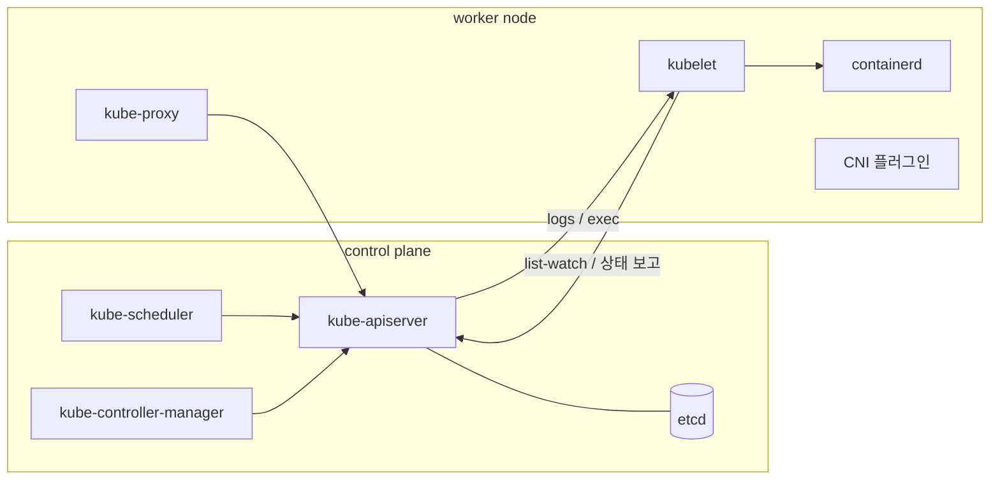

# 1. 들어가며

2026년 9월 22일부터 24일까지 캐나다 토론토에서 열린 ROSCon Global 2026에 다녀왔다. 행사 앱(Whova)으로 열린 작은 모임 중에 Kubernetes와 KubeEdge로 ROS를 운영하는 이야기를 나누는 자리가 있어서 참석했다. 15분 정도 서서 궁금한 것을 묻고 답을 듣는 형식이었다.

모임을 연 사람은 Tomoya Fujita였다. KubeEdge SIG Robotics의 chair 중 한 명이고 ROS PMC(Project Management Committee) 위원이다. ROSCon 2023에서 [ROS with Kubernetes/KubeEdge](https://roscon.ros.org/2023/talks/ROS_with_KubernetesKubeEdge.pdf)를 발표했고, 이 글에서 계속 참고할 [ros_k8s](https://github.com/fujitatomoya/ros_k8s) 저장소를 만들었다.

ros_k8s는 ROS와 ROS 2를 Kubernetes·KubeEdge 클러스터에서 돌려 보는 튜토리얼 저장소다. 실물 장비(Ubuntu PC, Raspberry Pi)나 kind 같은 가상 환경에 클러스터를 꾸리고 ROS 2 앱을 배포하는 절차가 문서로 정리되어 있다. 다만 KubeEdge 설치 문서는 명령을 따라가는 데 집중되어 있어서, KubeEdge가 무엇이고 왜 그렇게 구성하는지는 따로 공부해야 했다. 모임에서 나눈 이야기를 계기로 그 빈 곳을 채우며 정리한 것이 이 글이다.

**이 글에서 다루는 것**

- 로봇을 그냥 Kubernetes 노드로 붙이면 생기는 문제
- KubeEdge의 구조와, `kubectl apply` 한 번으로 로봇에 파드가 뜨기까지의 흐름
- 클라우드와 연결이 끊기거나 로봇이 재부팅될 때 일어나는 일
- keadm으로 로봇 한 대를 엣지 노드로 붙이는 4단계 설치
- 로봇에 적용할 때 잘 맞는 점과 주의할 점

# 2. 왜 로봇에 Kubernetes인가

Tomoya Fujita가 ROS TSC에서 발표한 [ROS with Kubernetes](https://www.slideshare.net/slideshow/rostscrosk8s20230309pdf/256331489)는 이 질문에서 출발한다. 지금은 환경마다 앱을 배포하는 방식이 따로다.

| 환경 | 지금 배포하는 방식 |
|---|---|
| 클라우드 | 컨테이너와 Kubernetes. 개발자는 kubectl·Helm·GitOps로 배포한다 |
| IoT 장치 | 장치별로 정적으로 구현되어 있어 바꾸기 어렵다 |
| 로봇 | 로봇마다 환경을 구성하고 설치한다 |

클라우드와 엣지 장치는 아키텍처부터 다르다. 그래서 같은 앱이라도 환경마다 구성하고 실행하는 데 시간과 노력이 따로 든다.

로봇과 IoT 장치도 Kubernetes 노드로 만들면 이야기가 달라진다. 클라우드 앱을 배포하던 방식 그대로 어디에든 배포할 수 있고, Kubernetes가 원래 갖고 있는 기능을 로봇에서도 쓸 수 있다.

- 라벨로 배포 대상을 고른다 (예: 배달 로봇만, 특정 현장의 로봇만)
- Rolling·Canary 방식으로 업데이트한다
- 앱이 죽으면 자동으로 복구한다
- 하드웨어를 추상화한다
- 관측하고 확장한다

로봇은 여러 대가 협업하고, 센싱 결과에 따라 앱을 올리고 내리며, 문제가 생기면 스스로 복구되어야 한다. 클라우드에서 쓰던 배포·운영 방식을 엣지까지 가져오려는 것이 로봇에 Kubernetes를 쓰려는 동기다.

그런데 로봇을 그냥 Kubernetes 노드로 붙이면 몇 가지 문제가 생긴다. 그 전에 Kubernetes가 노드를 어떻게 다루는지부터 짚는다.

# 3. Kubernetes 기본

KubeEdge를 이해할 때 핵심은 Kubernetes의 **어느 부분을 바꾸는지**다. 그래서 Kubernetes 전체가 아니라 바뀌는 부분 위주로 짧게 짚는다.

## 3.1 control plane과 node

control plane은 "무엇을 어디에 띄울지" 결정해서 기록하고, 각 노드가 그 결정을 실행한다. 컴포넌트끼리는 서로 직접 말하지 않고 모두 API 서버를 거친다. 스케줄러가 kubelet에게 "이거 띄워"라고 말하는 대신 API 서버에 기록하고, kubelet이 그 기록을 보고 움직이는 식이다.

| 구분 | 컴포넌트 | 하는 일 |
|---|---|---|
| control plane | kube-apiserver | 클러스터의 모든 읽기·쓰기를 받는 REST API 서버. 다른 컴포넌트는 모두 여기를 거친다 |
| control plane | etcd | 모든 리소스(Deployment, Pod, Service, Node 등)를 저장하는 key-value DB. API 서버만 접근한다 |
| control plane | kube-scheduler | 노드가 정해지지 않은 파드를 찾아 어느 노드에 둘지 정한다. 실행은 하지 않는다 |
| control plane | kube-controller-manager | 원하는 상태와 실제 상태를 비교해 맞추는 컨트롤러(Deployment, ReplicaSet, Node 등) 묶음 |
| node | kubelet | 노드마다 systemd 서비스로 도는 에이전트. 배정된 파드를 watch해 containerd로 띄우고, 상태와 하트비트를 보고한다 |
| node | containerd | 컨테이너를 실제로 만드는 런타임. kubelet과는 CRI(Container Runtime Interface)로 이야기한다 |
| node | kube-proxy | Service의 ClusterIP로 들어온 요청을 실제 파드 IP로 보내는 iptables/IPVS 규칙을 노드마다 설치한다 |
| node | CNI 플러그인 | 파드에 IP를 주고 노드 간 파드 통신 경로를 만든다. 없으면 노드가 `NotReady`로 남는다 |

## 3.2 "원하는 상태"와 list-watch

Kubernetes는 "명령"이 아니라 **"원하는 상태"를 저장**하는 방식으로 동작한다.

1. 사용자가 "nginx 파드 3개가 떠 있어야 한다"(Deployment `replicas: 3`)를 API 서버에 저장한다
2. 컨트롤러가 이 변화를 watch하다가 파드 객체 3개를 만든다
3. 스케줄러가 노드가 비어 있는 파드를 발견하고 `spec.nodeName`을 채운다
4. 각 노드의 kubelet이 "`nodeName`이 나인 파드"를 watch하다가 containerd로 컨테이너를 띄운다
5. kubelet이 파드 상태(`Running` 등)를 API 서버에 보고한다

여기서 **list-watch**는 처음에 목록을 한 번 받고(list), 이후에는 바뀐 것만 계속 받는(watch) 방식이다. 모든 컴포넌트가 이 방식으로 API 서버를 지켜본다.

**KubeEdge가 끼어드는 지점은 4·5번, kubelet ↔ API 서버 구간이다.** 나머지는 그대로 두고 이 구간만 바꾼다는 점을 기억해 두면 뒤의 구조가 쉽게 읽힌다.

## 3.3 노드와 연락이 끊기면

1. 노드의 하트비트가 끊기면 노드 상태가 `Unknown`(화면에는 `NotReady`)으로 바뀌고, 노드에 `node.kubernetes.io/unreachable:NoExecute` taint가 붙는다
2. Kubernetes는 일반 파드에 이 taint를 **300초** 동안만 견디는 toleration을 자동으로 넣는다. 그래서 5분이 지나면 그 노드의 파드가 축출(eviction) 대상이 된다
3. DaemonSet 파드는 이 taint를 기한 없이 견디는 toleration을 받으므로 축출되지 않는다

여기에 하나가 더 있다. 노드와 통신이 끊긴 동안에는 API 서버가 내린 파드 삭제 결정이 그 노드의 kubelet에 전달되지 않는다. 그래서 삭제 대상이 된 파드가 끊긴 노드에서는 계속 돌 수 있다([Kubernetes 문서](https://kubernetes.io/docs/concepts/scheduling-eviction/taint-and-toleration/#taint-based-evictions)). 이 어긋남은 5.4절과 7.2절에서 다시 나온다.

## 3.4 taint와 toleration

taint는 노드에 붙이는 **"이 노드는 피하라"는 표시**다. 파드가 "나는 이 표시를 견딘다"고 선언하면 피하지 않는데, 이 선언이 toleration이다. taint는 `key=value:effect` 모양이고, effect가 무엇을 막을지 정한다.

| effect | 동작 |
|---|---|
| `NoSchedule` | 견디지 못하는 새 파드를 배치하지 않는다. 이미 떠 있는 파드는 그대로 둔다 |
| `PreferNoSchedule` | 되도록 피하지만 보장하지는 않는다 |
| `NoExecute` | 새 파드를 배치하지 않고, 이미 떠 있는 파드 중 견디지 못하는 것은 쫓아낸다(축출) |

taint는 파드를 밀어내기만 하고 끌어당기지 않는다. toleration은 "가도 된다"는 허가일 뿐이라, 특정 노드에 파드를 고정하려면 `nodeSelector`나 node affinity를 함께 쓴다.

## 3.5 정리

이 글에서 계속 쓰일 세 가지다.

1. 모든 것은 API 서버를 거친다
2. 노드 쪽 대리인은 kubelet이다
3. 연결이 끊기면 클라우드는 노드를 의심한다

# 4. KubeEdge가 필요한 이유

클라우드에 Kubernetes 클러스터가 있고, 공장·매장·건물 곳곳에 로봇이 수십 대 있다고 해 보자. 이 로봇들에 컨테이너 앱을 배포하고 버전을 관리하고 싶다. 가장 단순한 방법은 로봇을 **일반 worker 노드로 `kubeadm join`**하는 것이다. 그렇게 하면 다음 문제가 생긴다.

## 4.1 노드와 API 서버가 서로 닿아야 한다

일반 Kubernetes 노드는 **양방향 연결**을 전제한다.

- kubelet → API 서버(6443): 내게 배정된 파드 목록을 받고 상태를 보고한다
- API 서버 → kubelet(10250): `kubectl logs`, `kubectl exec`, `port-forward`를 할 때 API 서버가 kubelet에 **직접 접속**한다
- CNI 오버레이(VXLAN 등)도 노드끼리 직접 통신할 수 있다고 가정한다

로봇은 LTE 라우터나 공유기 뒤, 즉 **NAT 뒤**에 있는 경우가 많다. 로봇에서 클라우드로 나가는 연결은 되지만 클라우드에서 로봇으로 들어오는 연결은 막힌다. 노드 IP도 사설 IP라 클라우드에서 보이지 않는다. 그래서 그냥 join하면 클라우드 → 로봇 방향이 필요한 `logs`·`exec`부터 동작하지 않는다.

## 4.2 회선이 끊기면 클라우드가 노드를 의심한다

3.3절에서 본 대로 하트비트가 끊기면 노드는 `NotReady`가 되고, 5분 뒤 그 노드의 파드가 축출 대상이 된다. 클라우드는 "노드가 죽었다"와 "회선만 끊겼다"를 구분하지 못한다. 로봇은 멀쩡히 일하고 있는데, 클라우드는 그 파드를 지우고 다른 곳에 띄우려는 어긋남이 생긴다.

## 4.3 끊긴 상태에서 재부팅하면 파드를 못 살린다

kubelet은 실행할 파드 목록을 API 서버에서 받아온다(static pod는 예외). 클라우드와 끊긴 상태에서 로봇이 재부팅되면 API 서버에서 목록을 받아올 수 없으니, 무엇을 띄워야 할지 모르는 상태가 된다.

## 4.4 장비가 작고 회선이 느리다

Raspberry Pi나 산업용 게이트웨이 같은 장비는 자원이 넉넉하지 않다. kubelet, kube-proxy, CNI 에이전트, 로그 수집기를 모두 올리면 부담이 된다. LTE처럼 느리고 비싼 회선에서 클러스터 정보를 계속 주고받는 것도 낭비다.

## 4.5 컨테이너가 아닌 장치를 다룰 방법이 없다

Kubernetes는 컨테이너를 관리한다. Modbus 센서, 블루투스 장치, PLC처럼 "컨테이너가 아닌 장치"를 표현할 기본 리소스가 없다.

## 4.6 KubeEdge의 답

| 문제 | KubeEdge의 답 | 자세히 |
|---|---|---|
| NAT 뒤 장비, 양방향 연결 필요 | 엣지가 클라우드로 **먼저 접속**한 터널 하나로 모든 제어를 처리 | 5절 |
| 끊기면 클라우드가 노드를 의심 | 엣지는 클라우드 판단과 상관없이 계속 동작하고, 다시 연결되면 동기화 | 5.4절 |
| 재부팅하면 파드를 못 살림 | 받은 정보를 엣지의 **SQLite에 저장**해 두고 그것으로 다시 띄움 | 5.3절, 5.4절 |
| 장비가 작고 회선이 느림 | kubelet을 줄인 **edgecore** 하나만 설치하고, 그 노드에 필요한 정보만 받음 | 5.1절, 5.3절 |
| 장치를 다룰 방법이 없음 | 장치를 CRD(`Device`, `DeviceModel`)로 표현 | 7.2절 |

한 줄로 정리하면 다음과 같다.

> **KubeEdge는 Kubernetes 클러스터는 클라우드에 그대로 두고, 엣지 장비에는 kubelet 대신 edgecore라는 가벼운 에이전트를 두어, 엣지가 먼저 연결한 터널 하나로 관리하는 프레임워크다.**

KubeEdge는 2018년 11월 Huawei Cloud가 오픈소스로 공개했다. 2019년 CNCF Sandbox에 들어갔고 2020년 9월 Incubating을 거쳐 2024년 10월 CNCF 졸업(Graduated) 프로젝트가 되었다([CNCF 발표](https://www.cncf.io/announcements/2024/10/15/cloud-native-computing-foundation-announces-kubeedge-graduation/)).

# 5. KubeEdge 구조

# 6. KubeEdge 설치

# 7. 장단점과 정리

# 8. FAQ

# 9. 마치며

# 10. 참고
