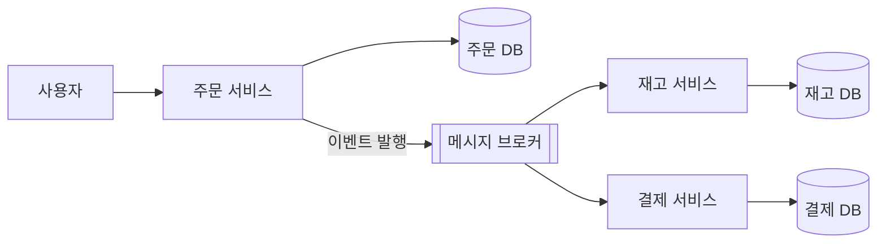
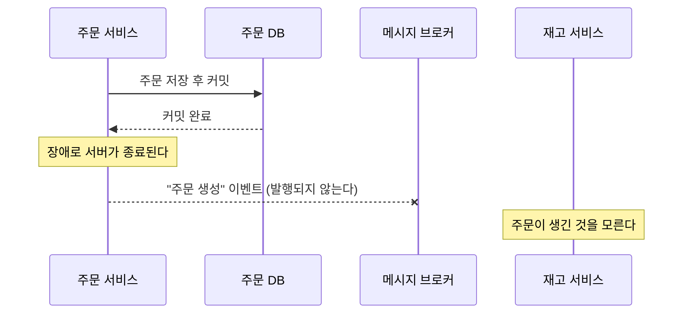
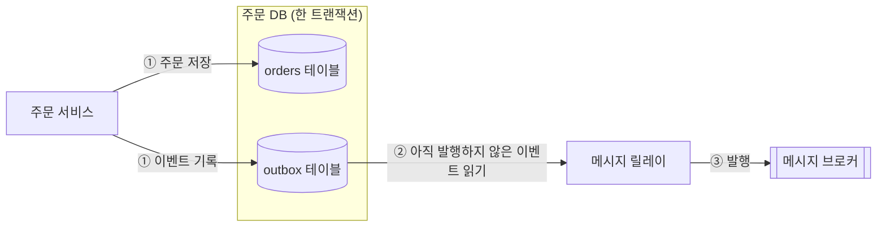
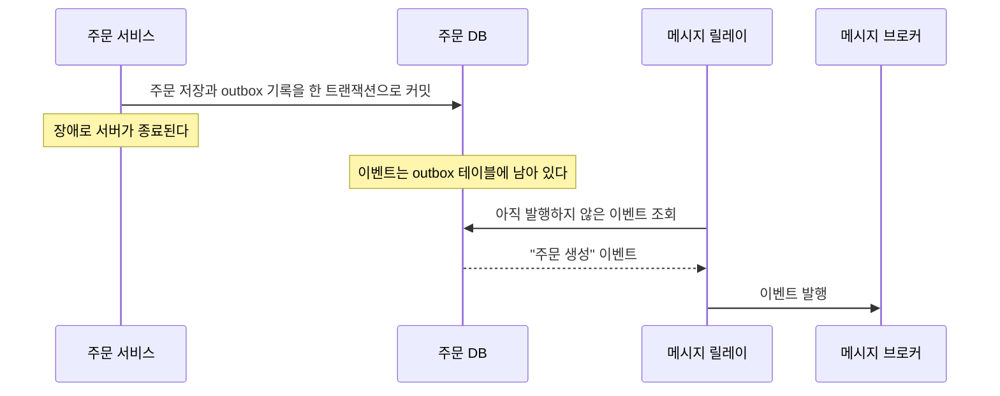
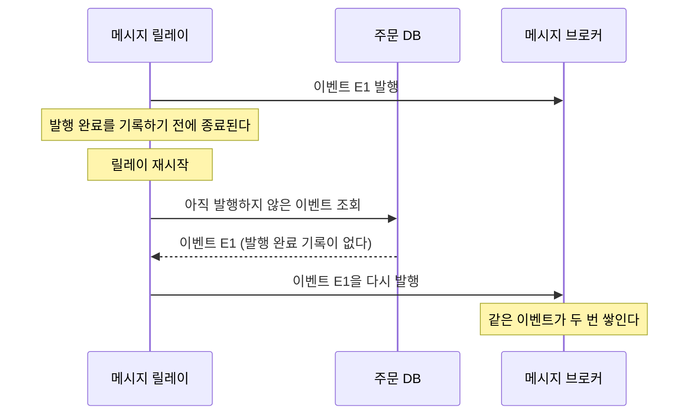
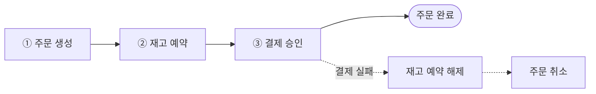
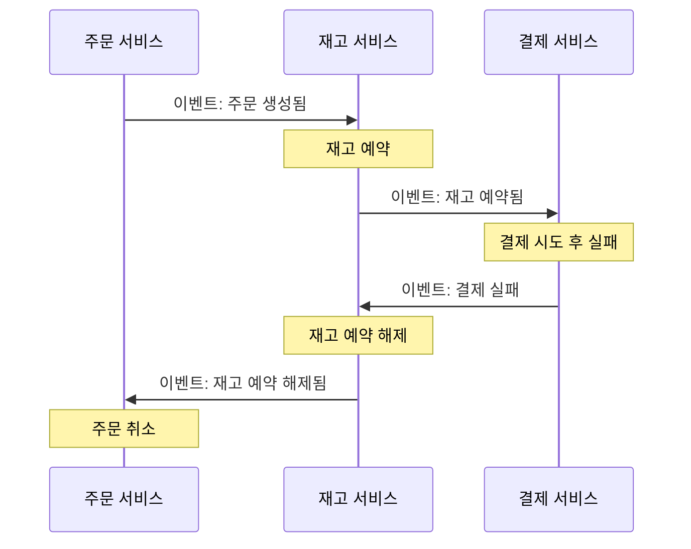
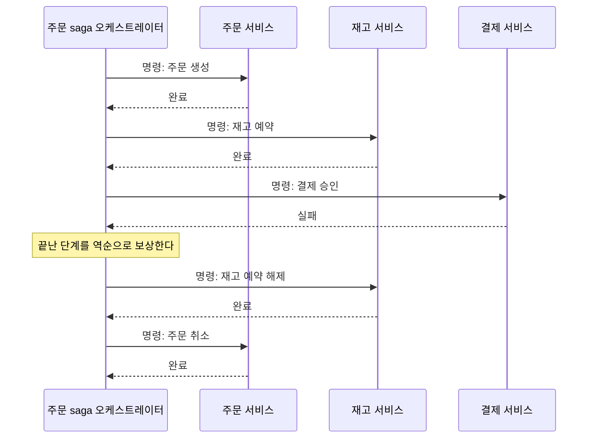
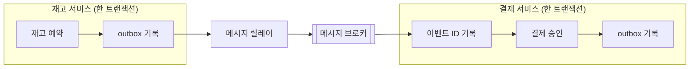

# 1. 들어가며

온라인 쇼핑몰에서 사용자가 주문 버튼을 눌렀다고 해 보자. 주문 하나를 처리하려면 주문을 기록하고, 재고를 확보하고, 결제를 승인해야 한다.

모든 데이터가 DB 하나에 있다면 이 일은 간단하다. 세 작업을 트랜잭션 하나로 묶으면 된다. 트랜잭션은 여러 작업을 한 단위로 묶어서 전부 성공시키거나 전부 취소하는 DB 기능이다. 중간에 결제가 실패하면 앞에서 저장한 주문과 재고 변경도 함께 취소되고, DB는 주문 버튼을 누르기 전 상태로 돌아간다.

그런데 서비스 규모가 커지면 주문, 재고, 결제를 서로 다른 서비스로 나누고 서비스마다 DB를 따로 두는 경우가 많다. 서비스끼리는 Kafka나 RabbitMQ 같은 메시지 브로커를 거쳐 메시지를 주고받는다. 이 구조에서는 세 작업이 서로 다른 DB에 저장되므로 트랜잭션 하나로 묶을 수 없다.

트랜잭션으로 묶을 수 없게 되면 두 가지 질문이 생긴다.

1. **서비스 하나 안에서**: 주문 서비스가 주문을 DB에 저장하는 일과 "주문이 생성됐다"는 이벤트를 발행하는 일을 어떻게 함께 성공시킬까? 이 질문에 답하는 방법이 **Outbox 패턴**이다
2. **여러 서비스에 걸쳐서**: 주문, 재고, 결제 중 한 단계가 실패하면 이미 끝난 앞 단계를 어떻게 되돌릴까? 이 질문에 답하는 방법이 **Saga 패턴**이다

이 글은 두 패턴이 각각 어떤 문제를 어떻게 푸는지 그림으로 설명한다. 코드는 다루지 않고, 예시로는 처음부터 끝까지 위의 쇼핑몰 주문 흐름 하나를 사용한다. 글에서 자주 쓰는 용어는 다음과 같다.

| 용어 | 뜻 |
|------|----|
| 트랜잭션 | 여러 DB 작업을 한 단위로 묶어 전부 성공시키거나 전부 취소하는 기능 |
| 커밋(commit) | 트랜잭션의 결과를 DB에 확정하는 일 |
| 메시지 브로커 | 서비스가 보낸 메시지를 보관했다가 그 메시지가 필요한 서비스에 전달하는 시스템 |
| 이벤트 | "주문이 생성됐다"처럼 이미 일어난 일을 알리는 메시지 |

# 2. 문제: DB 저장과 메시지 발행은 한 트랜잭션으로 묶이지 않는다

주문 서비스는 주문을 받으면 두 가지 일을 한다.

1. 주문을 주문 DB에 저장하고 커밋한다
2. 메시지 브로커에 "주문 생성" 이벤트를 발행한다

DB 트랜잭션은 그 DB 안에서 일어나는 작업만 묶을 수 있다. 메시지 브로커는 DB 밖에 있는 별도 시스템이므로, 2번 작업은 1번 작업의 트랜잭션에 포함되지 않는다. 이처럼 서로 다른 두 시스템에 각각 데이터를 쓰는 상황을 **dual write**라고 부른다.

dual write에서는 1번 작업이 끝난 뒤 2번 작업이 끝나기 전까지, 한쪽 시스템에만 데이터가 쓰인 순간이 생긴다. 주문을 커밋한 직후에 서버가 종료되면 어떤 일이 생기는지 보자.

주문 DB에는 주문이 남았지만 이벤트는 발행되지 않았다. 재고 서비스와 결제 서비스는 이 주문이 생긴 것을 모르므로, 주문은 "대기" 상태에 머문 채 더 이상 처리되지 않는다. 서버가 종료되지 않더라도 메시지 브로커가 잠시 응답하지 않아 발행에 실패하면 같은 일이 생긴다.

순서를 바꿔서 이벤트를 먼저 발행해도 문제는 사라지지 않는다. 이번에는 이벤트를 발행한 뒤 주문 커밋이 실패하면, 재고 서비스가 존재하지 않는 주문의 재고를 예약하게 된다(5.1절).

결국 주문 서비스가 지켜야 하는 조건은 하나로 정리된다. **주문이 커밋되면 이벤트도 반드시 발행되고, 주문이 커밋되지 않으면 이벤트도 발행되지 않아야 한다.** microservices.io의 Transactional Outbox 문서도 같은 조건을 이 패턴의 전제로 제시한다.

# 3. Outbox 패턴

## 3.1 동작 방식

Outbox 패턴의 아이디어는 단순하다. 이벤트를 메시지 브로커로 바로 보내지 않고, **보낼 이벤트를 주문과 같은 DB의 outbox 테이블에 먼저 기록한다.** 주문 테이블과 outbox 테이블은 같은 DB에 있으므로 트랜잭션 하나로 묶을 수 있다. outbox 테이블을 읽어 메시지 브로커로 발행하는 일은 별도 프로세스가 맡는다. 이 프로세스를 **메시지 릴레이(message relay)**라고 부른다.

이제 2장과 같은 상황에서 서버가 종료되어도 이벤트는 사라지지 않는다.

주문 서비스가 커밋 직후에 종료되어도 이벤트는 outbox 테이블에 남아 있으므로, 릴레이가 나중에 그 이벤트를 찾아 발행한다. 반대로 트랜잭션이 실패하면 주문과 outbox 기록이 함께 취소되어 발행할 이벤트 자체가 생기지 않는다. 이렇게 해서 2장에서 정리한 조건이 지켜진다.

outbox 테이블에는 보통 다음과 같은 정보를 담는다. 아래 컬럼 구성은 뒤에서 소개할 Debezium이 기본값으로 사용하는 구성이다.

| 컬럼 | 뜻 | 예시 |
|------|----|------|
| `id` | 이벤트마다 붙이는 고유 ID | UUID 값 |
| `aggregatetype` | 이벤트가 가리키는 대상의 종류 | `order` |
| `aggregateid` | 이벤트가 가리키는 대상의 ID | `123` (주문 번호) |
| `type` | 이벤트 종류 | `OrderCreated` |
| `payload` | 이벤트 내용 | `{"orderId": 123, "items": [...]}` |

aggregate는 도메인 주도 설계(DDD)에서 쓰는 용어인데, 여기서는 "주문 한 건"처럼 이벤트가 가리키는 대상이라고 이해하면 충분하다. `id` 컬럼은 3.2절에서 중복 이벤트를 걸러 낼 때 다시 쓰인다.

메시지 릴레이가 outbox 테이블에서 새 이벤트를 찾는 방법은 두 가지다.

| | Polling Publisher | Transaction Log Tailing |
|---|---|---|
| 방법 | outbox 테이블을 주기적으로 조회해서 아직 발행하지 않은 행을 가져온다 | DB가 변경 내용을 기록하는 로그(MySQL binlog, PostgreSQL WAL 등)를 읽어 outbox 테이블에 새로 들어온 행을 가져온다 |
| 장점 | 어떤 SQL DB에서도 동작하고 구현하기 쉽다 | 테이블을 반복해서 조회하지 않고, 커밋된 변경을 로그에서 정확하게 읽는다 |
| 단점 | 조회 주기만큼 발행이 늦어지고, 반복 조회가 DB에 부하를 준다. 이벤트를 순서대로 발행하기 까다롭다 | DB 종류마다 전용 도구가 필요하다 |

Polling 방식에서는 발행한 행에 발행 완료를 표시하거나 행을 지워서, 다음 조회 때 같은 행을 다시 가져오지 않게 한다. 두 번째 방식처럼 DB에서 일어난 변경을 감지해 다른 시스템으로 전달하는 기술을 CDC(Change Data Capture)라고 부른다. Debezium은 주로 Kafka Connect 커넥터로 실행하는 CDC 도구이며, outbox 테이블에 들어온 행을 `aggregatetype` 값에 맞는 Kafka 토픽으로 보내 주는 Outbox Event Router라는 변환 기능을 제공한다. Kafka Connect는 [Kafka Connect에 대한 소개](/kafka-connect에-대한-소개/)에서 다룬 적이 있다.

## 3.2 중복은 받는 쪽에서 막는다

Outbox 패턴은 이벤트가 사라지지 않게 해 주지만, 같은 이벤트가 두 번 발행되는 일까지 막지는 못한다. 릴레이가 이벤트를 발행한 뒤 발행 완료를 기록하기 전에 종료되면, 다시 시작한 릴레이는 그 이벤트를 아직 발행하지 않은 것으로 보고 한 번 더 발행한다.

이처럼 메시지가 사라지지는 않지만 두 번 이상 전달될 수 있는 전달 방식을 **at-least-once(최소 한 번 전달)**라고 부른다. microservices.io의 Transactional Outbox 문서도 릴레이가 같은 메시지를 두 번 이상 발행할 수 있으므로, 메시지를 받는 쪽이 멱등해야 한다고 설명한다.

**멱등(idempotent)**하다는 말은 같은 작업을 여러 번 실행해도 한 번 실행한 것과 결과가 같다는 뜻이다. 재고 서비스가 같은 "주문 생성" 이벤트를 두 번 받더라도 재고를 두 번 예약하면 안 된다. 받는 쪽을 멱등하게 만드는 대표적인 방법은 **처리한 이벤트의 ID를 기록해 두는 것**이다. microservices.io는 이 방법을 Idempotent Consumer 패턴이라고 부른다.

```mermaid
flowchart TD
    A[이벤트 수신] --> S[트랜잭션 시작]
    S --> B[processed_messages 테이블에 이벤트 ID 기록]
    B --> C{기록에 성공했나?}
    C -->|"성공: 처음 받은 이벤트"| D[재고 예약 후 커밋]
    C -->|"실패: 이미 기록된 ID"| E[트랜잭션 취소 후 이벤트 무시]
```

재고 서비스는 자기 DB에 `processed_messages` 테이블을 두고 이벤트 ID를 기본 키로 삼는다. 이벤트를 받으면 트랜잭션을 시작하고 이벤트 ID부터 기록한다. 이미 처리한 이벤트라면 같은 ID가 테이블에 있으므로 기본 키 제약 때문에 기록이 실패하고, 재고 서비스는 트랜잭션을 취소한 뒤 그 이벤트를 무시한다. ID를 먼저 조회해 보고 판단하는 방식보다 기록을 시도하는 방식이 안전하다. 재고 서비스 인스턴스 두 개가 같은 이벤트를 동시에 처리하더라도 둘 중 하나만 기록에 성공하기 때문이다.

이벤트 ID 기록과 재고 예약은 반드시 같은 트랜잭션에 넣어야 한다. 재고 예약을 커밋한 뒤 ID를 기록하기 전에 서버가 종료되면, 다시 받은 이벤트를 처음 받은 이벤트로 판단해서 재고를 또 예약하기 때문이다. 같은 DB 안에서 일어나는 두 작업을 트랜잭션 하나로 묶는다는 점에서, 이 방법은 Outbox 패턴과 원리가 같다.

작업 자체가 처음부터 멱등하다면 ID를 따로 기록하지 않아도 된다. "재고를 1개 줄인다"는 작업은 두 번 실행하면 재고가 2개 줄어든다. 반면 "주문 123에 대한 재고 예약을 만들되, 이미 있으면 그대로 둔다"나 "주문 123의 상태를 결제 완료로 바꾼다"는 작업은 몇 번을 실행해도 결과가 같다.

# 4. Saga 패턴

Outbox 패턴 덕분에 주문 서비스는 이벤트를 놓치지 않고 발행할 수 있게 됐다. 이제 두 번째 질문으로 넘어가자. 재고 예약까지 끝났는데 잔액이 부족해서 결제가 실패하면, 이미 각 서비스의 DB에 커밋된 주문과 재고 예약은 어떻게 되돌릴까?

## 4.1 동작 방식

Saga는 여러 서비스에 걸친 작업을 **서비스별 로컬 트랜잭션 여러 개로 나누고**, 단계마다 그 단계를 되돌리는 **보상 트랜잭션(compensating transaction)**을 미리 정해 두는 방식이다. 로컬 트랜잭션은 서비스 하나가 자기 DB 안에서 실행하는 일반 트랜잭션을 말한다. 모든 단계가 성공하면 작업이 끝나고, 중간 단계가 실패하면 이미 끝난 단계의 보상 트랜잭션을 역순으로 실행한다.

Saga라는 이름은 1987년 Hector Garcia-Molina와 Kenneth Salem이 발표한 논문 「Sagas」에서 나왔다. 이 논문은 원래 DB 하나에서 실행 시간이 몇 시간이나 며칠에 이를 수 있고, 그동안 락을 오래 잡고 있는 긴 트랜잭션(long lived transaction)을 짧은 트랜잭션 여러 개로 나누기 위해 saga를 제안했다. 논문이 정의한 보장은 다음과 같다. 트랜잭션 T1, T2, …, Tn으로 이루어진 saga는 T1부터 Tn까지 모두 실행되거나, 중간의 Tj까지 실행된 뒤 보상 트랜잭션 Cj, …, C1이 역순으로 실행된다. 마이크로서비스에서는 이 아이디어를 서비스마다 나뉜 트랜잭션에 적용한다.

쇼핑몰 주문을 saga로 나누면 다음과 같다.

| 단계 | 서비스 | 로컬 트랜잭션 | 보상 트랜잭션 |
|------|--------|---------------|---------------|
| 1 | 주문 | 주문 생성 (상태: 대기) | 주문 취소 |
| 2 | 재고 | 재고 예약 | 재고 예약 해제 |
| 3 | 결제 | 결제 승인 | 없음 (마지막 단계) |

마지막 단계에는 보상 트랜잭션이 필요 없다. 결제 승인이 실패하면 그 단계는 커밋되지 않았으므로 되돌릴 것이 없고, 결제가 성공하면 saga 전체가 성공으로 끝나기 때문이다. 결제까지 성공하면 주문 서비스가 주문 상태를 "완료"로 바꾸고 saga를 마친다.

실선은 정상 흐름이고, 점선은 결제가 실패했을 때 실행하는 보상 흐름이다. 보상 트랜잭션은 이미 끝난 단계의 역순으로 실행된다.

여기서 주의할 점은 **보상이 rollback과 다르다는 것**이다. DB의 rollback은 아직 커밋하지 않은 변경을 없던 일로 만든다. 반면 saga의 각 단계는 이미 커밋됐기 때문에 없던 일로 만들 수 없다. 보상 트랜잭션은 앞 단계가 남긴 효과를 **의미상 되돌리는 새 트랜잭션**이다. 주문 취소는 주문 행을 지우지 않고 상태를 "취소"로 바꾸며, 재고 예약 해제는 예약했던 수량을 다시 돌려놓는다. 이미 "주문 접수" 메일을 보냈다면 메일을 회수할 수 없으므로, 보상 단계에서 "주문 취소" 메일을 새로 보낸다.

그래서 보상 트랜잭션은 DB가 자동으로 만들어 주지 않고, 개발자가 단계마다 직접 설계해야 한다. microservices.io의 Saga 문서도 "자동 rollback이 없다"는 점을 saga의 단점으로 꼽는다.

## 4.2 Choreography와 Orchestration

Saga를 구현하는 방식은 각 단계를 누가 다음 단계로 넘기느냐에 따라 두 가지로 나뉜다.

- **Choreography**: 전체를 지휘하는 조정자가 없다. 각 서비스가 자기 단계를 마친 뒤 이벤트를 발행하고, 그 이벤트를 받은 다음 서비스가 자기 단계를 실행한다
- **Orchestration**: 오케스트레이터(orchestrator)라는 조정자가 각 서비스에 실행할 단계를 명령하고, 결과를 받아 다음 단계를 정한다

결제가 실패하는 상황을 두 방식으로 그려 보면 차이가 잘 보인다. 먼저 choreography다. 그림의 화살표는 모두 메시지 브로커를 거쳐 전달되는 이벤트다.

각 서비스는 자기가 받는 이벤트와 보내는 이벤트만 안다. 전체 흐름은 어느 한 곳에도 정의되어 있지 않으며, 서비스들이 주고받는 이벤트를 차례로 따라가야 파악할 수 있다.

다음은 orchestration이다.

전체 흐름과 보상 순서는 오케스트레이터 한 곳에 정의되어 있고, 각 서비스는 받은 명령을 실행해 결과만 돌려준다. 오케스트레이터가 꼭 독립된 서비스일 필요는 없으며, 주문 서비스 안에 객체로 둘 수도 있다. 위 그림에서는 역할을 구분하기 위해 따로 그렸다.

Azure Architecture Center의 Saga 문서는 두 방식을 다음과 같이 비교한다.

| | Choreography | Orchestration |
|---|---|---|
| 전체 흐름을 아는 곳 | 없다 (각 서비스에 흩어져 있다) | 오케스트레이터 |
| 장점 | 조정자를 따로 만들 필요가 없고, 조정자 때문에 생기는 단일 장애 지점이 없다. 단계가 적은 단순한 흐름에 잘 맞는다 | 단계가 많은 복잡한 흐름에 잘 맞는다. 서비스 사이의 순환 의존을 피할 수 있고, 각 서비스는 자기 단계만 책임진다 |
| 단점 | 단계가 늘수록 흐름을 따라가기 어렵다. 서비스 사이에 순환 의존이 생길 수 있고, 통합 테스트가 어렵다 | 오케스트레이터가 전체 흐름을 관리하므로 오케스트레이터가 장애 지점이 된다 |

정리하면 단계가 적은 단순한 흐름에는 choreography가 잘 맞고, 단계와 분기가 많아질수록 orchestration으로 관리하기가 쉬워진다.

## 4.3 주의할 점

Saga를 도입할 때 꼭 알아야 할 점이 두 가지 있다.

**첫째, saga에는 격리성이 없다.** DB 트랜잭션은 원자성(Atomicity), 일관성(Consistency), 격리성(Isolation), 지속성(Durability)이라는 네 가지 성질을 보장하며, 앞 글자를 따서 ACID라고 부른다. 이 중 격리성은 실행 중인 트랜잭션의 중간 결과를 다른 트랜잭션이 보지 못하게 하는 성질이다. 그런데 saga는 단계마다 커밋하므로, saga가 끝나기 전에도 중간 결과가 다른 요청에 보인다. 「Sagas」 논문도 일부만 실행된 saga의 결과를 다른 트랜잭션이 볼 수 있다고 명시한다.

예를 들어 재고가 1개 남은 상품을 사용자 A가 주문했다고 하자. A의 saga가 재고를 예약한 뒤 결제가 실패하면, 보상 트랜잭션이 재고 예약을 해제하기 전까지 재고는 0개로 보인다. 그 사이에 같은 상품을 주문하려던 사용자 B는 품절 안내를 받는다. Azure 문서는 격리성이 없어서 생기는 문제를 다음과 같이 분류하며, 위 예시는 이 중 dirty read에 해당한다.

| 문제 | 뜻 |
|------|----|
| Lost update | 한 saga가 다른 saga의 변경을 고려하지 않고 데이터를 수정해서, 다른 saga의 변경을 덮어쓴다 |
| Dirty read | 다른 saga가 수정하고 있어서 아직 확정되지 않은 데이터를 읽는다 |
| Fuzzy read | 한 saga의 여러 단계가 같은 데이터를 읽는 사이에 값이 바뀌어, 단계마다 서로 다른 값을 본다 |

대표적인 대응책은 **semantic lock**이다. DB 락 대신 데이터의 상태 값으로 "처리 중"을 표시하는 방법이다. 4.1절의 표에서 주문을 처음부터 "대기" 상태로 만든 이유가 여기에 있다. 주문은 saga가 끝날 때 "완료"나 "취소"로 바뀌고, 다른 기능은 "대기" 상태의 주문을 아직 확정되지 않은 주문으로 다룬다. 예를 들어 배송 처리를 시작하지 않고, 화면에는 "처리 중"으로 보여 준다. 이 밖에 실행 순서와 관계없이 같은 결과가 나오도록 수정 작업을 설계하는 방법(commutative updates)이나, 데이터를 수정하기 직전에 값이 바뀌지 않았는지 다시 확인하는 방법(reread value)도 있다.

**둘째, 보상 트랜잭션도 실패할 수 있다.** 네트워크 장애나 서비스 장애가 생기면 보상 트랜잭션도 실패한다. 보상이 끝내 실패하면 saga는 앞으로 진행하지도 못하고 되돌아가지도 못한 채, 데이터가 어긋난 상태로 남는다. 「Sagas」 논문도 보상 트랜잭션의 코드에 버그가 있으면 시스템이 트랜잭션을 취소하지도 완료하지도 못하는 상태가 된다고 지적한다.

그래서 보상 트랜잭션은 성공할 때까지 재시도할 수 있게 만들어야 한다. 재시도하면 같은 보상이 여러 번 실행될 수 있으므로, 보상 트랜잭션도 3.2절에서 본 것처럼 멱등해야 한다. 재시도로도 해결되지 않으면 알림을 보내 사람이 직접 처리하게 한다. 또 메일 발송처럼 되돌리기 어려운 작업은 saga의 뒤쪽 단계에 두는 편이 좋다. 뒤에 둘수록 그 작업을 보상해야 하는 경우가 줄어든다.

# 5. FAQ

## 5.1 이벤트를 먼저 발행하고 DB에 저장하면 안 되나?

안 된다. 순서를 바꾸면 어느 시스템에 먼저 쓰느냐만 달라질 뿐, 한쪽에만 데이터가 쓰이는 순간은 그대로 남는다. 이벤트를 발행한 뒤에 주문 커밋이 실패하면(제약 조건 위반, 서버 장애 등), 주문은 DB에 없는데 "주문 생성" 이벤트는 이미 메시지 브로커에 들어가 있다. 재고 서비스는 그 이벤트를 받아 존재하지 않는 주문의 재고를 예약하고, 한 번 발행한 이벤트는 다시 회수할 수 없다.

그래서 Outbox 패턴은 처음에는 DB 한 곳에만 데이터를 쓰고, 메시지 브로커에는 DB에 커밋된 기록을 바탕으로 나중에 발행한다.

## 5.2 2PC를 쓰면 되지 않나?

2PC(two-phase commit)는 여러 시스템에 걸친 트랜잭션을 하나로 묶는 프로토콜이다. 코디네이터가 모든 참여자에게 커밋할 준비가 됐는지 묻고(1단계), 모두 준비됐다고 답하면 커밋을 지시한다(2단계). 이론상으로는 dual write 문제를 풀 수 있지만, 마이크로서비스에서는 다음과 같은 이유로 잘 쓰지 않는다.

- 모든 참여자가 2PC를 지원해야 한다. Kafka 같은 메시지 브로커나 외부 결제 API는 2PC에 참여하지 못하는 경우가 많다
- 참여자는 코디네이터의 결정을 받을 때까지 락을 잡고 기다린다. 그 사이에 코디네이터가 종료되면 참여자는 커밋할지 취소할지 모르는 채로 락을 계속 잡고 있게 된다
- 가장 느린 참여자가 응답할 때까지 모든 참여자가 기다려야 하므로 처리량이 떨어진다

microservices.io의 Transactional Outbox 문서도 "2PC는 선택지가 아니다(2PC is not an option)"라는 조건을 전제로 패턴을 설명한다.

## 5.3 Outbox와 Saga는 어떻게 함께 쓰나?

Saga의 각 단계는 자기 DB에 로컬 트랜잭션을 커밋하고, 다음 단계를 위한 이벤트나 명령을 발행한다. 이 구조에는 2장에서 본 dual write 문제가 그대로 있다. 재고 서비스가 재고 예약을 커밋한 뒤 "재고 예약됨" 이벤트를 발행하기 전에 종료되면, saga는 그 자리에서 더 이상 진행되지 않는다.

그래서 saga에 참여하는 각 서비스는 Outbox 패턴으로 이벤트를 발행하고, 이벤트를 받는 쪽은 3.2절에서 본 방법으로 중복을 걸러 낸다. 오케스트레이터도 saga의 진행 상태를 저장하면서 명령을 보내므로 같은 방식이 필요하다. microservices.io의 Saga 문서도 이 이유로 Transactional Outbox를 관련 패턴으로 연결한다.

# 6. 마무리

이 글에서 다룬 내용을 정리하면 다음과 같다.

| 질문 | 패턴 | 핵심 |
|------|------|------|
| 서비스 하나 안에서 DB 저장과 이벤트 발행을 함께 성공시키려면? | Outbox | 이벤트를 같은 트랜잭션으로 outbox 테이블에 기록하고, 메시지 릴레이가 발행한다 |
| 같은 이벤트가 두 번 도착하면? | Idempotent Consumer | 처리한 이벤트 ID를 같은 트랜잭션으로 기록하고, 이미 기록된 이벤트는 무시한다 |
| 여러 서비스에 걸친 작업이 중간에 실패하면? | Saga | 이미 끝난 단계를 보상 트랜잭션으로 역순으로 되돌린다 |

두 패턴은 모든 서비스가 같은 순간에 같은 상태를 보는 것을 포기한다. 그 대신 잠시 어긋나더라도 결국에는 상태가 맞춰지는 방식을 택하며, 이를 최종 일관성(eventual consistency)이라고 부른다. 주문이 잠시 "대기" 상태로 보이거나 이벤트가 조금 늦게 도착하는 현상은 이 선택에 따르는 비용이다. 이 비용을 받아들이면 서비스마다 DB를 따로 두면서도, 이벤트를 잃어버리거나 절반만 처리된 주문을 방치하는 일을 막을 수 있다.

# 7. 참고

- [Pattern: Transactional outbox - microservices.io](https://microservices.io/patterns/data/transactional-outbox.html)
- [Pattern: Polling publisher - microservices.io](https://microservices.io/patterns/data/polling-publisher.html)
- [Pattern: Transaction log tailing - microservices.io](https://microservices.io/patterns/data/transaction-log-tailing.html)
- [Pattern: Idempotent Consumer - microservices.io](https://microservices.io/patterns/communication-style/idempotent-consumer.html)
- [Pattern: Saga - microservices.io](https://microservices.io/patterns/data/saga.html)
- [Saga design pattern - Azure Architecture Center](https://learn.microsoft.com/en-us/azure/architecture/patterns/saga)
- [Outbox Event Router - Debezium Documentation](https://debezium.io/documentation/reference/stable/transformations/outbox-event-router.html)
- [Hector Garcia-Molina, Kenneth Salem, "Sagas", ACM SIGMOD 1987 (PDF)](https://www.cs.cornell.edu/andru/cs711/2002fa/reading/sagas.pdf)
- [Kafka Connect에 대한 소개](/kafka-connect에-대한-소개/)
