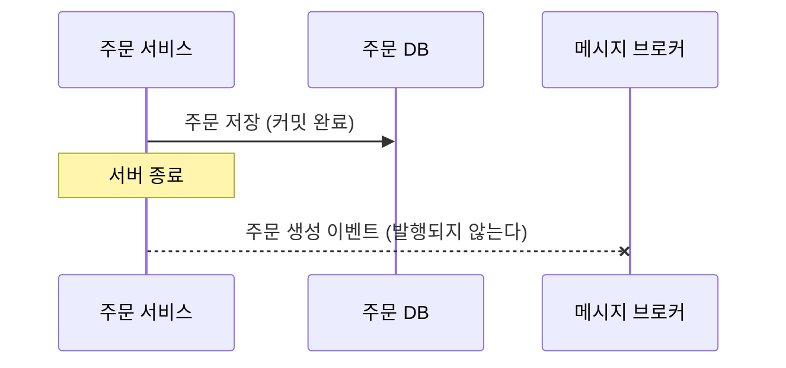
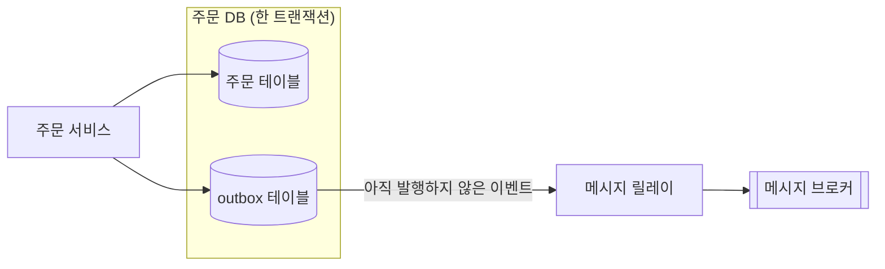
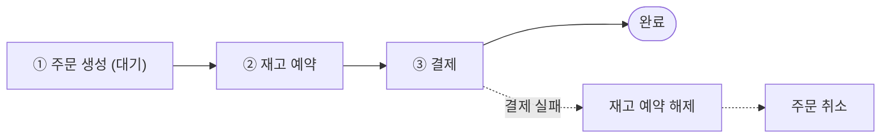

# 1. 들어가며

DB가 하나뿐이면 "모두 성공하거나 모두 취소하기"는 트랜잭션 하나로 해결된다. 그런데 주문, 재고, 결제를 서로 다른 서비스로 나누고 DB도 따로 두면 이 보장이 사라진다. 이때 생기는 문제는 크게 두 가지다.

| 문제 | 해결 방법 |
|------|-----------|
| 주문은 저장했는데 다른 서비스에 알리지 못했다 | Outbox 패턴 |
| 여러 단계 중 중간 단계가 실패했다 | Saga 패턴 |

이 글은 두 패턴을 피자 가게 이야기로 설명하고, 이야기마다 실제 시스템에서는 어떻게 동작하는지 덧붙인다.

# 2. 문제: 적어 두고 알리기 전에 멈추면

피자 가게 점원은 주문을 받으면 두 가지 일을 한다. 장부에 주문을 적고, 주방에 "피자 하나요!"라고 알린다. 그런데 장부에 적은 직후 점원이 급한 전화를 받으러 자리를 비우면 어떻게 될까? 장부에는 주문이 있는데 주방은 아무것도 모른다. 손님은 피자를 받지 못한다.

실제 시스템에서 장부는 DB이고, 주방에 알리는 일은 Kafka 같은 메시지 브로커에 이벤트를 발행하는 일이다. DB와 메시지 브로커는 서로 다른 시스템이라 트랜잭션 하나로 묶을 수 없다. 그래서 DB에 커밋한 직후 서버가 종료되면 이벤트는 발행되지 않는다. 이 문제를 dual write 문제라고 부른다.

순서를 바꿔 주방에 먼저 알려도 마찬가지다. 알린 뒤에 장부에 적지 못하면, 주방은 장부에 없는 주문의 피자를 굽는다.

# 3. Outbox 패턴: 알릴 내용도 장부에 같이 적는다

해결 방법은 간단하다. 점원은 주방에 직접 알리지 않고, 장부에 주문을 적을 때 **주방에 전할 쪽지도 같은 장부에 함께 적는다.** 두 가지를 한 번에 적으므로 주문만 적히고 쪽지가 빠지는 일은 생기지 않는다. 쪽지를 주방에 가져다주는 일은 심부름꾼이 맡는다. 심부름꾼은 장부를 보고 아직 전하지 않은 쪽지를 찾아 주방에 전달한다.

실제 시스템에서 쪽지를 적는 칸은 같은 DB에 있는 outbox 테이블이고, 심부름꾼은 메시지 릴레이라는 별도 프로세스다. 주문과 이벤트가 같은 DB에 있으므로 트랜잭션 하나로 묶인다. 서버가 커밋 직후에 종료되어도 이벤트는 outbox 테이블에 남아 있어서, 릴레이가 나중에 찾아 발행한다. 릴레이는 outbox 테이블을 주기적으로 조회하는 방식(polling)으로 만들거나, Debezium 같은 CDC 도구로 DB 변경 로그를 읽는 방식으로 만든다.

**같은 쪽지가 두 번 갈 수도 있다.** 심부름꾼이 쪽지를 전한 뒤 "전달함" 표시를 하기 전에 넘어지면, 다시 일어난 심부름꾼은 같은 쪽지를 한 번 더 가져간다. 그래서 주방은 받은 쪽지의 번호를 적어 두고, 이미 받은 번호의 쪽지는 버린다.

실제 시스템에서는 이벤트를 받는 서비스가 처리한 이벤트 ID를 자기 DB에 기록하고, 같은 ID가 다시 오면 무시한다. 이렇게 같은 이벤트를 여러 번 받아도 결과가 한 번 받은 것과 같게 만드는 성질을 멱등성(idempotency)이라고 부른다.

# 4. Saga 패턴: 실패하면 앞 단계를 하나씩 되돌린다

이번에는 피자 한 판이 세 단계를 거친다고 하자. 주문서를 쓰고, 냉장고에서 도우를 꺼내 두고, 계산대에서 카드를 긁는다. 그런데 카드가 거절됐다. 이미 끝난 앞의 두 단계는 어떻게 해야 할까?

답은 **단계마다 되돌리는 방법을 미리 정해 두고, 실패하면 거꾸로 하나씩 되돌리는 것**이다. 꺼낸 도우는 다시 냉장고에 넣고, 주문서에는 "취소" 도장을 찍는다. 이 방식을 Saga 패턴이라고 부르고, 되돌리는 작업을 보상 트랜잭션(compensating transaction)이라고 부른다.

여기서 보상은 지우개가 아니라는 점이 중요하다. 주문서를 찢어 버리지 않고 "취소" 도장을 찍는다. 각 서비스의 DB에 이미 커밋된 데이터는 없던 일로 만들 수 없으므로, 반대 효과를 내는 새 작업을 실행하는 것이다.

단계를 다음 단계로 넘기는 방법은 두 가지다.

| 방식 | 피자 가게에서는 | 실제 시스템에서는 |
|------|-----------------|-------------------|
| Choreography | 이어달리기처럼 자기 일을 마친 사람이 다음 사람에게 알린다 | 각 서비스가 이벤트를 발행하고, 그 이벤트를 받은 다음 서비스가 이어서 실행한다 |
| Orchestration | 점장 한 명이 순서대로 "다음은 주방", "다음은 계산대"라고 지시한다 | 오케스트레이터가 각 서비스에 명령하고, 결과를 받아 다음 단계를 정한다 |

단계가 적으면 choreography가 간단하고, 단계가 많아질수록 orchestration으로 흐름을 관리하기 쉽다.

Saga를 쓸 때 주의할 점도 두 가지 있다.

- **중간 상태가 다른 사람에게 보인다**: 도우를 꺼내 둔 사이에 온 다른 손님은 "도우가 떨어졌어요"라는 말을 듣는다. 그래서 주문을 처음부터 "대기" 상태로 만들고, saga가 끝나기 전까지는 확정되지 않은 주문으로 다룬다
- **되돌리기도 실패할 수 있다**: 보상 트랜잭션은 성공할 때까지 재시도할 수 있게 만들고, 여러 번 실행되어도 결과가 같도록 멱등하게 만든다

또 saga의 각 단계도 "자기 DB에 적고 다음 서비스에 알리는" 일이므로, 2장의 dual write 문제가 똑같이 생긴다. 그래서 saga의 각 단계는 3장의 Outbox 패턴으로 이벤트를 발행한다.

# 5. 마무리

| 패턴 | 피자 가게에서는 | 실제 시스템에서는 |
|------|-----------------|-------------------|
| Outbox | 전할 쪽지도 장부에 같이 적고, 심부름꾼이 주방에 전한다 | 이벤트를 같은 트랜잭션으로 outbox 테이블에 기록하고, 메시지 릴레이가 발행한다 |
| 멱등 소비자 | 주방은 이미 받은 번호의 쪽지를 버린다 | 처리한 이벤트 ID를 기록해 두고 중복 이벤트를 무시한다 |
| Saga | 카드가 거절되면 도우를 다시 넣고 주문서에 취소 도장을 찍는다 | 끝난 단계를 보상 트랜잭션으로 역순으로 되돌린다 |

두 패턴 모두 모든 서비스의 데이터가 한순간에 맞아떨어지는 것을 포기한다. 그 대신 잠깐 어긋나더라도 결국에는 맞춰지는 방식을 택하며, 이를 최종 일관성(eventual consistency)이라고 부른다.

# 6. 참고

- [Pattern: Transactional outbox - microservices.io](https://microservices.io/patterns/data/transactional-outbox.html)
- [Pattern: Idempotent Consumer - microservices.io](https://microservices.io/patterns/communication-style/idempotent-consumer.html)
- [Pattern: Saga - microservices.io](https://microservices.io/patterns/data/saga.html)
- [Saga design pattern - Azure Architecture Center](https://learn.microsoft.com/en-us/azure/architecture/patterns/saga)
- [Outbox Event Router - Debezium Documentation](https://debezium.io/documentation/reference/stable/transformations/outbox-event-router.html)
