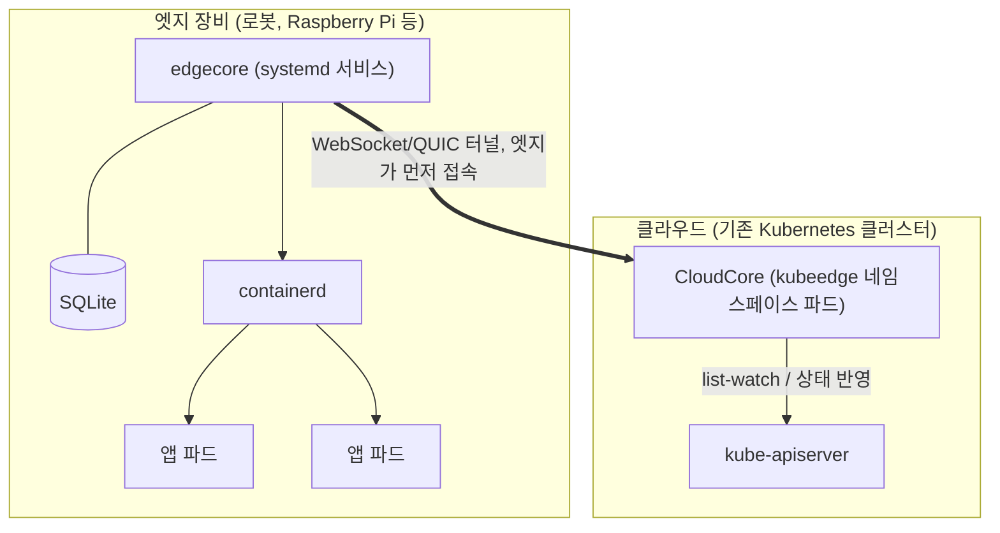
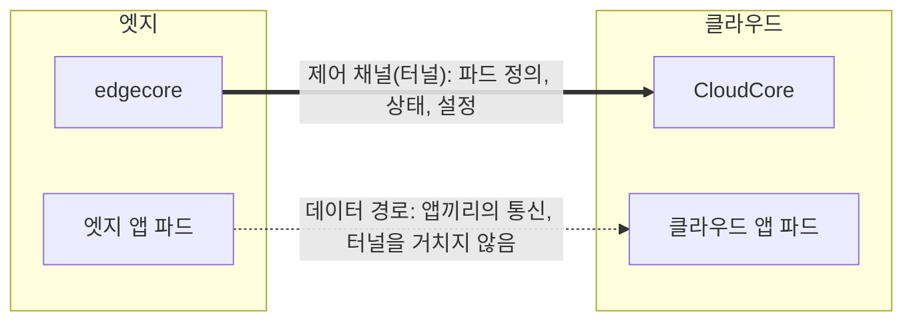

# KubeEdge 입문 블로그 글 Implementation Plan

> **For agentic workers:** REQUIRED SUB-SKILL: Use superpowers:subagent-driven-development (recommended) or superpowers:executing-plans to implement this plan task-by-task. Steps use checkbox (`- [ ]`) syntax for tracking.

**Goal:** 발표 자료(19~32번 슬라이드) 순서를 뼈대로, 스터디 노트로 보강한 KubeEdge 입문 단일 글의 초안을 `docs/start/`에 작성하고 PR을 만든다.

**Architecture:** 사실 확인 조사를 먼저 끝내 결과표를 만든 뒤, 그 표에서 확인된 것만 본문에 쓴다. 본문은 절 묶음 단위로 나눠 쓰고 묶음마다 커밋한다. 설치 절의 출력은 ros_k8s `docs/`에서 정해진 규칙으로 발췌한다. 마지막에 정적 검사와 dev 서버 렌더링 확인을 거쳐 PR을 만든다.

**Tech Stack:** Markdown + YAML frontmatter, Mermaid(클라이언트 렌더), Next.js 16 dev 서버, `gh` CLI

**Spec:** `docs/superpowers/specs/2026-10-25-kubeedge-blog-design.md`

---

## 경로 별칭

| 별칭 | 절대 경로 |
|------|----------|
| BLOG_REPO | `/Users/user/src/workspace_blogv2/blog-v2.advenoh.pe.kr-kubeedge` |
| SP | `/private/tmp/claude-501/-Users-user-src-workspace-blogv2/10eac8f3-0e71-414a-bce6-adf2341f31cc/scratchpad` |
| NOTE | `SP/sources/kubeedge-note.md` (스터디 노트 사본, 비공개) |
| SLIDES | `SP/sources/slides-19-32.md` (발표 자료 19~32번 슬라이드 텍스트와 발표자 노트, 비공개) |
| ROSK8S | `SP/src/ros_k8s` (공개 저장소 shallow clone, 커밋 `d4e32db`) |
| ARTICLE | `BLOG_REPO/docs/start/kubeedge-입문-로봇을-kubernetes-엣지-노드로-관리하기/index.md` |
| FACTS | `SP/research/fact-check.md` (사실 확인 결과표, 커밋하지 않음) |

BLOG_REPO는 `feat/kubeedge-입문` 브랜치 전용 git worktree이고 spec이 커밋되어 있다(`aba9667`). 원래 저장소 폴더(`blog-v2.advenoh.pe.kr`)는 다른 작업이 쓰고 있으므로 그 폴더로 `cd`하거나 그 폴더에서 브랜치를 바꾸지 않는다. dev 서버도 겹치지 않게 3001 포트를 쓴다.

**NOTE·SLIDES는 비공개 자료다.** 내용을 옮길 때 비공개 저장소 이름, 파일 경로, 사내 시스템 이름, 팀 내부 이야기는 ARTICLE·커밋 메시지·PR 본문에 쓰지 않는다. SLIDES의 발표자 노트 중 개인 소감 외의 팀 코멘트는 쓰지 않는다.

## NOTE 장 위치 (줄 번호)

| 장 | 줄 | 장 | 줄 |
|---|---|---|---|
| 1 왜 필요한가 | 11-59 | 8 네트워킹 | 576-633 |
| 2 Kubernetes 기본 | 61-183 | 9 디바이스 관리 | 635-1026 |
| 3 전체 구조 | 185-234 | 10 설치 도구와 버전 | 1028-1118 |
| 4 CloudCore | 236-330 | 12 로봇 관점 | 1155-1194 |
| 5 EdgeCore | 332-455 | 14 FAQ | 1222-1377 |
| 6 파드가 뜨기까지 | 457-512 | 참고 자료 | 1379-1392 |
| 7 엣지 자율성 | 514-574 | | |

## File Structure

| 파일 | 책임 | 커밋 |
|------|------|------|
| `docs/superpowers/plans/2026-10-25-kubeedge-blog.md` | 이 계획 | O |
| ARTICLE | 글 본문 (신규) | O |
| FACTS | 사실 확인 결과표 | X (scratchpad) |

`cover.png`, `index_en.md`, `slides.html`, 퀴즈는 범위 밖이다.

## 공통 작성 규칙 (모든 본문 Task에 적용)

1. **문체**: 해라체(`~다`). NOTE·SLIDES는 합니다체라 옮기면서 바꾼다. 개인 목소리("나는", "~했다")는 1절과 9절에만 둔다
2. **추측 금지**: 사실·수치·날짜·버전은 NOTE·SLIDES·ROSK8S에 있거나 FACTS에서 "확인"된 것만 쓴다. NOTE의 "(추론)", "(확인 필요)", "(구조상 추론)" 표시가 붙은 문장은 FACTS 결과에 따라 고쳐 쓰거나 뺀다. 표시 문구 자체는 본문에 남기지 않는다
3. **Mermaid**: 노드 텍스트와 엣지 라벨 모두에 `<br/>`, `<br>` 등 HTML 태그를 쓰지 않는다. NOTE의 다이어그램을 옮길 때는 줄바꿈 대신 쉼표나 괄호로 한 줄로 만든다
4. **상호참조**: NOTE의 "N장 참고", "FAQ N번" 같은 내부 참조는 이 글의 절 번호(예: "5.4절")로 바꾼다. `[[위키링크]]`는 남기지 않는다
5. **heading**: `content-heading-style` 스킬 규칙을 따른다. 절은 `# N. 제목`, 하위 절은 `## N.M 제목`, 그 아래는 `### N.M.K 제목`. 번호 없는 heading을 쓰지 않는다. H3는 내용이 길 때만 쓴다. heading에 수식·HTML을 쓰지 않는다

---

## Task 1: 사실 확인 조사

**Files:**
- Create: FACTS

spec 4.1의 확인 대상에 본문 작성 중 근거가 필요한 항목을 더해 조사한다. 1차 자료(KubeEdge 공식 문서, kubeedge GitHub 저장소·이슈·릴리스, Kubernetes 공식 문서, CNCF)를 우선한다. 웹 페이지는 WebFetch, GitHub 파일은 `gh api` 또는 raw URL로 읽는다.

- [ ] **Step 1: FACTS 파일 생성**

```bash
mkdir -p /private/tmp/claude-501/-Users-user-src-workspace-blogv2/10eac8f3-0e71-414a-bce6-adf2341f31cc/scratchpad/research
cat > /private/tmp/claude-501/-Users-user-src-workspace-blogv2/10eac8f3-0e71-414a-bce6-adf2341f31cc/scratchpad/research/fact-check.md <<'EOF'
# KubeEdge 글 사실 확인 결과

| # | 항목 | 원본 주장 | 결과 | 근거 URL | 글에 쓸 문장 |
|---|---|---|---|---|---|
EOF
```

`결과`는 `확인` / `수정`(원본과 다르게 확인됨) / `뺌`(확인 안 됨) 중 하나다.

- [ ] **Step 2: 항목별 조사**

| # | 항목 | 원본 주장 | 먼저 볼 곳 |
|---|---|---|---|
| 1 | 재연결 뒤 클라우드의 삭제 결정이 엣지에 반영 | NOTE 530행 "구조상 동작, 버전별 확인 필요" | `kubeedge/kubeedge` docs/proposals 의 edge autonomy·reliable message delivery 문서, KubeEdge 문서 |
| 2 | `app-offline.kubeedge.io=autonomy` 라벨 | NOTE 539행 "v1.6 추가, 현재 동작 확인 필요" | https://kubeedge.io/blog/release-v1.6/ , kubeedge 소스에서 `app-offline` 검색(`gh search code "app-offline.kubeedge.io" --repo kubeedge/kubeedge`) |
| 3 | EdgeMesh는 Service(TCP/UDP/HTTP)용이고 DDS 멀티캐스트 discovery를 대신하지 않음 | NOTE 626행 "구조상 추론" | https://github.com/kubeedge/edgemesh README, edgemesh 문서 |
| 4 | 엣지 노드에서 device plugin 동작 (GPU는 공식 문서) | NOTE 718-720행 | https://github.com/kubeedge/website/blob/6b8fd13bbd177fdade81ab4a54d3e6f5f3c70edc/docs/advanced/gpu.md |
| 5 | KubeEdge ↔ Kubernetes 호환표 (1.19~1.23 × K8s 1.27~1.32) | NOTE 1087-1098행 | https://github.com/kubeedge/kubeedge#kubernetes-compatibility |
| 6 | Edged가 v1.12부터 kubelet 코드를 내장 | NOTE 369행 | KubeEdge v1.12 릴리스 노트(블로그 또는 CHANGELOG) |
| 7 | 2018년 Huawei에서 시작, CNCF Graduated | SLIDES 24번 노트, NOTE 59행 | CNCF 프로젝트 페이지 https://www.cncf.io/projects/kubeedge/ , KubeEdge 졸업 발표 |
| 8 | CloudCore HA 구성 가능 | NOTE 1254행 | KubeEdge 문서 (HA 관련 페이지) |
| 9 | keink(KubeEdge IN kind)가 alpha | NOTE 1258행 | https://github.com/kubeedge/keink README |
| 10 | ROSCon 2026 일정·장소(토론토, 2026-09-22~24) | 발표 자료 개요 | https://roscon.ros.org/2026/ |
| 11 | Tomoya Fujita 소속·역할(Sony R&D US Lab, ROS TSC, KubeEdge SIG Robotics Chair), ROSCon 2023 발표 | SLIDES 20번 | ROSCon 2023 프로그램, KubeEdge SIG Robotics 페이지, GitHub 프로필 |
| 12 | 엣지 노드로 kube-proxy·CNI DaemonSet이 스케줄되는 문제와 nodeAffinity로 제외하는 방법 | NOTE 1230-1246행 | keadm 설치 문서 https://kubeedge.io/docs/setup/install-with-keadm/ |
| 13 | CloudCore 포트 10000~10004 용도 | NOTE 221-230행 | keadm 설치 문서, cloudcore Helm chart values |
| 14 | `kubectl logs/exec`에 cloudStream·edgeStream 필요 | NOTE 1227행, ROSK8S Setup_KubeEdge.md NOTE | https://kubeedge.io/docs/advanced/debug/ |
| 15 | unreachable taint 기본 `tolerationSeconds: 300`, DaemonSet은 기한 없이 견딤 | NOTE 172-177행 | https://kubernetes.io/docs/concepts/scheduling-eviction/taint-and-toleration/ , DaemonSet 문서 |
| 16 | 메시지 전달 보장: ACK, ObjectSync CRD, at-least-once | NOTE 549-574행 | https://github.com/kubeedge/kubeedge/blob/master/docs/proposals/sig-node/reliable-message-delivery.md |
| 17 | 장치 API가 v1.15부터 `devices.kubeedge.io/v1beta1`, DMI 방식 | NOTE 733-776행 | https://github.com/kubeedge/kubeedge/blob/master/docs/proposals/sig-device-iot/device-crd-v1beta1.md |
| 18 | 엣지 MetaServer 기본 비활성, `127.0.0.1:10550` | NOTE 370행 | KubeEdge MetaServer 문서 |

항목마다 FACTS 표에 한 행을 추가한다. 예:

```markdown
| 2 | app-offline 라벨 | v1.6에서 추가, 파드에 달면 toleration 자동 변경 | 뺌 | https://kubeedge.io/blog/release-v1.6/ | (7.2절에서 DaemonSet·toleration 두 방법만 소개) |
```

- [ ] **Step 3: 결과 요약 확인**

```bash
grep -c '^| [0-9]' /private/tmp/claude-501/-Users-user-src-workspace-blogv2/10eac8f3-0e71-414a-bce6-adf2341f31cc/scratchpad/research/fact-check.md
grep -E '\| (뺌|수정) \|' /private/tmp/claude-501/-Users-user-src-workspace-blogv2/10eac8f3-0e71-414a-bce6-adf2341f31cc/scratchpad/research/fact-check.md
```

Expected: 첫 명령은 `18`. 두 번째 명령은 본문에서 고치거나 뺄 항목 목록이다. 이 목록을 Task 2~6 작성 중 계속 참조한다.

커밋 없음 (FACTS는 scratchpad 파일이다).

---

## Task 2: 초안 뼈대, frontmatter, 1~2절

**Files:**
- Create: ARTICLE

- [ ] **Step 1: 파일 생성 (frontmatter + 절 제목 뼈대)**

```bash
mkdir -p "/Users/user/src/workspace_blogv2/blog-v2.advenoh.pe.kr-kubeedge/docs/start/kubeedge-입문-로봇을-kubernetes-엣지-노드로-관리하기"
cat > "/Users/user/src/workspace_blogv2/blog-v2.advenoh.pe.kr-kubeedge/docs/start/kubeedge-입문-로봇을-kubernetes-엣지-노드로-관리하기/index.md" <<'EOF'
---
title: "KubeEdge 입문 - 로봇을 Kubernetes 엣지 노드로 관리하기"
description: "로봇을 Kubernetes 노드로 붙이면 무엇이 문제인지, KubeEdge가 이를 어떻게 해결하는지 구조와 설치 흐름으로 정리한다"
date: 2026-10-25
update: 2026-10-25
tags:
  - kubeedge
  - kubernetes
  - k8s
  - edge-computing
  - ros2
  - robot
  - 쿠버네티스
  - 엣지컴퓨팅
  - 로봇
---

# 1. 들어가며

# 2. 왜 로봇에 Kubernetes인가

# 3. Kubernetes 기본

# 4. KubeEdge가 필요한 이유

# 5. KubeEdge 구조

# 6. KubeEdge 설치

# 7. 장단점과 정리

# 8. FAQ

# 9. 마치며

# 10. 참고
EOF
```

- [ ] **Step 2: 1절 들어가며 작성**

출처: SLIDES 20번(텍스트 + 발표자 노트), FACTS #10·#11.

담을 내용 (개인 목소리 허용):
- ROSCon 2026(FACTS #10에서 확인된 일정·장소만)에서 Whova 앱으로 열린 모임에 참석했다. 15분 정도 서서 질문하고 답을 듣는 형식이었다
- 주최한 Tomoya Fujita 소개: FACTS #11에서 확인된 소속·역할만. ros_k8s 저장소 작성자, ROSCon 2023 발표 "ROS / ROS 2 with Kubernetes and KubeEdge"
- 그때 나눈 이야기를 계기로 KubeEdge를 공부했고, 이 글은 그 정리다
- ros_k8s 소개 한두 문장: Kubernetes·KubeEdge 위에 ROS/ROS 2 앱을 배포하는 튜토리얼 저장소. 링크 https://github.com/fujitatomoya/ros_k8s
- **이 글에서 다루는 것** 굵은 글씨 목록: 로봇을 그냥 노드로 붙이면 생기는 문제, KubeEdge 구조, keadm 설치 4단계, 로봇에 적용할 때의 장단점

- [ ] **Step 3: 2절 왜 로봇에 Kubernetes인가 작성**

출처: SLIDES 21번(텍스트 + 발표자 노트). 출처 표기: ROS TSC 발표 "ROS with Kubernetes"(Tomoya Fujita), https://www.slideshare.net/slideshow/rostscrosk8s20230309pdf/256331489

담을 내용:
- 지금은 환경마다 배포 방식이 따로다. 표로 정리한다:

| 환경 | 지금 배포하는 방식 |
|---|---|
| 클라우드 | 컨테이너와 Kubernetes. 개발자는 kubectl·Helm·GitOps로 배포 |
| IoT 장치 | 장치별 정적 구현, 바꾸기 어려움 |
| 로봇 | 로봇마다 환경 구성과 설치 |

- 클라우드와 엣지 장치는 아키텍처가 달라 환경 구성·앱 실행에 시간과 노력이 많이 든다
- 로봇·IoT 장치도 Kubernetes 노드로 만들면 클라우드 앱처럼 같은 방식으로 어디에든 배포할 수 있다
- Kubernetes가 주는 것: 라벨로 배포 대상 지정, Rolling·Canary 업데이트, 자동 복구, 하드웨어 추상화, 관측·확장
- 로봇은 여러 대가 협업하고, 센싱에 따라 앱을 올리고 내리며, 스스로 복구되어야 한다. 그래서 클라우드에서 쓰던 배포 방식을 엣지까지 가져오려는 것이 동기다
- 다리 문장: "그런데 로봇을 그냥 Kubernetes 노드로 붙이면 몇 가지 문제가 생긴다. 그 전에 Kubernetes가 노드를 어떻게 다루는지부터 짚는다."

- [ ] **Step 4: 커밋**

```bash
cd /Users/user/src/workspace_blogv2/blog-v2.advenoh.pe.kr-kubeedge
git add "docs/start/kubeedge-입문-로봇을-kubernetes-엣지-노드로-관리하기/index.md"
git commit -q -F - <<'EOF'
docs: KubeEdge 입문 초안 뼈대와 1~2절 작성

* frontmatter와 절 제목 뼈대
* 들어가며: ROSCon 2026 모임과 ros_k8s 소개
* 왜 로봇에 Kubernetes인가: 환경별 배포 방식 비교

Co-Authored-By: Claude Opus 5.5 <noreply@anthropic.com>
EOF
```

---

## Task 3: 3~4절 (Kubernetes 기본, KubeEdge가 필요한 이유)

**Files:**
- Modify: ARTICLE (`# 3.`, `# 4.` 아래)

- [ ] **Step 1: 3절 Kubernetes 기본 작성**

출처: SLIDES 22번(텍스트 + 발표자 노트), NOTE 2.1·2.2·2.4(61-177행), NOTE FAQ 9(1324-1344행), FACTS #15.

구성:
1. 도입: KubeEdge는 Kubernetes의 어느 부분을 바꾸는지가 핵심이라 바뀌는 부분 위주로 짧게 본다
2. **control plane과 node** 다이어그램. NOTE 67-88행의 Mermaid를 그대로 옮긴다(HTML 태그 없음)
3. 컴포넌트 표 (각 한두 줄, NOTE 94-145행을 압축):

| 구분 | 컴포넌트 | 하는 일 |
|---|---|---|
| control plane | kube-apiserver | 모든 읽기·쓰기를 받는 REST API 서버. 다른 컴포넌트는 서로 직접 말하지 않고 여기를 거친다 |
| control plane | etcd | 모든 리소스를 저장하는 key-value DB. API 서버만 접근한다 |
| control plane | kube-scheduler | 노드가 정해지지 않은 파드의 노드를 정한다. 실행은 하지 않는다 |
| control plane | kube-controller-manager | 원하는 상태와 실제 상태를 맞추는 컨트롤러 묶음 (Deployment, ReplicaSet, Node 등) |
| node | kubelet | 노드마다 systemd 서비스로 도는 에이전트. 배정된 파드를 watch해 containerd로 띄우고 상태·하트비트를 보고한다 |
| node | containerd | 컨테이너를 실제로 만드는 런타임. kubelet과는 CRI로 이야기한다 |
| node | kube-proxy | Service ClusterIP를 파드 IP로 바꾸는 iptables/IPVS 규칙을 노드마다 설치한다 |
| node | CNI 플러그인 | 파드에 IP를 주고 노드 간 파드 통신 경로를 만든다. 없으면 노드가 `NotReady`다 |

4. **"원하는 상태"와 list-watch**: NOTE 149-159행의 5단계 번호 목록. list-watch 정의 한 문장. 끝에 굵게: **KubeEdge가 끼어드는 지점은 4·5번, kubelet ↔ API 서버 구간이다**
5. **노드와 연락이 끊기면**: NOTE 172-177행의 4단계. FACTS #15 결과로 300초·DaemonSet 문장을 확인된 대로 쓴다
6. **taint와 toleration** 짧은 설명: NOTE 1326-1334행. effect 표(`NoSchedule`/`PreferNoSchedule`/`NoExecute`)와 "taint는 밀어내기만 하고 끌어당기지 않는다" 한 줄
7. 마무리로 기억할 세 가지(NOTE 179-183행): 모든 것은 API 서버를 거친다 / 노드 쪽 대리인은 kubelet이다 / 연결이 끊기면 클라우드는 노드를 의심한다

- [ ] **Step 2: 4절 KubeEdge가 필요한 이유 작성**

출처: SLIDES 23번(텍스트 + 발표자 노트), NOTE 1장(11-59행), FACTS #7.

구성:
1. 상황 제시(NOTE 13행): 클라우드에 Kubernetes가 있고 현장 곳곳에 로봇이 수십 대 있다. 가장 단순한 방법은 로봇을 일반 worker 노드로 `kubeadm join`하는 것이다. 그러면 다음 문제가 생긴다
2. `## 4.1`~`## 4.5` 하위 절로 문제 다섯 개를 각각 한 단락씩:
   - 4.1 노드와 API 서버가 서로 닿아야 한다 (NOTE 15-23행, SLIDES 23번 노트의 "로봇은 LTE나 공유기 뒤, NAT 뒤" 설명). kubelet→API 서버(6443), API 서버→kubelet(10250) 두 방향을 명시
   - 4.2 회선이 끊기면 클라우드가 노드를 의심한다 (NOTE 25-29행, 3절의 축출 설명으로 연결)
   - 4.3 끊긴 상태에서 재부팅하면 파드를 못 살린다 (NOTE 31-34행)
   - 4.4 장비가 작고 회선이 느리다 (NOTE 36-39행)
   - 4.5 컨테이너가 아닌 장치를 다룰 방법이 없다 (NOTE 41-43행)
3. `## 4.6 KubeEdge의 답`: NOTE 47-53행 표. "자세히" 열의 장 번호를 이 글의 절 번호로 바꾼다:

| 문제 | KubeEdge의 답 | 자세히 |
|---|---|---|
| NAT 뒤 장비, 양방향 연결 필요 | 엣지가 클라우드로 먼저 접속한 터널 하나로 모든 제어 | 5절 |
| 끊기면 클라우드가 노드를 의심 | 엣지는 클라우드 판단과 상관없이 계속 동작, 다시 연결되면 동기화 | 5.4절 |
| 재부팅하면 파드를 못 살림 | 받은 정보를 엣지의 SQLite에 저장해 두고 그것으로 다시 띄움 | 5.3절, 5.4절 |
| 장비가 작고 회선이 느림 | kubelet을 줄인 edgecore 하나만 설치, 그 노드에 필요한 정보만 수신 | 5.3절 |
| 장치를 다룰 방법이 없음 | 장치를 CRD(`Device`, `DeviceModel`)로 표현 | 7.2절 |

4. 한 줄 정의를 인용문으로(NOTE 57행): **KubeEdge는 Kubernetes 클러스터는 클라우드에 그대로 두고, 엣지 장비에는 kubelet 대신 edgecore라는 가벼운 에이전트를 두어, 엣지가 먼저 연결한 터널 하나로 관리하는 프레임워크다.**
5. 출발과 CNCF 단계: FACTS #7 결과대로 한 문장

- [ ] **Step 3: 커밋**

```bash
cd /Users/user/src/workspace_blogv2/blog-v2.advenoh.pe.kr-kubeedge
git add "docs/start/kubeedge-입문-로봇을-kubernetes-엣지-노드로-관리하기/index.md"
git commit -q -F - <<'EOF'
docs: KubeEdge 입문 3~4절 작성

* Kubernetes 기본: list-watch와 KubeEdge가 끼어드는 지점, 끊기면 축출
* KubeEdge가 필요한 이유: 로봇을 그냥 join하면 생기는 문제 5가지와 답

Co-Authored-By: Claude Opus 5.5 <noreply@anthropic.com>
EOF
```

---

## Task 4: 5절 KubeEdge 구조

**Files:**
- Modify: ARTICLE (`# 5.` 아래)

- [ ] **Step 1: 5절 도입 (전체 구조)**

출처: NOTE 3장(185-219행), SLIDES 24번.

- 전체 구조 다이어그램. NOTE 187-205행을 HTML 태그 없이 옮긴다:



- 클라우드 / 엣지 / 연결 / 클라우드에서 보이는 모습 4개 항목(NOTE 207-210행)
- 대리인 관계 표(NOTE 214-217행)와 본사·지점 비유(NOTE 219행)

- [ ] **Step 2: 5.1 `kubectl apply`부터 로봇에 파드가 뜨기까지**

출처: SLIDES 24번(6단계 + 발표자 노트), NOTE 6장(457-496행).

- SLIDES 24번의 6단계를 번호 목록으로
- 시퀀스 다이어그램은 NOTE 461-490행을 옮기되 participant를 `participant MM as MetaManager (SQLite)`로 바꾼다(`<br/>` 제거)
- 일반 노드와 다른 점 3가지(NOTE 494-496행): CloudCore가 대신 watch하고 push, SQLite에 먼저 저장 후 ACK, 자기 노드 것만 수신

- [ ] **Step 3: 5.2 CloudCore 모듈**

출처: NOTE 4장(236-315행), FACTS #13.

- 모듈 표(NOTE 276-284행)에서 CloudHub, EdgeController, DeviceController, SyncController, CloudStream 5행을 싣고, Router·DynamicController는 표 아래 "선택 기능으로 Router(사용자 정의 메시지 라우팅)와 DynamicController(엣지 앱의 list-watch 지원)도 있다" 한 문장
- 요약 문장(NOTE 288행): CloudHub가 통신, EdgeController·DeviceController가 "무엇을 보낼지", SyncController가 "제대로 갔는지"
- 배포 경로 흐름도: NOTE 296-311행 Mermaid를 그대로 옮긴다(HTML 태그 없음). 아래에 "엣지로 가는 길은 둘이다" 설명(NOTE 313-315행)
- 모듈 간 통신은 Beehive 프레임워크라는 한 문장(NOTE 234행)

- [ ] **Step 4: 5.3 edgecore 모듈**

출처: NOTE 5장(332-403행), FACTS #6·#18.

- 모듈 표(NOTE 365-374행) 8행. Edged 행의 "v1.12부터 kubelet 코드 내장"은 FACTS #6 결과대로, MetaServer 행의 주소·기본값은 FACTS #18 결과대로
- 굵게 한 줄: **받은 Pod를 SQLite에 먼저 저장한 다음 Edged에 넘기는 것이 일반 kubelet과 다른 점이다**
- 설정 파일 위치(`/etc/kubeedge/config/edgecore.yaml`)와 `systemctl restart edgecore`
- NOTE 378-397행 yaml 발췌를 "구조만 보기 위한 발췌, 값은 환경마다 다름" 주석과 함께 그대로 싣는다

- [ ] **Step 5: 5.4 끊겼을 때와 재부팅했을 때**

출처: NOTE 7장(514-574행), NOTE 5.1.2(426-438행), FACTS #1·#16.

- 도입: KubeEdge의 가장 중요한 특징. 양쪽에서 무슨 일이 일어나는지 나눠 본다
- **엣지에서**: NOTE 520-524행 5개 항목
- 재부팅 복구 흐름: NOTE 428-435행 Mermaid를 그대로 옮긴다(HTML 태그 없음). "1~4번은 클라우드와 연결되지 않아도 엣지 혼자 진행된다"
- **클라우드에서**: NOTE 528-531행. 530행("다시 연결되면 쌓인 결정이 엣지로 내려가 반영")은 FACTS #1 결과대로 쓰거나 뺀다
- 축출 회피는 여기서 한 문장만 쓰고 "로봇에서 무슨 일이 생기는지와 피하는 방법은 7.2절에서 다룬다"로 넘긴다
- **메시지 전달 보장**: NOTE 553-574행 시퀀스 다이어그램(HTML 태그 없음)과 4개 항목. FACTS #16 결과와 대조한다

- [ ] **Step 6: 커밋**

```bash
cd /Users/user/src/workspace_blogv2/blog-v2.advenoh.pe.kr-kubeedge
git add "docs/start/kubeedge-입문-로봇을-kubernetes-엣지-노드로-관리하기/index.md"
git commit -q -F - <<'EOF'
docs: KubeEdge 입문 5절 구조 작성

* 전체 구조와 CloudCore/edgecore 대리인 관계
* kubectl apply부터 로봇에 파드가 뜨기까지 시퀀스
* CloudCore·edgecore 모듈 표, 끊겼을 때와 재부팅했을 때 동작

Co-Authored-By: Claude Opus 5.5 <noreply@anthropic.com>
EOF
```

---

## Task 5: 6절 KubeEdge 설치

**Files:**
- Modify: ARTICLE (`# 6.` 아래)

### 출력 발췌 규칙 (spec 4.2)

- 명령 블록은 SLIDES 26~30번 기준(프롬프트 없이 `#` 주석)으로 쓴다
- 바로 아래에 "**확인 (ros_k8s 문서 발췌)**" 라벨을 달고 출력 블록을 둔다. 출력 블록은 ROSK8S 문서의 `>` 프롬프트를 그대로 유지한다
- 원문 마스킹(`xxxxx`, `v1.32.x`, `...<snip>`)은 그대로 둔다. 줄을 생략한 곳에는 `...<snip>`을 넣는다
- v1.37이 찍힌 줄은 넣지 않는다. 표 출력에서 v1.37이 찍힌 열은 열째로 뺀다
- 토큰은 `<토큰>`, 노드 이름은 `tomoyafujita` → `cloud`, `ubuntu` → `robot-01`. 이름을 바꾼 뒤 열 정렬을 다시 맞춘다
- 문서에 없는 출력은 만들지 않는다

아래 블록들은 위 규칙을 적용해 미리 만들어 둔 것이다. 그대로 쓴다.

- [ ] **Step 1: 6절 도입**

출처: SLIDES 25번(텍스트 + 발표자 노트), NOTE 10.1·10.2(1028-1098행), FACTS #5.

- 첫 문단: 설치 절차는 ros_k8s 문서와 KubeEdge 공식 문서 기준이고, 출력은 ros_k8s 문서에서 발췌했다. 원문의 노드 이름 `tomoyafujita`(클라우드)·`ubuntu`(Raspberry Pi)는 읽기 쉽게 `cloud`·`robot-01`로 바꿨다
- 4단계 표:

| 단계 | 실행 위치 | 하는 일 | 확인 |
|---|---|---|---|
| 1. 클러스터 준비 | 클라우드·로봇 | 패키지 설치, `kubeadm init` + CNI, control-plane taint 제거 | `kubectl get nodes` → Ready |
| 2. CloudCore 설치 | 클라우드 | `keadm init`(Helm으로 CloudCore 배포), `keadm gettoken` | `kubectl get all -n kubeedge` |
| 3. 로봇 참여 | 로봇 | `keadm join` → edgecore 설치, 인증서 발급(10002), 터널 연결(10000) | `kubectl get nodes` → `agent,edge` |
| 4. ROS 2 파드 배포 | 클라우드 → 로봇 | `kubectl apply`, CloudCore가 터널로 전달 | `kubectl get pods` → Running |

- 설치 전 확인 표: NOTE 1076-1083행 6행
- 버전 호환: NOTE 1087-1098행의 표를 FACTS #5 결과로 검증해 싣는다. "ros_k8s 설치 스크립트는 기본으로 Kubernetes v1.37을 설치하므로 KubeEdge를 쓰려면 `KUBERNETES_VERSION=v1.32`를 지정해야 한다"(ROSK8S `docs/Setup_KubeEdge.md`). "표에 없는 최신 버전은 비호환이 아니라 검증되지 않은 것이다"

- [ ] **Step 2: 6.1 1단계: 패키지 설치**

출처: SLIDES 26번(명령 + 발표자 노트), ROSK8S `docs/Install_Kubernetes_Packages.md`, `docs/Setup_Kubernetes_Cluster.md`.

명령 블록은 SLIDES 26번의 4개 묶음(swap·forwarding, containerd, Kubernetes v1.32 패키지, keadm v1.23.1)을 그대로 쓴다. 이어서 설명 4개(SLIDES 26번 오른쪽 목록과 발표자 노트): containerd.io는 CRI가 꺼진 채 설치된다, cgroup 드라이버를 systemd로 맞춘다, apt 저장소가 마이너 버전별이라 URL의 v1.32가 버전을 정한다, keadm은 클라우드·로봇 모두 필요하다. swap은 fstab도 고쳐야 재부팅 뒤 다시 켜지지 않는다는 점을 덧붙인다.

확인 블록:

```bash
> sysctl net.ipv4.ip_forward
net.ipv4.ip_forward = 1

> grep SystemdCgroup /etc/containerd/config.toml
      SystemdCgroup = true

> keadm version
version: version.Info{Major:"1", Minor:"23", GitVersion:"v1.23.1", GitCommit:"...", GitTreeState:"clean", BuildDate:"2026-07-15T...", GoVersion:"go1.2x.x", Compiler:"gc", Platform:"linux/amd64"}
```

`kubeadm version` 출력은 문서가 v1.37 기준이라 싣지 않는다. 본문에는 "`kubeadm version`으로 v1.32인지 확인한다"라고만 쓴다.

- [ ] **Step 3: 6.2 1단계: control-plane 생성**

출처: SLIDES 27번, SLIDES 25번 발표자 노트("control-plane taint를 제거하는 이유"), NOTE FAQ 2(1230-1246행), FACTS #12.

명령 블록은 SLIDES 27번 그대로(kubeadm init, cilium CLI + `cilium install --version 1.20.2`, taint 제거).

확인 블록 1 — CNI 배포 전 (VERSION 이후 열은 v1.37이 찍혀 있어 뺀다):

```bash
> kubectl get nodes
NAME    STATUS     ROLES           AGE
cloud   NotReady   control-plane   1m

> kubectl get pods -A
NAMESPACE     NAME                                   READY   STATUS    RESTARTS   AGE
kube-system   coredns-xxxxxxxxxx-xxxxx               0/1     Pending   0          4m3s
kube-system   coredns-xxxxxxxxxx-xxxxx               0/1     Pending   0          4m3s
kube-system   etcd-cloud                             1/1     Running   0          4m16s
kube-system   kube-apiserver-cloud                   1/1     Running   0          4m16s
kube-system   kube-controller-manager-cloud          1/1     Running   0          4m17s
kube-system   kube-proxy-xxxxx                       1/1     Running   0          4m3s
kube-system   kube-scheduler-cloud                   1/1     Running   0          4m16s
```

본문 설명: CNI가 없어서 노드는 `NotReady`, coredns는 `Pending`이다. 이 상태에서는 CloudCore 파드도 뜰 수 없다.

확인 블록 2 — Cilium:

```bash
> cilium install --version 1.20.2
🔮 Auto-detected Kubernetes kind: kubernetes
ℹ️  Using Cilium version 1.20.2
🔮 Auto-detected cluster name: kubernetes
🔮 Auto-detected kube-proxy has been installed

> cilium status --wait
    /¯¯\
 /¯¯\__/¯¯\    Cilium:             OK
 \__/¯¯\__/    Operator:           OK
 /¯¯\__/¯¯\    Envoy DaemonSet:    OK
 \__/¯¯\__/    Hubble Relay:       disabled
    \__/       ClusterMesh:        disabled
...<snip>
```

Cilium 배포 뒤 `kubectl get nodes` 출력은 문서에 없으므로 블록을 만들지 않고 "이제 노드가 Ready로 바뀐다"라고 본문에 쓴다.

확인 블록 3 — taint 제거:

```bash
> kubectl get nodes -o json | jq '.items[].spec.taints'
[
  {
    "effect": "NoSchedule",
    "key": "node-role.kubernetes.io/control-plane"
  }
]

> kubectl taint nodes --all node-role.kubernetes.io/control-plane-
node/cloud untainted

> kubectl get nodes -o json | jq '.items[].spec.taints'
null
```

이어서 `### 6.2.1 taint를 지우는 이유` 소제목으로 SLIDES 25번 발표자 노트의 4개 항목을 해라체로 옮긴다. 핵심: 지우지 않으면 `keadm init`이 `Error: timed out waiting for the condition`으로 실패한다(ROSK8S Setup_KubeEdge.md). 프로덕션에서는 taint를 유지하고 CloudCore를 worker 노드에 두거나 CloudCore에만 toleration을 준다. "taint 제거는 문을 여는 것, toleration은 그 파드에만 통과증을 주는 것".

마지막으로 `### 6.2.2 엣지 노드에 DaemonSet이 뜨지 않게 하기` 소제목: NOTE 1232-1246행의 kube-proxy affinity patch와 설명. FACTS #12 결과에 맞춰 문장을 다듬는다. 로봇이 3단계에서 참여한 뒤 Cilium·kube-proxy DaemonSet이 엣지 노드로 가려 한다는 시점을 밝힌다.

- [ ] **Step 4: 6.3 2단계: CloudCore 설치**

출처: SLIDES 28번, NOTE 3.1(221-230행), ROSK8S `docs/Setup_KubeEdge.md`, FACTS #13.

명령 블록은 SLIDES 28번 그대로. 설명: `keadm init`은 Helm chart로 `kubeedge` 네임스페이스에 배포한다. `--advertise-address`는 로봇이 실제로 닿는 IP이고 CloudCore 인증서에 들어간다.

확인 블록:

```bash
> keadm init --advertise-address=<YOUR_IP_ADDRESS> --kube-config=/root/.kube/config --kubeedge-version=v1.23.1
Kubernetes version verification passed, KubeEdge v1.23.1 installation will start...
CLOUDCORE started
=========CHART DETAILS=======
Name: cloudcore
LAST DEPLOYED: Wed Oct 14 15:36:04 2026
NAMESPACE: kubeedge
STATUS: deployed
REVISION: 1

> kubectl get all -n kubeedge
NAME                             READY   STATUS    RESTARTS   AGE
pod/cloudcore-xxxxxxxxxx-xxxxx   1/1     Running   0          42s

NAME                TYPE        CLUSTER-IP      EXTERNAL-IP   PORT(S)                                             AGE
service/cloudcore   ClusterIP   10.111.74.141   <none>        10000/TCP,10001/UDP,10002/TCP,10003/TCP,10004/TCP   42s

NAME                                    DESIRED   CURRENT   READY   UP-TO-DATE   AVAILABLE   NODE SELECTOR   AGE
daemonset.apps/edge-eclipse-mosquitto   0         0         0       0            0           <none>          42s

NAME                        READY   UP-TO-DATE   AVAILABLE   AGE
deployment.apps/cloudcore   1/1     1            1           42s

NAME                                   DESIRED   CURRENT   READY   AGE
replicaset.apps/cloudcore-xxxxxxxxxx   1         1         1       42s

> keadm gettoken
<토큰>
```

출력 아래 포트 표(NOTE 225-230행, FACTS #13으로 검증). `edge-eclipse-mosquitto` DaemonSet은 엣지용 MQTT 브로커라는 한 문장(NOTE 776행).

- [ ] **Step 5: 6.4 3단계: 로봇 참여**

출처: SLIDES 29번, NOTE 10.1(1041-1053행), ROSK8S `docs/Setup_KubeEdge.md`.

명령 블록은 SLIDES 29번 그대로. 설명: 로봇 한 대가 엣지 노드 하나가 된다. edgecore가 kubelet을 대체하므로 kubelet을 먼저 끈다. `--kubeedge-version`은 CloudCore와 같게, `--cgroupdriver`는 containerd의 `SystemdCgroup`과 맞춘다. 노드 이름은 기본이 hostname이고 `--edgenode-name`으로 지정할 수 있다.

`keadm join` 내부 시퀀스: NOTE 1043-1053행 Mermaid를 그대로 옮긴다(HTML 태그 없음).

확인 블록:

```bash
> systemctl disable --now kubelet
> systemctl is-active containerd
active

> keadm join --cloudcore-ipport=<YOUR_IP_ADDRESS>:10000 --token=<YOUR_TOKEN> --kubeedge-version=v1.23.1 --remote-runtime-endpoint=unix:///run/containerd/containerd.sock --cgroupdriver=systemd
...<snip>
I1014 15:39:14.636693  990048 join_others.go:273] KubeEdge edgecore is running, For logs visit: journalctl -u edgecore.service -xe
I1014 15:39:24.645991  990048 join.go:94] 9. Install Complete!

> systemctl status edgecore
● edgecore.service
     Loaded: loaded (/etc/systemd/system/edgecore.service; enabled; preset: enabled)
     Active: active (running) since Wed 2026-10-14 15:39:14 PST; 1min 21s ago
   Main PID: 990292 (edgecore)
      Tasks: 24 (limit: 18670)
     Memory: 33.3M (peak: 35.1M)
        CPU: 6.113s
     CGroup: /system.slice/edgecore.service
             └─990292 /usr/local/bin/edgecore
...<snip>
```

클라우드에서 확인하는 블록:

```bash
> kubectl get nodes -o wide
NAME       STATUS   ROLES           AGE   VERSION                    INTERNAL-IP     EXTERNAL-IP   OS-IMAGE           KERNEL-VERSION     CONTAINER-RUNTIME
cloud      Ready    control-plane   30m   v1.32.x                    192.168.1.248   <none>        Ubuntu 24.04 LTS   6.8.0-xx-generic   containerd://2.x.x
robot-01   Ready    agent,edge      2m    v1.32.x-kubeedge-v1.23.1   192.168.1.79    <none>        Ubuntu 24.04 LTS   6.8.0-xx-raspi     containerd://2.x.x
```

본문 설명 두 가지: (1) 로봇이 ROLES `agent,edge`로 보이고 VERSION에 `-kubeedge-v1.23.1`이 붙어 일반 노드와 구분된다. (2) edgecore 프로세스의 메모리가 `33.3M`으로 찍혀 있다. 이 문서 환경의 측정값 하나라는 단서를 달아 "가볍다"는 설명을 뒷받침한다.

- [ ] **Step 6: 6.5 4단계: ROS 2 파드 배포**

출처: SLIDES 30번(+ 발표자 노트), ROSK8S `yaml/ros2-sample-hostnic.yaml`, `docs/Setup_KubeEdge.md`, NOTE 8.1·8.2(580-614행), NOTE 12.1(1157-1166행), FACTS #14.

명령 블록:

```bash
# talker 는 로봇, listener 는 클라우드에 배포
kubectl apply -f ./yaml/ros2-sample-hostnic.yaml
kubectl get pods -o wide
kubectl delete -f ./yaml/ros2-sample-hostnic.yaml
```

yaml 핵심 발췌 (ROSK8S yaml에서 노드 이름만 바꿈). 파일 링크: https://github.com/fujitatomoya/ros_k8s/blob/main/yaml/ros2-sample-hostnic.yaml

```yaml
# ros2-talker-1 → 로봇 (엣지 노드)
      containers:
      - image: tomoyafujita/ros:rolling
        args: ["source /opt/ros/$ROS_DISTRO/setup.bash && ros2 topic pub /chatter1 std_msgs/String \"data: Hello, I am talker-1\""]
      nodeSelector:
        kubernetes.io/hostname: robot-01
      hostNetwork: true

# ros2-listener-1 → 클라우드 노드
      containers:
      - image: tomoyafujita/ros:rolling
        args: ["source /opt/ros/$ROS_DISTRO/setup.bash && ros2 topic echo /chatter1 std_msgs/String"]
      nodeSelector:
        kubernetes.io/hostname: cloud
      hostNetwork: true
      tolerations:
      - key: node-role.kubernetes.io/control-plane
        operator: Exists
        effect: NoSchedule
```

확인 블록:

```bash
> kubectl apply -f ./yaml/ros2-sample-hostnic.yaml
deployment.apps/ros2-talker-1 created
deployment.apps/ros2-listener-1 created

> kubectl get pods -o wide
NAME                               READY   STATUS    RESTARTS   AGE   IP              NODE       NOMINATED NODE   READINESS GATES
ros2-listener-1-xxxxxxxxxx-xxxxx   1/1     Running   0          1m    192.168.1.248   cloud      <none>           <none>
ros2-talker-1-xxxxxxxxxx-xxxxx     1/1     Running   0          1m    192.168.1.79    robot-01   <none>           <none>
```

listener가 메시지를 받는 출력은 문서에 없으므로 만들지 않는다.

이어서 `### 6.5.1 hostNetwork를 쓰는 이유` 소제목:
- 출력에서 talker 파드 IP `192.168.1.79`가 6.4절 `robot-01`의 INTERNAL-IP와 같다. hostNetwork라 파드가 장비의 네트워크를 그대로 쓴다
- 제어 채널과 데이터 경로는 다르다(NOTE 580-598행). 다이어그램은 NOTE 582-594행을 HTML 태그 없이 옮긴다:



- edgecore는 CNI 플러그인을 엣지에 배포하지 않는다(NOTE 604-606행, ROSK8S Setup_KubeEdge.md "Container Network Interface" 절). 그래서 이 예제는 hostNetwork로 띄운다
- 굵게: **talker와 listener가 통신되는 것은 두 장비가 같은 LAN이라 DDS 멀티캐스트가 그대로 되기 때문이지 KubeEdge 덕분이 아니다**(NOTE 1166행). 다른 네트워크라면 7.2절
- 마지막 단락 `kubectl logs/exec`: 로봇 파드의 logs·exec는 cloudStream·edgeStream을 켜야 한다. FACTS #14로 확인한 문서 링크와 NOTE 394-403행의 `keadm join --set` 예시를 싣는다

- [ ] **Step 7: 커밋**

```bash
cd /Users/user/src/workspace_blogv2/blog-v2.advenoh.pe.kr-kubeedge
git add "docs/start/kubeedge-입문-로봇을-kubernetes-엣지-노드로-관리하기/index.md"
git commit -q -F - <<'EOF'
docs: KubeEdge 입문 6절 설치 작성

* keadm 4단계 설치 절차와 설치 전 확인, 버전 호환표
* 각 단계 출력은 ros_k8s 문서 발췌 (노드 이름 cloud/robot-01로 변경, 토큰 가림)
* hostNetwork를 쓰는 이유: 제어 채널과 데이터 경로 구분

Co-Authored-By: Claude Opus 5.5 <noreply@anthropic.com>
EOF
```

---

## Task 6: 7~9절과 참고

**Files:**
- Modify: ARTICLE (`# 7.`~`# 10.` 아래)

- [ ] **Step 1: 7절 도입과 7.1 로봇에 잘 맞는 점**

출처: SLIDES 31번, NOTE 12.2(1168-1173행).

- 7절 첫머리 인용문(SLIDES 31번 상단): "Kubernetes 클러스터는 클라우드에 그대로, 엣지에는 kubelet 대신 가벼운 edgecore, 엣지가 먼저 연결한 터널 하나로 관리"
- 7.1: 4개 항목을 굵은 제목 + 한두 문장으로. NAT·LTE 뒤 로봇도 등록 / 끊겨도·재부팅해도 ROS 노드가 다시 뜸(엘리베이터, 지하 주차장) / 수십 대에 같은 버전 배포(kubectl·Helm·GitOps, 노드 라벨 `robot-type=delivery` 같은 그룹 배포) / 가벼움

- [ ] **Step 2: 7.2 주의할 점**

출처: SLIDES 31번, NOTE 12.3(1175-1186행), 항목별 NOTE 위치는 아래. 항목마다 `### 7.2.N` 소제목(7.2.1~7.2.7) + 한 단락.

1. **다른 네트워크 간 DDS discovery** (NOTE 628-633행): DDS는 멀티캐스트로 서로를 찾는다. KubeEdge 터널은 제어 정보만 나른다. NAT 뒤·LTE라면 Fast-DDS Discovery Server, `ROS_STATIC_PEERS`, rmw_zenoh 같은 유니캐스트 방식과 VPN 같은 경로를 따로 구성해야 한다
2. **엣지 CNI 없음과 EdgeMesh** (NOTE 608-626행): 선택지 표(NOTE 610-615행: hostNetwork / 엣지에 CNI 직접 설치 / EdgeMesh / Cilium 연동). EdgeMesh 설명(NOTE 621-624행). NOTE 626행(DDS를 대신하지 않음)은 FACTS #3 결과대로. hostNetwork 운영 시 포트·`ROS_DOMAIN_ID` 충돌을 직접 관리해야 한다
3. **하드웨어 접근** (NOTE 635-727행, FACTS #4·#17):
   - 로봇 본체 장치와 네트워크 장치의 구분 표. NOTE 656-665행을 줄여 4~5행만(USB 카메라, LiDAR, 모터 드라이버(CAN), GPU, 건물 IP 카메라)
   - 로봇 본체 장치는 KubeEdge Device 기능이 아니라 Kubernetes 일반 방법으로 다룬다. `/dev` hostPath + privileged(NOTE 678-697행 yaml과 주의점) vs device plugin(NOTE 701-716행). 엣지 노드의 device plugin은 FACTS #4에서 확인된 범위(GPU)만 단정하고, 일반 장치는 확인되지 않았으면 언급하지 않는다
   - 어느 쪽을 쓸까 3줄(NOTE 725-727행)
   - 네트워크 장치는 KubeEdge Device CRD(`DeviceModel`, `Device`)와 Mapper로 다룬다는 것을 2~3문장으로. desired/reported twin 개념 한 문장. API 버전은 FACTS #17 결과대로. ONVIF·Modbus 예제 YAML은 넣지 않는다
4. **축출 정책** (NOTE 533-547행, NOTE FAQ 10 1346-1377행, FACTS #2·#15):
   - 로봇 앱은 그 로봇에 묶여야 해서 축출이 의미 없다
   - "로봇에서 생기는 일"(NOTE 1368-1373행): Deployment로 배포했는데 Wi-Fi가 5분 넘게 끊기면 다른 로봇에 대체 파드가 뜨거나, 고정했다면 `Pending` 후 재접속하자마자 앱이 한 번 꺼졌다 켜진다
   - 관리 주체별 축출 뒤 동작 표(NOTE 1361-1366행)
   - 피하는 방법: DaemonSet, `tolerationSeconds` 없는 toleration(NOTE 541-547행 yaml). `app-offline` 라벨은 FACTS #2 결과가 `확인`일 때만 세 번째 방법으로 넣는다
5. **이미지 크기와 회선**: ROS 이미지는 수 GB인 경우가 많다. 레지스트리 미러, 사전 pull, `imagePullPolicy: IfNotPresent`(6.5절 yaml도 이 설정을 쓴다)
6. **실시간성**: KubeEdge는 배포·관리 계층일 뿐 실시간 스케줄링을 보장하지 않는다. CPU 고정 등은 별도 설정
7. **버전 고정**: 클러스터 Kubernetes 버전이 KubeEdge 호환 범위에 묶인다(6절 호환표)

- [ ] **Step 3: 7.3 도입 전에 던질 질문**

출처: NOTE 12.4(1188-1194행). 5개 질문을 번호 목록으로. 3번 질문 끝에 "(7.2절)" 같은 참조를 단다.

- [ ] **Step 4: 8절 FAQ**

출처: SLIDES 32번(+ 발표자 노트), NOTE FAQ 3·4·5·6(1248-1262행), FACTS #8·#9. 질문은 `## 8.N 질문` 형식(8.1~8.5).

1. **실제 production에서 Kubernetes·KubeEdge로 로봇을 운용했나요?** — ROSCon 모임에서 Tomoya Fujita에게 직접 물었지만 confidential이라 답을 듣지 못했다 (개인 목소리 예외 허용: 현장 일화)
2. **CloudCore가 죽으면 엣지 앱도 멈추나요?** — 멈추지 않는다. 엣지 입장에서는 클라우드와 끊긴 것과 같아 5.4절처럼 앱은 계속 돌고 새 배포·상태 보고만 멈춘다. HA 구성 문장은 FACTS #8 결과대로
3. **엣지 파드에서 Service 이름으로 접속이 안 됩니다** — 엣지에는 기본으로 CNI·kube-proxy·CoreDNS 연결이 없다(6.5절). EdgeMesh 설치 또는 hostNetwork + 실제 IP
4. **엣지 장비는 어느 정도 사양이 필요한가요?** — arm64·arm·amd64 바이너리, Raspberry Pi에서 동작(ros_k8s 검증 환경). 실제 사양은 올릴 ROS 2 노드와 이미지 크기에 좌우된다. 6.4절의 edgecore 메모리 출력 참조
5. **Mac 한 대로 체험해 볼 수 있나요?** — 일반 kind 노드는 kubelet이 이미 도는 컨테이너라 edgecore를 올릴 수 없다. keink(성숙도는 FACTS #9 결과대로)를 쓰거나, kind에 CloudCore를 두고 Raspberry Pi를 엣지로 붙인다. 기존 kind 글로 연결한다:

```markdown
kind 사용법은 [맥에서 Kubernetes kind로 쉽고 빠르게 클러스터 구성하기](/맥에서-kubernetes-kind로-쉽고-빠르게-클러스터-구성하기) 글에 정리해 두었다.
```

블로그 내부 링크 형식은 `](/{slug})`다(카테고리 없음, 기존 글들도 이 형식). kind 글 폴더는 `contents/database/맥에서-kubernetes-kind로-쉽고-빠르게-클러스터-구성하기/`에 있고 slug는 폴더 이름이다. 링크 전에 폴더가 있는지 확인한다:

```bash
ls -d /Users/user/src/workspace_blogv2/blog-v2.advenoh.pe.kr-kubeedge/contents/*/맥에서-kubernetes-kind로-쉽고-빠르게-클러스터-구성하기
```

- [ ] **Step 5: 9절 마치며**

출처: SLIDES 31번 발표자 노트(장점·단점 메모). 개인 목소리 허용.

- 한 줄 정리: 4.6절의 한 줄 정의를 다시 짧게
- 소감 세 가지: Kubernetes 위라서 Helm 차트로 로봇 앱을 관리할 수 있다는 점이 좋다 / 대신 Kubernetes를 잘 알아야 한다 / 로봇 노드를 잘 구분해서 배포해야 한다(라벨·nodeSelector·축출 정책)
- 다음에 해 볼 것은 실제로 해 볼 계획이 확인된 것이 없으므로 쓰지 않는다

- [ ] **Step 6: 10절 참고 작성**

기존 글 형식대로 URL 목록. NOTE 1381-1392행에서 이 글에 실제로 인용한 것만 남기고, FACTS의 근거 URL 중 본문에 쓴 것을 더한다. 최소 포함:

```markdown
# 10. 참고

- https://kubeedge.io/docs/
- https://github.com/kubeedge/kubeedge
- https://kubeedge.io/docs/setup/install-with-keadm/
- https://kubeedge.io/docs/advanced/debug/
- https://github.com/kubeedge/kubeedge/blob/master/docs/proposals/sig-node/reliable-message-delivery.md
- https://github.com/kubeedge/edgemesh
- https://github.com/fujitatomoya/ros_k8s
- https://www.slideshare.net/slideshow/rostscrosk8s20230309pdf/256331489
```

- [ ] **Step 7: 커밋**

```bash
cd /Users/user/src/workspace_blogv2/blog-v2.advenoh.pe.kr-kubeedge
git add "docs/start/kubeedge-입문-로봇을-kubernetes-엣지-노드로-관리하기/index.md"
git commit -q -F - <<'EOF'
docs: KubeEdge 입문 7~10절 작성

* 장단점: 로봇에 잘 맞는 점, 주의할 점(DDS, CNI, 하드웨어, 축출 등), 도입 전 질문
* FAQ 5문항, 마치며, 참고 자료

Co-Authored-By: Claude Opus 5.5 <noreply@anthropic.com>
EOF
```

---

## Task 7: 정적 검증

**Files:**
- Modify: ARTICLE (검증에서 걸린 곳만)

모든 명령은 BLOG_REPO에서 실행한다. `A` 변수를 먼저 잡는다:

```bash
cd /Users/user/src/workspace_blogv2/blog-v2.advenoh.pe.kr-kubeedge
A="docs/start/kubeedge-입문-로봇을-kubernetes-엣지-노드로-관리하기/index.md"
```

- [ ] **Step 1: 인코딩**

```bash
file -I "$A"
```

Expected: `text/plain; charset=utf-8`

- [ ] **Step 2: HTML 태그 (Mermaid 포함 본문 전체)**

```bash
grep -n -E '<br ?/?>' "$A"
```

Expected: 출력 없음

- [ ] **Step 3: 사내 정보·비공개 경로**

검사할 단어 목록은 공개 저장소에 남기지 않도록 scratchpad의 `SP/research/internal-terms.txt`에 한 줄에 하나씩 두었다.

```bash
grep -n -i -F -f /private/tmp/claude-501/-Users-user-src-workspace-blogv2/10eac8f3-0e71-414a-bce6-adf2341f31cc/scratchpad/research/internal-terms.txt "$A"
```

Expected: 출력 없음. `사내망`처럼 일반 명사로 쓴 경우는 문맥을 보고 남겨도 되지만, 사내 시스템·팀 이야기면 해당 문장을 일반화하거나 삭제한다.

- [ ] **Step 4: 추측 표시·작업 메모 잔재**

```bash
grep -n -E '\(추론\)|확인 필요|구조상 추론|TBD|TODO|FACTS|NOTE [0-9]|SLIDES|\[\[' "$A"
```

Expected: 출력 없음

- [ ] **Step 5: 원본 내부 참조 잔재**

```bash
grep -n -E '[0-9]+장 (참고|FAQ)|FAQ [0-9]+번|ros_k8s 에서는|입문 노트' "$A"
```

Expected: 출력 없음. 남아 있으면 이 글의 절 번호 참조로 바꾼다.

- [ ] **Step 6: 절 구조**

```bash
grep -n -E '^#{1,2} ' "$A"
```

Expected: `# 1. 들어가며`부터 `# 10. 참고`까지 순서대로, 하위 절은 `## 4.1`~`## 4.6`, `## 5.1`~`## 5.4`, `## 6.1`~`## 6.5`, `## 7.1`~`## 7.3`, 8절은 `## 8.1`~`## 8.5`, H3는 `### N.M.K` 번호 형식(6.2.1, 6.2.2, 6.5.1, 7.2.1~7.2.7 등)

- [ ] **Step 7: 원문 노드 이름과 토큰 잔재**

```bash
grep -n -E 'tomoyafujita[^/]|ubuntu +Ready|eyJhbGci' "$A"
```

Expected: 6절 도입의 이름 변경 안내 문장 한 줄만 나온다(``원문의 노드 이름 `tomoyafujita`(클라우드)…``). 출력 블록 안에서 걸린 줄이 있으면 `cloud`/`robot-01`로 바꾼다. `tomoyafujita/ros:rolling` 이미지 이름과 GitHub URL의 `fujitatomoya`는 정규식에 걸리지 않는다.

- [ ] **Step 8: FACTS의 뺌 항목이 본문에 없는지**

FACTS에서 결과가 `뺌`인 항목의 핵심어를 본문에서 검색한다. 예: #2가 `뺌`이면

```bash
grep -n 'app-offline' "$A"
```

Expected: 출력 없음. 뺌 항목마다 반복한다.

- [ ] **Step 9: 분량**

```bash
wc -m "$A"
```

Expected: 25,000~38,000자 정도. 38,000자를 크게 넘으면 5.2·5.3·7.2의 설명 문단을 표로 압축한다.

- [ ] **Step 10: 수정 사항 커밋 (수정이 있었을 때만)**

```bash
git add "$A"
git commit -q -F - <<'EOF'
docs: KubeEdge 입문 정적 검증 반영

* 검증에서 걸린 표현 정리

Co-Authored-By: Claude Opus 5.5 <noreply@anthropic.com>
EOF
```

---

## Task 8: dev 서버에서 렌더링 확인

**Files:**
- 임시: `BLOG_REPO/contents/cloud/kubeedge-입문-로봇을-kubernetes-엣지-노드로-관리하기/index.md` (확인 후 삭제, 커밋하지 않음)

`docs/start/`의 글은 사이트에 렌더되지 않는다. Mermaid는 빌드가 아니라 브라우저에서 렌더되므로, 초안을 잠시 `contents/cloud/`에 복사해 dev 서버에서 본다.

> **실행 시 변경 (2026-10-25)**: dev 서버는 한글 slug 글을 500으로 내므로 아래 Step 2와 달리 ASCII 임시 폴더(`contents/cloud/kubeedge-preview-tmp/`)로 복사하고 `npm run generate:manifest` 후 `npx next dev -p 3001`로 띄웠다. chrome-devtools MCP 프로필은 다른 세션이 쓰고 있었고 playwright 브라우저는 설치되어 있지 않아, 별도 프로필의 headless Chrome(`--virtual-time-budget=20000 --dump-dom`)으로 렌더된 DOM을 덤프해 `div.mermaid-diagram`·`pre.mermaid-error` 개수와 TOC 링크를 셌다. 정리 시 `next-env.d.ts`를 `git restore`하고 manifest를 재생성했다.

- [ ] **Step 1: 디스크 여유 확인과 의존성 설치**

```bash
df -h /System/Volumes/Data | tail -1
cd /Users/user/src/workspace_blogv2/blog-v2.advenoh.pe.kr-kubeedge
[ -d node_modules ] || npm install --legacy-peer-deps
```

Expected: 여유 공간 5GB 이상, 설치 성공. 여유가 5GB 미만이면 설치하지 말고 사용자에게 알린다.

- [ ] **Step 2: 임시 복사 후 dev 서버 실행**

```bash
cd /Users/user/src/workspace_blogv2/blog-v2.advenoh.pe.kr-kubeedge
SLUG="kubeedge-입문-로봇을-kubernetes-엣지-노드로-관리하기"
mkdir -p "contents/cloud/$SLUG"
cp "docs/start/$SLUG/index.md" "contents/cloud/$SLUG/index.md"
npm run dev -- -p 3001
```

dev 서버는 `run_in_background`로 띄운다.

- [ ] **Step 3: 브라우저에서 확인**

chrome-devtools MCP로 `http://localhost:3001/kubeedge-입문-로봇을-kubernetes-엣지-노드로-관리하기/`를 연다(404면 `http://localhost:3001/posts/`에서 글 링크를 찾아 들어간다). 다음을 확인한다:

1. Mermaid 렌더 결과. `components/article/mermaid-renderer.tsx`는 성공한 블록을 `div.mermaid-diagram`으로 교체하고, 실패한 블록은 `pre.language-mermaid`에 `mermaid-error` 클래스를 붙인 채 남긴다. 렌더가 끝나도록 몇 초 기다린 뒤 `evaluate_script`로 확인:

```javascript
() => ({
  rendered: document.querySelectorAll('div.mermaid-diagram svg').length,
  failed: document.querySelectorAll('pre.mermaid-error').length,
  pending: document.querySelectorAll('pre.language-mermaid').length,
})
```

Expected: `failed`와 `pending`이 0이고 `rendered`가 본문의 ```` ```mermaid ```` 블록 수와 같다. 블록 수는 `grep -c '^```mermaid' "docs/start/$SLUG/index.md"`로 센다.

2. 목차(TOC)에 1~10절이 모두 보인다
3. 표가 깨지지 않는다(특히 6.3절 포트 표, 7.2절 축출 표)
4. `list_console_messages`에 `Mermaid 렌더링 실패`가 없다

렌더 에러가 있으면 `docs/start/` 쪽 원본을 고치고 다시 복사해 확인한다.

- [ ] **Step 4: 임시 복사본 삭제와 dev 서버 종료**

```bash
cd /Users/user/src/workspace_blogv2/blog-v2.advenoh.pe.kr-kubeedge
rm -rf "contents/cloud/kubeedge-입문-로봇을-kubernetes-엣지-노드로-관리하기"
git status --short
```

dev 서버 프로세스를 종료한다. Expected: `git status --short`에 `contents/` 변경이 없다. `public/` 아래 생성물이 바뀌었으면 `git checkout -- public/`으로 되돌린다.

- [ ] **Step 5: 수정 사항 커밋 (Step 3에서 고친 것이 있을 때만)**

```bash
git add "docs/start/kubeedge-입문-로봇을-kubernetes-엣지-노드로-관리하기/index.md"
git commit -q -F - <<'EOF'
docs: KubeEdge 입문 Mermaid 렌더링 오류 수정

Co-Authored-By: Claude Opus 5.5 <noreply@anthropic.com>
EOF
```

---

## Task 9: PR 생성

**Files:** 없음 (git 작업만)

- [ ] **Step 1: 커밋 목록 확인**

```bash
cd /Users/user/src/workspace_blogv2/blog-v2.advenoh.pe.kr-kubeedge
git log --oneline origin/main..HEAD
git status --short
```

Expected: spec, plan, 본문 커밋들이 보이고 작업 트리가 깨끗하다.

- [ ] **Step 2: push와 PR 생성**

리뷰어는 지정하지 않는다(`--reviewer` 금지). 본문의 "사실 확인" 절은 FACTS에서 `수정`·`뺌` 항목만 한 줄씩 요약해 채운다. 비공개 자료의 경로·이름은 쓰지 않는다.

```bash
cd /Users/user/src/workspace_blogv2/blog-v2.advenoh.pe.kr-kubeedge
git push -u origin feat/kubeedge-입문
gh pr create --base main --title "docs: KubeEdge 입문 초안 작성" --body "$(cat <<'EOF'
## 개요

로봇을 Kubernetes 엣지 노드로 관리하는 KubeEdge 입문 단일 글의 초안입니다. ROSCon 2026 참석 후 정리한 발표 자료 순서를 뼈대로, 스터디 내용으로 보강했습니다.

발행 카테고리는 `cloud`입니다.

## 변경 사항

* `docs/superpowers/specs/2026-10-25-kubeedge-blog-design.md` 설계 문서
* `docs/superpowers/plans/2026-10-25-kubeedge-blog.md` 실행 계획
* `docs/start/kubeedge-입문-로봇을-kubernetes-엣지-노드로-관리하기/index.md` 초안

## 작성 방침

* 설치 절의 출력은 직접 실행한 결과가 아니라 ros_k8s `docs/` 발췌입니다. 노드 이름은 `cloud`/`robot-01`로 바꿨고 토큰은 가렸습니다
* 추론으로 남아 있던 내용은 공식 문서로 확인한 것만 남겼습니다

## 사실 확인에서 고치거나 뺀 것

* (FACTS의 수정·뺌 항목을 한 줄씩)

## 이번 범위에서 제외

* 다른 선택지 비교(OpenYurt, K3s)
* 영문 버전, 커버 이미지, 슬라이드, 퀴즈

🤖 Generated with [Claude Code](https://claude.com/claude-code)
EOF
)"
```

`(FACTS의 수정·뺌 항목을 한 줄씩)` 줄은 PR을 만들기 전에 실제 항목으로 바꾼다. 바꿀 항목이 없으면 그 절을 "없음"으로 쓴다.

Expected: PR URL 출력. 이 URL을 사용자에게 바로 보고한다. 머지는 하지 않는다.
